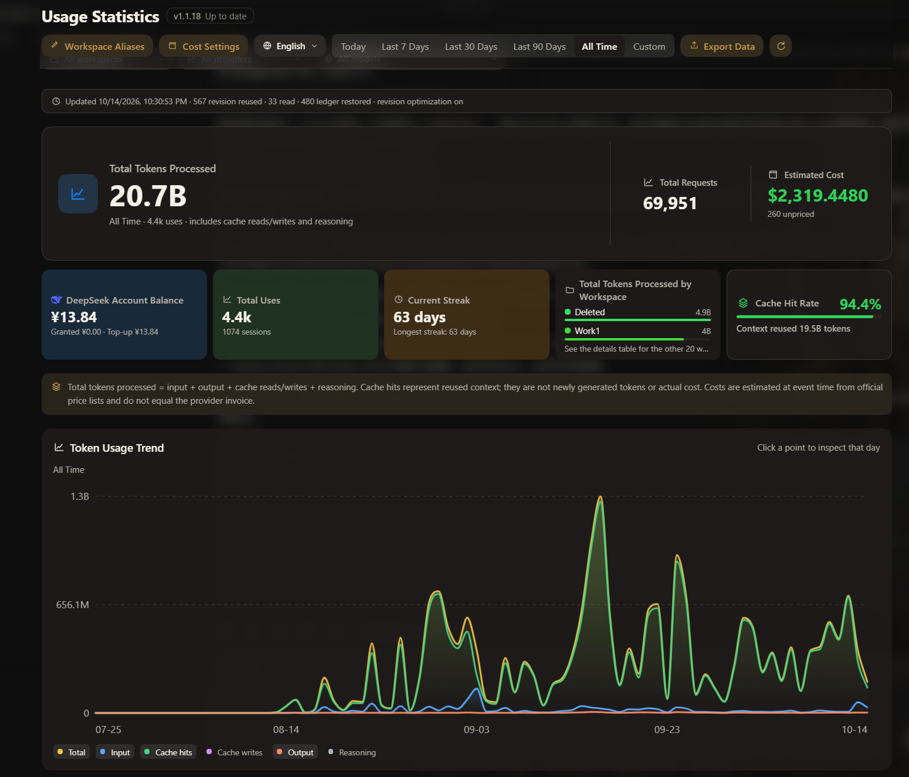
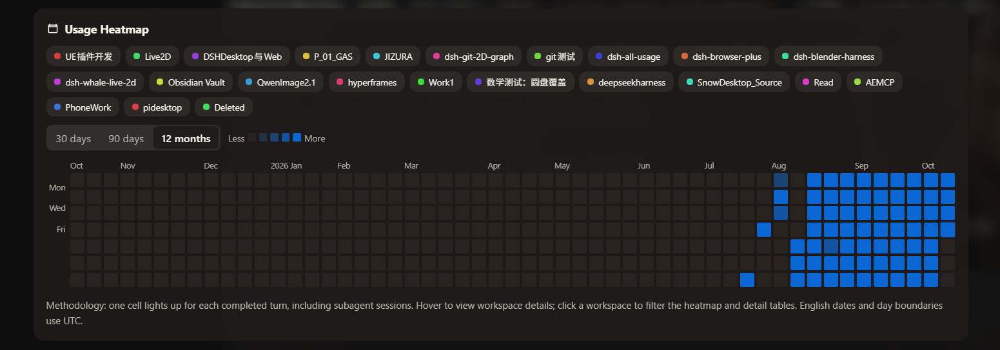
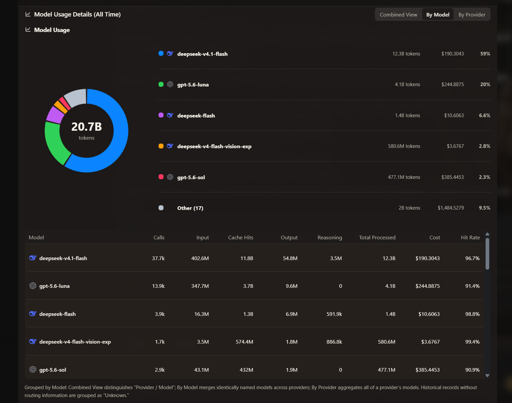
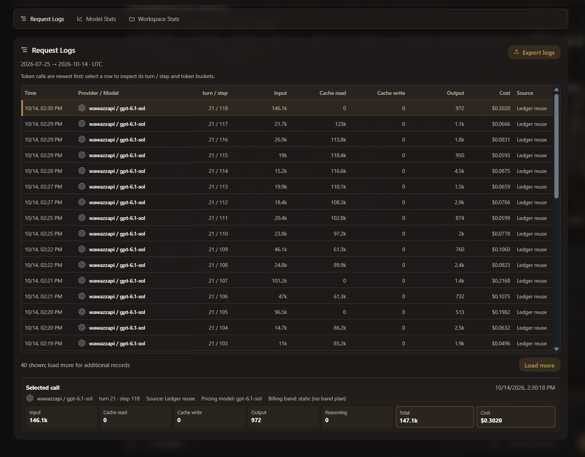
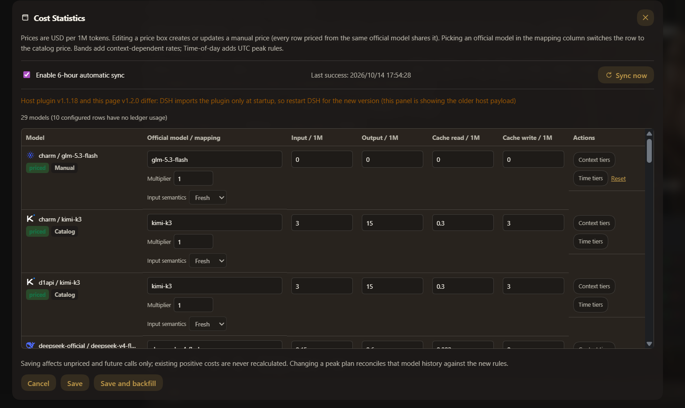
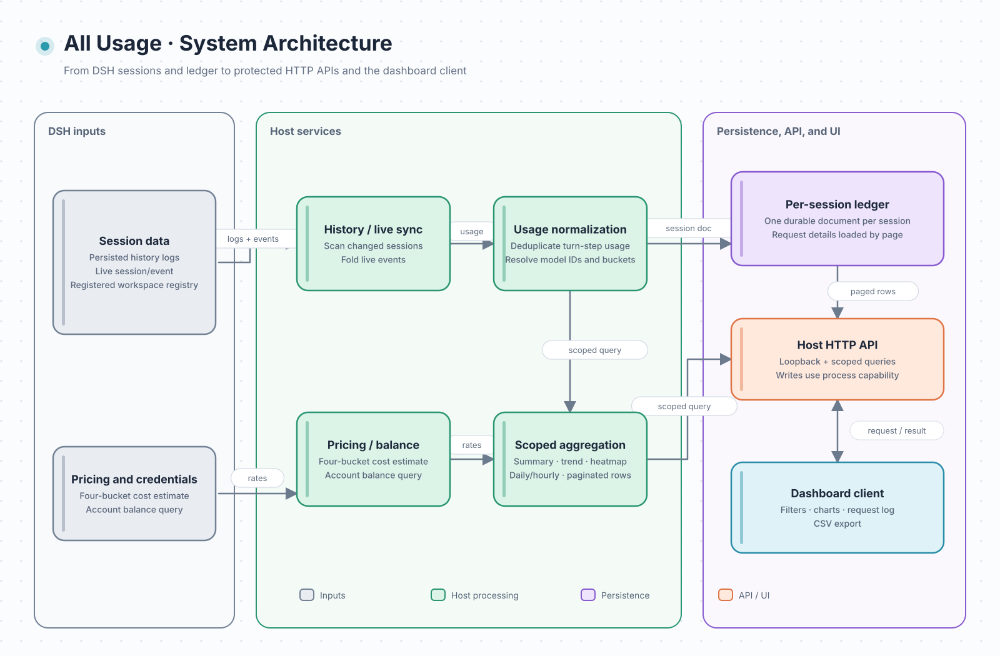
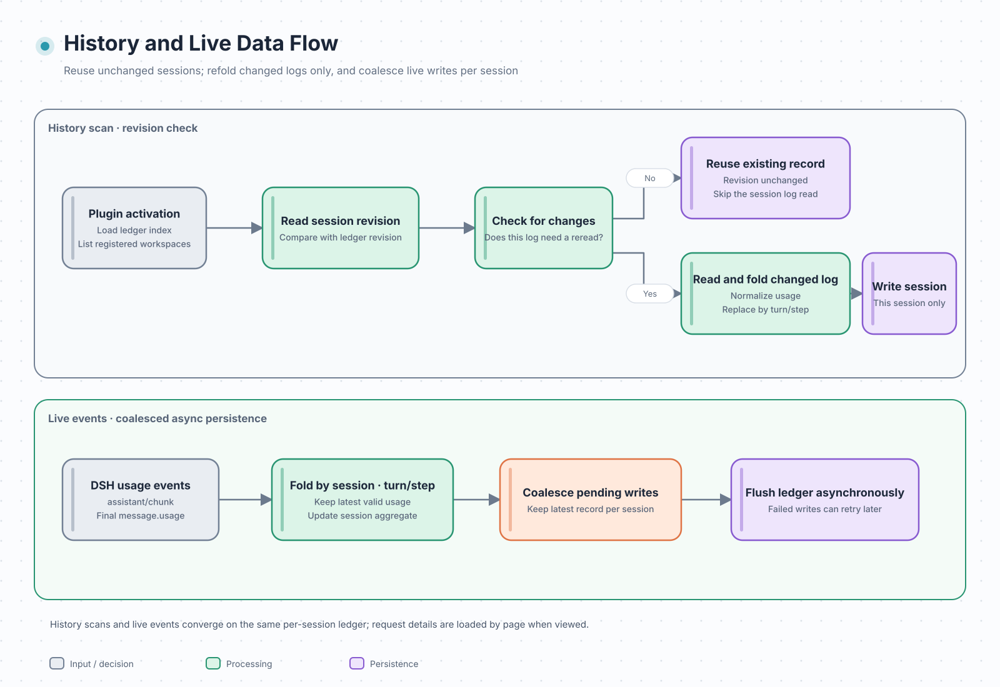

# dsh-all-usage

[中文](README.md) · [English](README.en.md)

## Introduction

A full usage dashboard for DeepSeek Harness. Analyze tokens, cache behavior, estimated cost, account balance, and activity by model, provider, workspace, and time range.

For DSH users who need to inspect token usage, model costs, and workspace activity from local session data.

## Quick Start

~~~bash
dsh plugin --profile web add github:ParticleLight/dsh-all-usage
~~~

The installation command assembles the bundle. Usually, refreshing the browser page loads the client; no manual profile edits are required. If your DSH version does not dynamically assemble newly installed packages, use its supported package reload or restart, then refresh the page and open the dashboard from the DSH sidebar.

## Core Features

- **Explore usage across dimensions**: inspect summaries, trends, heatmaps, and paginated request logs; combine date, workspace, provider, and model filters, then export the current view to CSV.
- **Understand models and workspaces**: compare mixed-model, merged-model, and provider views, with streaks, workspace distributions, and daily turn details; 43 brand marks are built in and unknown model identities stay neutral.
- **Configure costs and balances**: estimate costs across four token buckets, map official models or set manual prices, configure context tiers and peak windows, and query account balance; see Configuration below.
- **Sync complete history incrementally**: scan readable sessions, reuse unchanged per-session ledger data using persisted revisions, read only changed logs, and follow DSH workspace-registry changes.
- **Audit routine operation**: inspect scan health, reads, ledger restores, and failures; switch interface language, manage workspace aliases, and check the running plugin version.

## Screenshots

The five screenshots above were captured on 2026-10-14 from the v1.2.0 client UI; the host plugin shown is v1.1.18. The live usage and workspace data belong to that capture environment, and the version-mismatch warning in Cost settings is intentionally preserved.

## Technology Stack and Architecture

- **Host** (entry `lib/index.js`, assembled by `lib/plugin.js`): split by responsibility across `aggregation.js` (aggregation/query), `ledger.js` (durable ledger), `session-sync.js` (history/live sync), `pricing-runtime.js` (runtime pricing), `balance.js` (balance), and `http.js` (protected routes); aggregates `turn/end`, `assistant/chunk` usage, and final `assistant/message.usage`, folds live `session/event` updates, and exposes data routes through `webServer`.
- **Client**: readable source lives in `src/client.js`; `npm run build:client` uses the pinned Terser version to generate the `window.__ModuleLoader__` bundle at `lib/client.js`, which registers the “Usage statistics” sidebar entry through the `sidebar.footer.action` slot. All API routes accept loopback requests and reject an explicit cross-origin Origin; balance reads and alias writes also require a process-scoped token generated when the plugin starts (the balance GET tolerates browsers omitting Origin). **Writes are authorized by that token, not by an Origin**: the DSH desktop shell runs the UI on its own scheme and forwards requests through Electron, which strips `Origin` (with `Host`/`Cookie`/`Sec-Fetch-*`), so requiring one made every desktop save fail with 403. A present `Origin` must still be loopback or the shell's own scheme, and `Host` must still be loopback (DNS-rebinding guard).

### History and Live Data Flow

### Storage and Performance

- **One record per session**: the ledger writes each session as its own document (stable-hashed into 32 directories), so an update publishes one file. Measured on the same data: a single update went from rewriting a 13.27 MB shard (273 ms) to writing one record (a 4.6 ms median).
- **One identity per route**: usage items reference the route identity and its price definition instead of repeating them, so 1059 records shrank from **91.3 to 74.7 MB (-18%)**
- **The snapshot pays for one timezone only**: `GET /api/all-usage?utc=0|1` returns a single calendar (both copies used to split the payload in half), and a day keeps its session-id detail for the last **180 days** while older days keep counts and aggregates
- **The trend chart is capped at 180 points**: past half a year it drops to three days per point and widens to week / month / quarter / year, so the chart cannot grow with history
- **Budgets live in the code**: 20 query and 20 records cache entries, 5000 pricing resolutions, 512 context entries per session, 500 price rows, 32 shards, 180 trend points and a 180-day session-id window - guarded by `test/perf-budgets.test.js`, so relaxing one means editing that table
- **Reproducible benchmarks**: `node bench/ledger.mjs` (ledger size and per-update rewrite cost), `node bench/ledger-layout.mjs` (the two storage layouts, on copies of real shards) `node bench/endpoints.mjs` (median latency and payload of five read endpoints) and `node scripts/dead-code.mjs` (exports nothing references, client helpers nobody calls, stylesheet classes no markup can render)

## Installation

This is a standard DSH community plugin package with a `dsh.bundle` manifest and Web Client. It reads persisted session logs and a separate usage ledger, then backfills history on activation.

### Compatibility and Known Limitations

- **Runtime**: Node.js `>=22 <25` is required. CI runs the test suite, syntax checks, and package-content checks on Node 22 and Node 24.
- **DSH compatibility**: `package.json` declares DSH runtime `>=0.1.1-rc.1 <0.1.5-0 || >=0.1.5-rc.1 <0.1.6-0 || >=0.1.7-rc.2 <0.1.8-0 || >=0.2.0-rc.2 <0.2.1-0 || 0.2.1-alpha.2 || 0.2.1-rc.1 || 0.2.1-rc.2`; the real Cordis service chain is verified locally on `0.2.1-rc.1` and `0.2.1-rc.2` (strict smoke on Node 24; both promote Cordis to the stable 4.0.5 / loader 1.0.6 / timer 1.1.7 pairing), `0.2.1-alpha.2`, `0.2.0-rc.2`, `0.1.7-rc.2`, `0.1.5-rc.2`, `0.1.5-rc.1`, `0.1.1-rc.2` and `0.1.1-rc.1`. Every declared runtime is in the CI smoke matrix on Node 22 and 24, but the two `0.2.1` lines are reported as SKIPPED — not passed — because upstream has never published the matching `@deepseek-ai/dsh-invariants` version. `0.1.2-rc.1` has also been verified compatible through real-world use, but is not covered by the CI smoke matrix. The declaration is split per tuple rather than written as one interval because node-semver only admits a prerelease version when some comparator shares its exact `major.minor.patch` tuple and itself carries a prerelease tag — `0.2.0-rc.2` is admitted only because the range says `>=0.2.0-rc.2`.
- **Desktop client (Electron, Windows)**: the plugin is verified running in the DSH desktop client (`@deepseek-ai/dsh-desktop` `0.1.7-rc.2` as measured). The desktop client keeps a 40px caption strip across the top of its window for its own minimise / maximise / close buttons and marks the document with `data-windows-titlebar` and `--dsh-windows-titlebar-height`; the panel draws from **below** that strip, so the client's own close button is never covered. Browsers carry no such marker and reserve nothing. The strip height comes from the host's declaration first, then the Window Controls Overlay rectangle, then the user agent; to tune it, run `localStorage.setItem('dsh-all-usage:topInset', '48')` in DevTools and reload (`0` reserves nothing) — no rebuild required. The desktop client ships its own runtime; the version measured there, `0.1.7-rc.2`, is part of the declared range and of the CI smoke matrix below.
- **Web service dependency**: the Host declares `webServer` as a required dependency, so DSH waits for a late-mounted service before applying the plugin; this package targets the DSH Web profile and does not expose routes without WebServer. The HTTP guard also checks the actual socket peer, so a reverse proxy is accepted only when the connection itself is loopback.
- **Interface language**: on first entry the panel follows DSH's **Language** setting (`Settings → General → Language`, read through the host's `locale` service); without that service it falls back to the browser language and then to English. Once a language is picked inside the panel, the panel's choice wins and the host setting stops overriding it. The language also decides the timezone — Chinese uses local time, English uses UTC — so switching it refetches the matching snapshot.

| DSH runtime | Node.js support | Real Cordis smoke | Conclusion |
| --- | --- | --- | --- |
| `0.2.1-rc.2` | `>=22 <25` | Passed (strict real Cordis smoke verified locally on Node 24; stable Cordis 4.0.5 / loader 1.0.6 / timer 1.1.7) | Declared and verified (this exact rc only; CI reports SKIPPED because upstream never published `dsh-invariants@0.2.1-rc.2`) |
| `0.2.1-rc.1` | `>=22 <25` | Passed (strict real Cordis smoke verified locally on Node 24; stable Cordis 4.0.5 / loader 1.0.6 / timer 1.1.7) | Declared and verified (this exact rc only; no other rc versions implied; CI reports SKIPPED because upstream never published `dsh-invariants@0.2.1-rc.1`) |
| `0.2.1-alpha.2` | `>=22 <25` | Passed (strict real Cordis smoke verified locally on Node 24; CI reports SKIPPED because upstream never published `dsh-invariants@0.2.1-alpha.2`) | Declared and verified (this exact alpha.2 only; no other alpha versions implied) |
| `0.2.0-rc.2` | `>=22 <25`, CI covers 22/24 | Passed (real Cordis service chain, CI covers Node 22/24) | Declared and verified (historically verified; CI covers Node 22/24) |
| `0.1.7-rc.2` | `>=22 <25`, CI covers 22/24 | Passed (real Cordis service chain, CI covers Node 22/24) | Declared and verified (historically verified; CI covers Node 22/24) |
| `0.1.5-rc.2` | `>=22 <25`, CI covers 22/24 | Passed (real Cordis service chain, CI covers Node 22/24) | Declared and verified |
| `0.1.5-rc.1` | `>=22 <25`, CI covers 22/24 | Passed (real Cordis service chain, CI covers Node 22/24) | Declared and verified |
| `0.1.2-rc.1` | `>=22 <25` | Passed through real-world use (not in CI) | Verified compatible in real-world use |
| `0.1.1-rc.2` | `>=22 <25`, CI covers 22/24 | Passed (real Cordis service chain, CI covers Node 22/24) | Declared and verified |
| `0.1.1-rc.1` | `>=22 <25`, CI covers 22/24 | Passed (real Cordis service chain, CI covers Node 22/24) | Declared and verified |
| Other versions | `>=22 <25` | Not tested | Outside the verified matrix |

An unlisted DSH version is not necessarily incompatible. Include the DSH, Node.js, and plugin versions when reporting an issue.

- **Interrupted requests**: an interrupted upstream request may emit only `assistant/chunk` usage and never produce a final `assistant/message`; that chunk is retained. A later final message for the same turn/step replaces it. If the upstream emits no usage event at all, exact token usage cannot be reconstructed from response text.
- **Estimated cost**: cost is an estimate based on models.dev rates and DSH usage buckets, not a provider invoice. Unavailable catalogs and unmatched models remain unpriced instead of receiving guessed rates. Cache reads, cache writes, and reasoning follow the buckets reported by the upstream DSH event.
- **Tiered prices**: models.dev context-tiered entries select the applicable rate from the request input context (fresh input plus cache read/write tokens); malformed schedules remain unsupported.
- **Workspace boundary**: only sessions whose cwd maps to a DSH-registered workspace are included. Unregistered cwds, including existing directories absent from the registry, are ignored. The registry is kept fresh by a `domain/changed` probe: any durable workspace-domain write triggers a reread, and only added/removed workspaces are reprocessed incrementally — unchanged workspaces reuse their computed aggregates and ledger. Data deleted or corrupted before a successful session flush cannot be recovered from the separate ledger.

### Manual Local Registration

1. Place this directory anywhere and create a symlink to it under $DSH_HOME/profiles/node_modules/ (use a junction on Windows):

   ~~~powershell
   New-Item -ItemType Junction -Path (Join-Path $env:DSH_HOME 'profiles/node_modules/dsh-all-usage') -Target '<absolute plugin path>'
   ~~~

2. Add this entry to $DSH_HOME/profiles/web/cordis.patch.yml:

   ~~~yaml
   - insert:
       - id: all-usage
         name: dsh-all-usage
   ~~~

The profile patch layer hot-reloads; save the file and refresh the page.

## Usage Examples

### Common Scenarios

- Choose today, the last 7/30/90 days, all history, or a custom date range. Combine workspace, provider, and model filters, use trends and heatmaps to find changes, inspect individual request rows, and export CSV.
- To review cost estimates, check model mappings and price status first, then inspect input, output, cache-read, and cache-write buckets. Unmatched or unverifiable prices are shown as unpriced.
- For failed or incomplete requests, use the redacted event examples below. A local record means DSH observed usage; it does not prove the provider charged for the request.

### Local Statistics vs Official Billing

This plugin reports replayable statistics from local DSH event logs; it is not a mirror of a provider invoice:

- Local statistics read DSH `assistant/chunk`, final `assistant/message`, and related session events, then deduplicate and replace samples by logical `turn / step`. Official billing may use a provider tokenizer, rounding rules, discounts, free quotas, and billing periods.
- A failed request is included locally whenever it leaves a usage chunk; whether the provider charged for that failed request must be checked against the official bill.
- Prices come from the public models.dev catalog and local explicit overrides. Catalog prices can differ from provider prices, regional rates, and invoice discounts, so the cost field is an estimate. A price belongs to the model, so every row priced from the same official model shares one manual entry; price edits never rewrite existing positive costs, while a peak-plan change reconciles that model's history against the new policy.
- Local statistics include registered workspaces only; old ledger rows for unregistered cwds are excluded. Usage recorded for a **deleted workspace** is kept and summed into one "Deleted" row, so removing a workspace never shrinks historical totals. Totals can still be lower than the official bill when logs are damaged, cleaned up, or the upstream emits no usage event.

### Reproducible Event Examples

The following are redacted minimal examples; the complete runnable data is in [`fixtures/usage-events.json`](fixtures/usage-events.json).

#### Retaining a failed request chunk

~~~json
[
  {"type": "assistant/chunk", "data": {"turn": 1, "step": 1, "chunk": {"type": "usage", "usage": {"inputTokens": 100, "outputTokens": 20}}}},
  {"type": "request/error", "data": {"code": "upstream-failed"}}
]
~~~

Without a final `assistant/message`, the chunk remains one local call; this does not mean the provider necessarily charged for it.

#### Orphan usage chunk

~~~json
{"type": "assistant/chunk", "data": {"turn": 1, "step": 1, "chunk": {"type": "usage", "usage": {"inputTokens": 7, "cacheReadTokens": 8}}}}
~~~

Without request/context or request/header, tokens are still counted, but the model identity is shown as Unknown; the plugin does not guess a model from a provider name or display string.

#### Cache token buckets

~~~json
{"inputTokens": 100, "outputTokens": 20, "cacheReadTokens": 40, "cacheWriteTokens": 5, "reasoningTokens": 3}
~~~

The local processed total is `100 + 20 + 40 + 5 + 3 = 168`; cost uses the input, output, cacheRead, and cacheWrite buckets, and reasoning is not added to output again.

Replay the repository fixture:

~~~bash
node scripts/replay-fixture.mjs fixtures/usage-events.json
~~~

The command loads the real plugin Host, calls its compatible APIs, checks the documented token/record totals, and prints a non-sensitive summary.

### Data Semantics, Privacy, and Limits

- Calls and tokens come from DSH session logs; `session/flush` rebuilds and queues the derived ledger only when related events are dirty, coalescing the latest pending record per session and draining on plugin disposal. Readable logs and ledger history are backfilled when the plugin activates, so successfully persisted data survives reloads or session deletion; deleting a workspace likewise keeps its history, summed into one "Deleted" row together with usage that had not reached the ledger yet
- Day-level range data retains every readable historical session date with tracked usage; the heatmap is a switchable-span view (last 30 days / 90 days / 12 months, 12 months by default), not a fixed latest-53-week view
- After a session is deleted, successfully flushed usage is restored from the separate ledger; disposal hints and periodic reconciliation trigger rebuilds without deleting ledger rows
- For each session and logical `turn / step`, only the final usage contribution is kept; retries or replaced messages do not double-count
- Input tokens are fresh (exclude cache hits/writes, which sit in their own buckets); all-zero usage replays do not overwrite recorded usage and pure cache-read requests still count
- The version check is a single read-only GET to `registry.npmjs.org` (the version number of `dsh-all-usage` only: no body, no cookies; issued by the host and cached for 6 hours, the page itself never reaches the network), and a failed check degrades to “unknown” instead of guessing
- The lightweight status endpoint exposes the Host instance, stats revision, scan progress, sync counters, the `memory` residency counters, `counters` (diagnostic operation counts), `accounting` (today's aggregate consistency) and `mismatch` (the first bucket-delta inconsistency sample, or null), plus the last client environment report (user agent, viewport, reserved strip and its source, panel rectangles — reported by a local client and kept in memory only). The mismatch sample carries the internal usage key and workspace ID (a usage key is derived from the session ID and can point at a session); the endpoint never carries prompts, reply bodies, workspace paths or credentials; full snapshots are fetched only after status changes or a manual refresh
- Scoped results keep turns, model calls, and distinct sessions as separate metrics; missing route identity is explicitly Unknown rather than inferred from a display label
- The records endpoint returns only a short hash, time, workspace ID, structured model identity, turn/step, token buckets, and current materialization source. It omits raw session IDs, paths, prompts, replies, and credentials
- Processed tokens = input + output + cache read/write + reasoning; a cache hit means reused context, not newly generated tokens or actual cost
- Cost follows the cc-switch four-bucket formula: input, output, cache-read, and cache-write tokens are priced independently, summed, then multiplied by the final multiplier; when input context is strictly greater than a context-tier threshold, all four rates switch for the whole request instead of progressive band splitting, and DSH reasoning is not added to output a second time
- Time-of-day pricing matches UTC weekdays against half-open windows: a matching request uses the rule's peak rates, anything else uses the row base rates (off-peak = base); usage before a plan's effective instant has no verifiable band and fails closed as unpriced instead of inheriting today's rates, and one plan is shared by every row priced from the same entry (for DeepSeek the built-in plan carries the official State Council holiday list, refreshed with plugin releases); with the holiday switch on, a statutory holiday never matches a peak window and the cost snapshot records pricingHoliday, so records show "Holiday off-peak" instead of a plain off-peak band. The built-in DeepSeek table already ships the 2026 arrangement (refreshed with plugin releases), so first-party or mapped DeepSeek rows price holidays as off-peak with no configuration; reseller routes stay static until they are mapped to the official entry
- Legacy ledger costs carrying `tiered` are migrated to `unsupported` (`tiered-pricing-not-modeled`) on load instead of remaining falsely marked as current flat priced estimates; token statistics are unchanged.
- Pricing sync is off by default; when models.dev is unavailable the last good catalog remains in use, and unmatched models never receive a guessed default price; the Cost Settings price boxes are the manual-price entry point (shared by every row priced from the same official model), each row expands into context bands and UTC peak rules (including optional all-day off-peak pricing on Chinese statutory holidays), and the built-in DeepSeek table can be copied for customisation or restored; dashboard range and detail-view preferences are stored in browser storage, while the 6-hour sync toggle is immediately saved through the protected pricing API
- Mapping semantics: a mapping with `identityKey` applies only to that exact route identity; a mapping without an identity key is the model-wide fallback. Legacy `usageIdentityKey` values are normalized when loaded.
- The holiday calendar is fetched only when the user clicks "Load from public calendar": the request goes to `cdn.jsdelivr.net` (falling back to `raw.githubusercontent.com`), carries nothing but the year, and **never includes usage, session, or credential data**; the returned dates stay inert until saved, and saving freezes them together with their source note into that model's peak plan (the source is excluded from the policy hash)
- Balance data comes from DeepSeek’s official `/user/balance` endpoint; the card shows guidance when no API key is configured
- English mode uses UTC for date buckets, range filters, streaks, heatmap dates, and export timestamps; Chinese mode uses local time
- The ledger assigns each session ID to one of 32 stable-hash directories and keeps **one record document per session**, so a flush publishes that one file instead of rewriting a shard; the old whole-unit files (including the original `all_usage_ledger.json`) are removed once the record tree provably holds the data, and `DSH_ALL_USAGE_KEEP_LEGACY=1` keeps them. An async write failure or an unflushed shutdown does not lose in-memory statistics; the next startup simply scans that session again
- Only sessions that can be mapped to a registered workspace by their working directory are included

## Configuration

| Setting | Where | Description |
| --- | --- | --- |
| Model pricing and rules | Dashboard “Cost settings” | models.dev sync is off by default; map official models, set manual prices, configure context tiers, UTC peak windows, and China statutory-holiday off-peak rules. See Data Semantics for formulas and boundaries. |
| Workspace aliases | DSH sidebar; KV unit `all_usage_aliases` under `$DSH_HOME/storages` | Replaces workspace names in the display. |
| Range and detail preferences | Browser-local storage | The selected dashboard range and detail view are saved locally. |
| Electron top inset | Browser `localStorage` key `dsh-all-usage:topInset` | Set a pixel value to adjust the reserved strip; `0` disables it. Refresh to apply. |
| Keep legacy ledger shards | Host environment variable `DSH_ALL_USAGE_KEEP_LEGACY=1` | Legacy whole-shard files are removed after the per-session record tree is confirmed; set to `1` to keep them. |
| Resident usage-row budget | Host environment variable `DSH_ALL_USAGE_RESIDENT_ROWS` | Rows, default 12000; a finite value is floored (Math.floor). A negative value keeps every detail row resident; `0` hands back every evictable row once a scan finishes; a non-numeric value falls back to the default. This is a soft budget: rows whose pricing is unsettled, and rows of a session that is being written, read, resynced or prefetched, are never handed back. |
| Session record cache limit | Host environment variable `DSH_ALL_USAGE_RECORD_CACHE_MB` | MiB, default 16. Only a finite value ≥ 0 is accepted; a negative or non-numeric value falls back to 16. `0` only evicts evictable clean records down to the most recent one, so protected records can push actual residency past the budget. This is a soft budget: a dirty, pending, writing, resyncing, prefetching or reading record is never evicted, and a ledger store that cannot read one record back keeps every record resident. Residency is estimated from usage-row counts (not a measured allocation); see `recordCacheMB` in status. |

## API and CLI

### CLI

The plugin has no separate runtime CLI. The official install command is in Quick Start; development and test commands are listed below.

### HTTP API

- `GET /api/all-usage` — compatible usage snapshot
- `GET /api/all-usage/status` — lightweight revision and sync health, plus the last client environment report (`clientEnv`), the running plugin version (`pluginVersion`) and a derived id of the write capability (`capabilityId`, changes when the capability rotates so the page can notice a plugin reload; the capability itself is only ever sent in the full snapshot), plus the `memory` residency counters: `residentRows` (resident usage detail rows), `residentRecords` (resident session records), `recordCacheMB` (session-record cache size in MiB to one decimal; an estimate derived from usage-row counts rather than a measured allocation), `sessions` (session aggregates), `recordsCache` (record query-cache stats) and `heapUsedMB` / `rssMB` (both belong to the whole Host process, not the plugin alone). The same response carries `counters` (diagnostic operation counts), `accounting` (today's aggregate consistency) and `mismatch` (the first bucket-delta inconsistency sample, or null)
- `GET /api/all-usage/query` — scoped aggregate, daily/hourly trend, and heatmap data; single-day scopes populate `hourly`, while cross-day scopes return an empty `hourly` array
- `GET /api/all-usage/records` — paginated privacy-safe canonical usage rows
- `GET /api/all-usage/icon?key=<brand key>` — serves one brand mark on demand (SVG with a long cache and an ETag); the client bundle carries only the resolution metadata, so adding a brand no longer grows it
- `GET /api/all-usage/version?force=1` — version check: the running version, the newest published version, the verdict (`latest` / `outdated` / `unknown`), when it was checked and where it came from; cached on the host for 6 hours with at most one upstream request every 30 seconds per process (the floor applies to `force=1` too), `force=1` comes from the refresh button
- `GET /api/all-usage/balance?force=1` — account balance using the configured `llm-deepseek` API key
- `POST /api/all-usage/alias` — update workspace aliases
- `GET /api/all-usage/pricing` — read the full editable price table: per-row effective rates and status, mappings, manual prices, peak plans (with their built-in/explicit origin and full rules), and rows that exist only in the configuration
- `GET /api/all-usage/pricing/models?q=...` — search official model IDs and display names, including preview rates, tiered-pricing flags, and whether a built-in peak table exists
- `POST /api/all-usage/pricing` — save sync, mappings, manual prices, context rate bands, and peak-window rules (request shape unchanged)
- `POST /api/all-usage/pricing/sync` — sync models.dev and backfill unpriced calls
- `POST /api/all-usage/pricing/holidays` — fetch one year of the Chinese holiday arrangement (the holiday-cn dataset, jsDelivr first with a GitHub raw fallback, cached host-side for 24 hours) and return only the off-day list plus its source; **nothing is written to the configuration** — the client freezes the dates into a peak plan
- `GET /api/all-usage/client-env` — client environment report (user agent, window-controls overlay height, the reserved strip **and its source**, viewport, panel rectangles); the client reports it at load and whenever the sheet opens, kept in memory only

## Development and Testing

- After editing `src/client.js`, run `npm run build:client`, reload the DSH client module, and refresh the page; `lib/client.js` is generated and should not be edited directly. After editing `lib/plugin.js` or another Host module, reload the package through DSH or restart the process
- The plugin has no third-party runtime dependencies: the Host uses Cordis services and the Client uses the runtime-provided React module; pinned Terser is only a development dependency for generating the browser artifact
- Manual npm recovery publishes require a target `v<package.version>` tag and full commit SHA; GitHub Actions checks both against the checked-out tag and package version. Release events perform the same commit check.

### Local Checks

~~~bash
npm test
npm run fixture:check
npm run build:client
npm run check:pack
~~~

## Status and Updates

The latest published release is `v1.2.1` ([GitHub Release](https://github.com/ParticleLight/dsh-all-usage/releases/tag/v1.2.1) | npm: `npm i dsh-all-usage@1.2.1`). See [CHANGELOG.md](CHANGELOG.md) for the complete development and release history.

### Latest published: v1.2.1

- **DSH `0.2.1-rc.1` and `0.2.1-rc.2` support**: both exact versions are verified on the real runtime.
- **The panel follows DSH's language**: it opens in DSH's Language setting, switching between Chinese and English refreshes the data immediately, and the English "Today" trend draws its hourly curve again.
- **Third-party themes can no longer bury the panel**: sidebar glass/wallpaper plugins do not cover it, and a theme that blanks the base background cannot punch holes in it.
- **DeepSeek Account usage is priced with the peak/off-peak bands again**: that route had been charged the off-peak rate all day; existing account-route usage is re-priced on the next reconciliation.

See [CHANGELOG.md](CHANGELOG.md) for the complete version history.

## Contributing and Contact

Use the templates below for bug reports. For general questions or feature discussion, visit the [project repository](https://github.com/ParticleLight/dsh-all-usage). Pull requests are welcome; bug reports should include the DSH, Node.js, and plugin versions.

- [Data inconsistency](.github/ISSUE_TEMPLATE/data-inconsistency.md)
- [Plugin startup failure](.github/ISSUE_TEMPLATE/startup-failure.md)
- [Cost calculation issue](.github/ISSUE_TEMPLATE/cost-calculation.md)

## License

MIT
