# dsh-all-usage

[中文](README.md) · [English](README.en.md) · [日本語](README.ja.md) · [Español](README.es.md) · [Français](README.fr.md) · [Deutsch](README.de.md) · [Русский](README.ru.md) · [Português](README.pt.md)

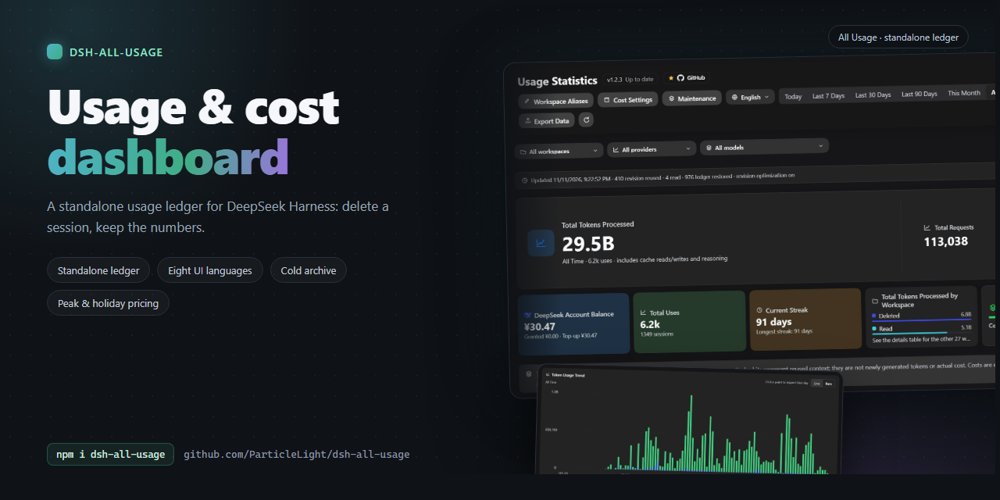

## Introducción

Un panel de uso completo para DeepSeek Harness. Analiza tokens, comportamiento de la caché, costo estimado, saldo de la cuenta y actividad por modelo, proveedor, espacio de trabajo y rango de tiempo.

Para los usuarios de DSH que necesitan inspeccionar el uso de tokens, los costos por modelo y la actividad de cada espacio de trabajo a partir de los datos de sesión locales.

## Inicio rápido

~~~bash
dsh plugin --profile web add github:ParticleLight/dsh-all-usage
~~~

El comando de instalación ensambla el paquete. Normalmente, basta con refrescar la página del navegador para cargar el cliente; no hace falta editar el perfil a mano. Si tu versión de DSH no ensambla dinámicamente los paquetes recién instalados, usa la recarga de paquetes o el reinicio que admita esa versión, refresca después la página y abre el panel desde la barra lateral de DSH.

## Funciones principales

- **Explora el uso en todas sus dimensiones**: consulta resúmenes, tendencias, mapas de calor y logs de solicitudes paginados; combina los filtros de fecha, espacio de trabajo, proveedor y modelo y exporta después la vista actual a CSV.
- **Entiende los modelos y los espacios de trabajo**: compara las vistas mixta, fusionada por modelo y por proveedor, con rachas, distribuciones por espacio de trabajo y detalles diarios por turno; incluye 43 logotipos de marca y las identidades de modelo desconocidas se mantienen neutras.
- **Configura costos y saldos**: estima el costo en los cuatro cubos de tokens, asigna modelos oficiales o fija precios manuales, configura tramos de contexto y ventanas de horas punta, y consulta el saldo de la cuenta; consulta Configuración más abajo.
- **Sincroniza el historial completo de forma incremental**: escanea las sesiones legibles, reutiliza los datos del libro mayor por sesión que no han cambiado gracias a las revisiones persistidas, lee solo los logs modificados y sigue los cambios del registro de espacios de trabajo de DSH.
- **Audita la operación habitual**: revisa la salud del escaneo, las lecturas, las restauraciones del libro mayor y los fallos; cambia el idioma de la interfaz, gestiona los alias de espacios de trabajo y comprueba la versión del plugin en ejecución.

## Recorrido por la interfaz

Estas capturas se tomaron el 2026-11-11 desde una instalación en funcionamiento (host 1.2.3 con el cliente 1.2.4): interfaces en chino e inglés, tema oscuro. Los datos de uso y de espacios de trabajo que aparecen pertenecen a ese entorno de captura.

### Vista general del panel

El encabezado contiene el estado de la versión y las herramientas (alias de espacios de trabajo, ajustes de costo, mantenimiento, idioma de la interfaz); debajo están el rango de tiempo (Hoy / Últimos 7 días / Últimos 30 días / Últimos 90 días / Este mes / Todo el tiempo / Personalizado) y los filtros de espacio de trabajo, proveedor y modelo. La tarjeta principal muestra el total de tokens, el número de solicitudes y el costo estimado del rango, y a continuación el saldo de la cuenta, los usos totales, la racha actual, la distribución por espacio de trabajo y la tasa de aciertos de caché.

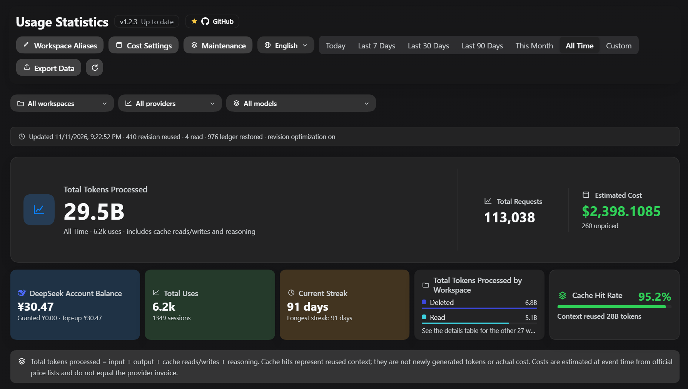

### Tendencia de uso

Una tendencia por día en forma de línea o de barras; haz clic en un punto de datos para leer ese día. Los rangos largos se agregan en puntos de tres días y después en semanas, meses, trimestres o años, con un máximo de 180 puntos por gráfico.

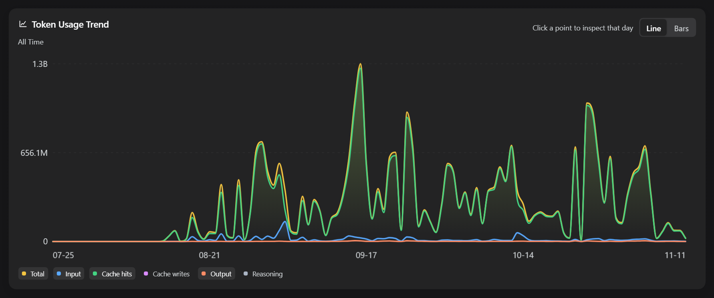

Al cambiar a barras, los mismos datos se leen por día, con la misma tarjeta al pasar el cursor y el mismo detalle del día.

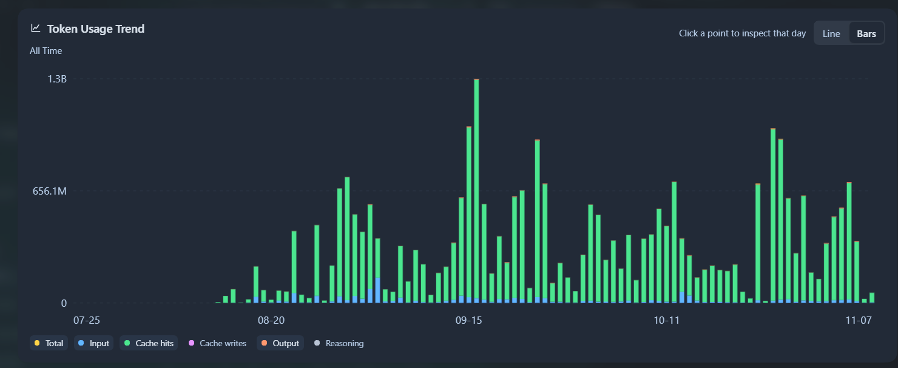

### Mapa de calor de uso

Tres rangos — 30 días, 90 días y 12 meses — con los días de la semana alineados por fila y una profundidad de color que muestra el volumen de tokens de cada día.

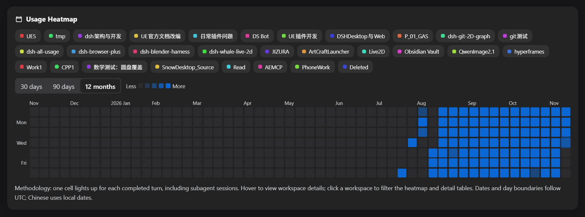

### Estadísticas de modelos y espacios de trabajo

El área de detalle ofrece logs de solicitudes, estadísticas de modelos y estadísticas de espacios de trabajo. Las estadísticas de modelos pueden fusionarse por vista combinada, por modelo o por proveedor, con llamadas, entrada, aciertos de caché, salida, razonamiento, total, costo y tasa de aciertos por fila; las estadísticas de espacios de trabajo se agregan por espacio de trabajo y respetan tus alias.

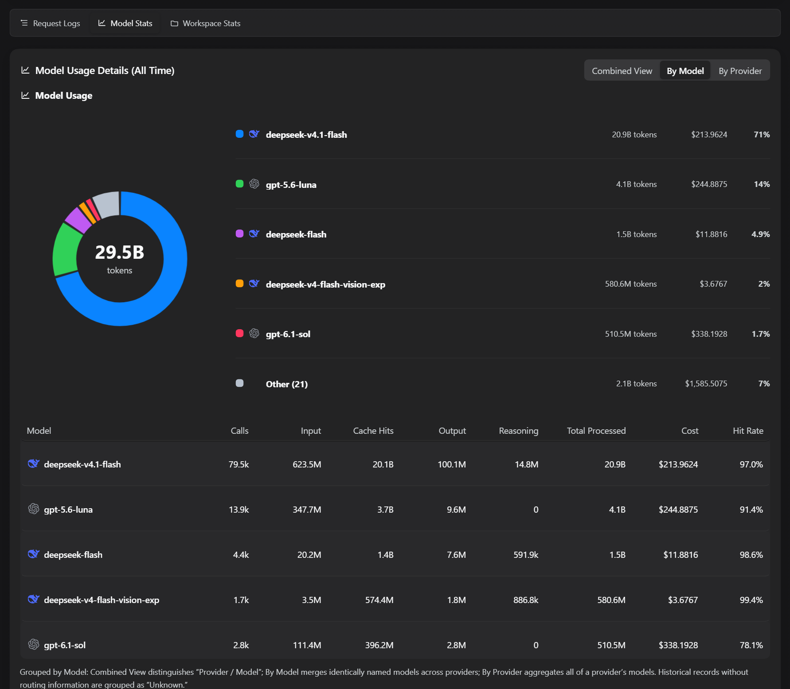

### Logs de solicitudes

Cada solicitud se lista de la más reciente a la más antigua con su modelo, sus tokens y su costo, y la vista filtrada actual se exporta a CSV; los contadores de auditoría, como la reutilización de revisiones, las lecturas y las restauraciones del libro mayor, están en la línea de sincronización de la parte superior de la página.

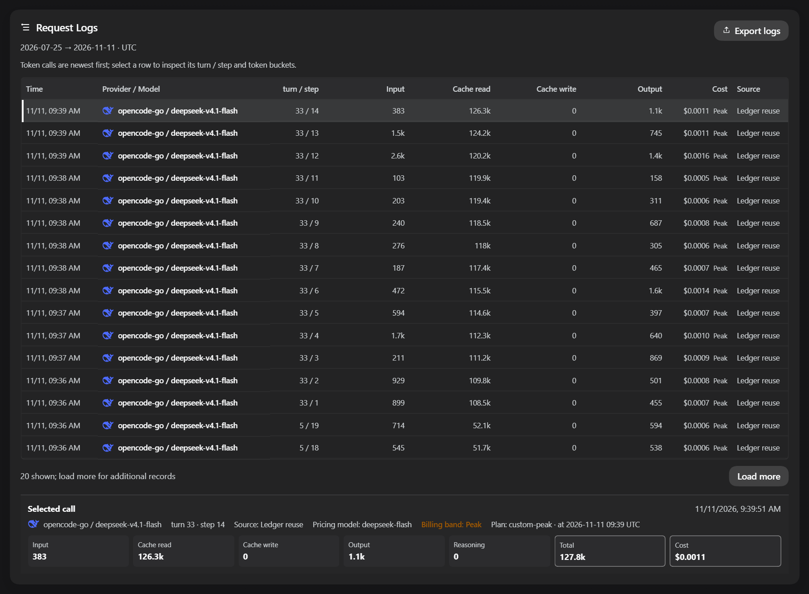

### Ajustes de costo

El costo se estima con cuatro cubos de tokens: asignación de modelos oficiales, precios manuales, tramos de contexto y ventanas de horas punta, además de una consulta del saldo de la cuenta.

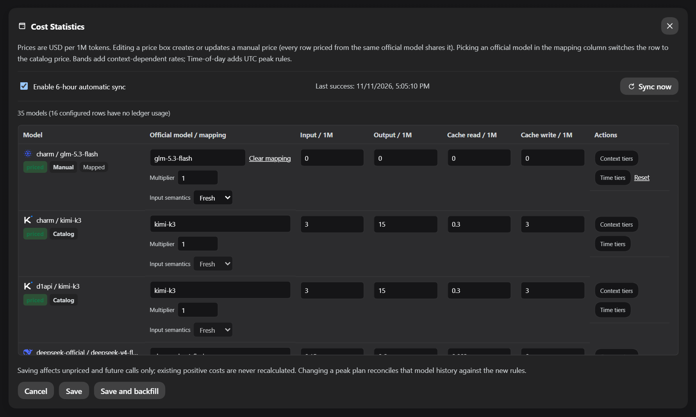

### Mantenimiento

Las sesiones que llevan un tiempo sin cambios se pliegan en archivos comprimidos mensuales: primero previsualiza los registros afectados, el tamaño y los meses, y solo después ejecútalo; los registros archivados siguen siendo legibles y contables.

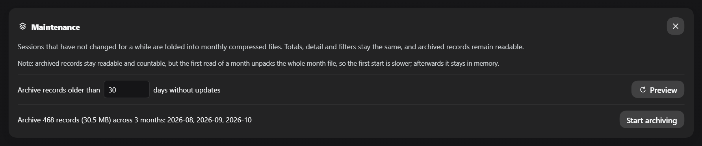

## Pila tecnológica y arquitectura

- **Host** (entrada `lib/index.js`, ensamblado por `lib/plugin.js`): dividido por responsabilidad entre `aggregation.js` (agregación/consulta), `ledger.js` (libro mayor duradero), `session-sync.js` (sincronización de historial y de datos en vivo), `pricing-runtime.js` (precios en tiempo de ejecución), `balance.js` (saldo) y `http.js` (rutas protegidas); agrega el uso de `turn/end`, de `assistant/chunk` y del `assistant/message.usage` final, pliega las actualizaciones en vivo de `session/event` y expone rutas de datos a través de `webServer`.
- **Cliente**: el código legible vive en `src/client.js`; `npm run build:client` usa la versión fijada de Terser para generar el paquete `window.__ModuleLoader__` en `lib/client.js`, que registra la entrada «Estadísticas de uso» de la barra lateral mediante el slot `sidebar.footer.action`. Todas las rutas de la API aceptan solicitudes de loopback y rechazan un Origin explícito de distinto origen; la lectura de saldo y la escritura de alias también requieren un token del ámbito del proceso generado al arrancar el plugin (el GET de saldo tolera que los navegadores omitan Origin). **Las escrituras se autorizan con ese token, no con un Origin**: el shell de escritorio de DSH ejecuta la interfaz con su propio esquema y reenvía las solicitudes a través de Electron, que elimina `Origin` (junto con `Host`/`Cookie`/`Sec-Fetch-*`), de modo que exigirlo hacía que toda escritura de escritorio fallara con 403. Un `Origin` presente debe seguir siendo loopback o el esquema propio del shell, y `Host` debe seguir siendo loopback (protección contra DNS rebinding).

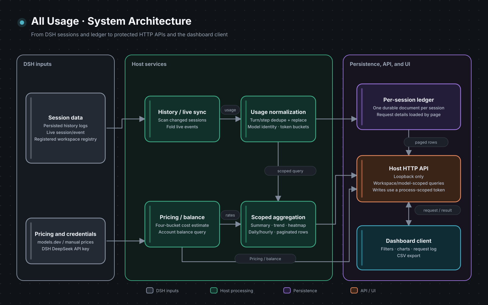

### Flujo del historial y de los datos en vivo

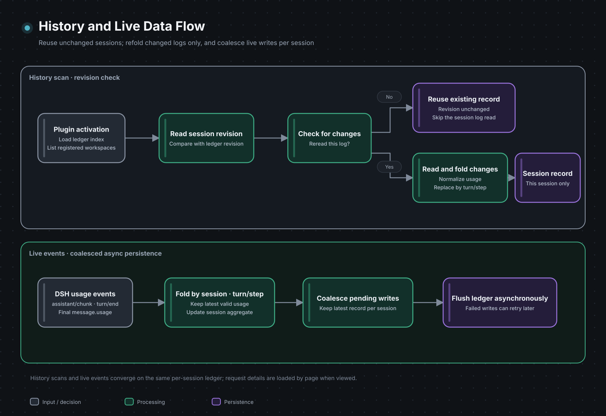

### Almacenamiento y rendimiento

- **Un registro por sesión**: el libro mayor escribe cada sesión como su propio documento (con hash estable en 32 directorios), de modo que una actualización publica un solo archivo. Medido con los mismos datos: una sola actualización pasó de reescribir un fragmento de 13,27 MB (273 ms) a escribir un registro (mediana de 4,6 ms).
- **Una identidad por ruta**: los elementos de uso referencian la identidad de ruta y su definición de precio en lugar de repetirlas, así que 1059 registros pasaron de **91,3 a 74,7 MB (-18 %)**
- **La instantánea paga una sola zona horaria**: `GET /api/all-usage?utc=0|1` devuelve un único calendario (antes las dos copias partían la carga útil en dos), y un día conserva el detalle de sus IDs de sesión durante los últimos **180 días**, mientras que los días más antiguos conservan los recuentos y los agregados
- **El gráfico de tendencia está limitado a 180 puntos**: pasado medio año baja a tres días por punto y se amplía a semana / mes / trimestre / año, así que el gráfico no puede crecer con el historial
- **Los presupuestos viven en el código**: 20 entradas de caché de consultas y 20 de registros, 5000 resoluciones de precios, 512 entradas de contexto por sesión, 500 filas de precios, 32 fragmentos, 180 puntos de tendencia y una ventana de IDs de sesión de 180 días - vigilados por `test/perf-budgets.test.js`, así que relajar uno implica editar esa tabla
- **Benchmarks reproducibles**: `node bench/ledger.mjs` (tamaño del libro mayor y costo de reescritura por actualización), `node bench/ledger-layout.mjs` (los dos diseños de almacenamiento, sobre copias de fragmentos reales) `node bench/endpoints.mjs` (latencia mediana y carga útil de cinco endpoints de lectura) y `node scripts/dead-code.mjs` (exportaciones que nada referencia, funciones auxiliares del cliente que nadie llama, clases de hoja de estilo que ningún marcado puede renderizar)

## Instalación

Este es un paquete de plugin comunitario de DSH estándar, con un manifiesto `dsh.bundle` y un cliente web. Lee los logs de sesión persistidos y un libro mayor de uso aparte, y después rellena el historial al activarse.

### Compatibilidad y limitaciones conocidas

- **Runtime**: se requiere Node.js `>=22 <25`. La CI ejecuta la suite de pruebas, las comprobaciones de sintaxis y las comprobaciones de contenido del paquete en Node 22 y Node 24.
- **Compatibilidad con DSH**: `package.json` declara el runtime de DSH `>=0.1.1-rc.1 <0.1.5-0 || >=0.1.5-rc.1 <0.1.6-0 || >=0.1.7-rc.2 <0.1.8-0 || >=0.2.0-rc.2 <0.2.1-0 || 0.2.1-alpha.2 || 0.2.1-rc.1 || 0.2.1-rc.2 || 0.2.2-alpha.3 || 0.2.2-rc.1`; la cadena de servicios real de Cordis está verificada localmente en `0.2.1-rc.1` y `0.2.1-rc.2` (prueba de humo estricta en Node 24; ambas promueven Cordis al emparejamiento estable 4.0.5 / loader 1.0.6 / timer 1.1.7), `0.2.1-alpha.2`, `0.2.0-rc.2`, `0.1.7-rc.2`, `0.1.5-rc.2`, `0.1.5-rc.1`, `0.1.1-rc.2` y `0.1.1-rc.1`. Todos los runtimes declarados están en la matriz de pruebas de humo de la CI en Node 22 y 24, pero las dos líneas `0.2.1` se informan como SKIPPED —no superadas— porque upstream nunca publicó la versión correspondiente de `@deepseek-ai/dsh-invariants`. `0.1.2-rc.1` también se ha verificado compatible mediante uso real, pero no está cubierto por la matriz de pruebas de humo de la CI. La declaración se divide por tupla en lugar de escribirse como un solo intervalo porque node-semver solo admite una versión preliminar cuando algún comparador comparte su tupla exacta `major.minor.patch` y además lleva una etiqueta de versión preliminar — `0.2.0-rc.2` se admite solo porque el rango dice `>=0.2.0-rc.2`.
- **Cliente de escritorio (Electron, Windows)**: el plugin está verificado funcionando en el cliente de escritorio de DSH (`@deepseek-ai/dsh-desktop` `0.1.7-rc.2` según la medición). El cliente de escritorio reserva una franja de título de 40 px en la parte superior de su ventana para sus propios botones de minimizar / maximizar / cerrar y marca el documento con `data-windows-titlebar` y `--dsh-windows-titlebar-height`; el panel se dibuja **por debajo** de esa franja, así que el botón de cerrar del propio cliente nunca queda tapado. Los navegadores no llevan ese marcador y no reservan nada. La altura de la franja se toma primero de la declaración del host, después del rectángulo de Window Controls Overlay y por último del user agent; para ajustarla, ejecuta `localStorage.setItem('dsh-all-usage:topInset', '48')` en DevTools y recarga (`0` no reserva nada) — no hace falta recompilar. El cliente de escritorio trae su propio runtime; la versión medida allí, `0.1.7-rc.2`, forma parte del rango declarado y de la matriz de pruebas de humo de la CI que aparece más abajo.
- **Dependencia del servicio web**: el Host declara `webServer` como dependencia obligatoria, así que DSH espera a que se monte tarde un servicio antes de aplicar el plugin; este paquete está orientado al perfil web de DSH y no expone rutas sin WebServer. La protección HTTP también comprueba el par real del socket, así que un proxy inverso solo se acepta cuando la conexión en sí es de loopback.
- **Idioma de la interfaz**: en la primera entrada el panel sigue el ajuste **Idioma** de DSH (`Ajustes → General → Idioma`, leído a través del servicio `locale` del host); sin ese servicio recurre al idioma del navegador y luego al inglés. Una vez elegido un idioma dentro del panel, la elección del panel prevalece y el ajuste del host deja de sobrescribirla. El idioma también decide la zona horaria — el chino usa la hora local y el inglés UTC —, así que cambiarlo vuelve a solicitar la instantánea correspondiente.

| Runtime de DSH | Compatibilidad con Node.js | Prueba de humo real de Cordis | Conclusión |
| --- | --- | --- | --- |
| `0.2.2-rc.1` | `>=22 <25` | Superada (prueba de humo real de Cordis estricta verificada localmente en Node 24; Cordis estable 4.1.0 / loader 1.1.0 / timer 1.2.0) | Declarada y verificada (solo esta rc exacta; la CI informa SKIPPED porque upstream nunca publicó `dsh-invariants@0.2.2-rc.1`) |
| `0.2.2-alpha.3` | `>=22 <25` | Superada (prueba de humo real de Cordis estricta verificada localmente en Node 24; Cordis preliminar 4.0.6-alpha.2 / loader 1.0.7-alpha.2 / timer 1.1.8-alpha.2) | Declarada y verificada (solo esta alpha.3 exacta; no implica otras versiones alpha; la CI informa SKIPPED porque upstream nunca publicó `dsh-invariants@0.2.2-alpha.3`) |
| `0.2.1-rc.2` | `>=22 <25` | Superada (prueba de humo real de Cordis estricta verificada localmente en Node 24; Cordis estable 4.0.5 / loader 1.0.6 / timer 1.1.7) | Declarada y verificada (solo esta rc exacta; la CI informa SKIPPED porque upstream nunca publicó `dsh-invariants@0.2.1-rc.2`) |
| `0.2.1-rc.1` | `>=22 <25` | Superada (prueba de humo real de Cordis estricta verificada localmente en Node 24; Cordis estable 4.0.5 / loader 1.0.6 / timer 1.1.7) | Declarada y verificada (solo esta rc exacta; no implica otras versiones rc; la CI informa SKIPPED porque upstream nunca publicó `dsh-invariants@0.2.1-rc.1`) |
| `0.2.1-alpha.2` | `>=22 <25` | Superada (prueba de humo real de Cordis estricta verificada localmente en Node 24; la CI informa SKIPPED porque upstream nunca publicó `dsh-invariants@0.2.1-alpha.2`) | Declarada y verificada (solo esta alpha.2 exacta; no implica otras versiones alpha) |
| `0.2.0-rc.2` | `>=22 <25`, la CI cubre 22/24 | Superada (cadena de servicios real de Cordis, la CI cubre Node 22/24) | Declarada y verificada (verificada históricamente; la CI cubre Node 22/24) |
| `0.1.7-rc.2` | `>=22 <25`, la CI cubre 22/24 | Superada (cadena de servicios real de Cordis, la CI cubre Node 22/24) | Declarada y verificada (verificada históricamente; la CI cubre Node 22/24) |
| `0.1.5-rc.2` | `>=22 <25`, la CI cubre 22/24 | Superada (cadena de servicios real de Cordis, la CI cubre Node 22/24) | Declarada y verificada |
| `0.1.5-rc.1` | `>=22 <25`, la CI cubre 22/24 | Superada (cadena de servicios real de Cordis, la CI cubre Node 22/24) | Declarada y verificada |
| `0.1.2-rc.1` | `>=22 <25` | Superada mediante uso real (no está en la CI) | Verificada compatible en uso real |
| `0.1.1-rc.2` | `>=22 <25`, la CI cubre 22/24 | Superada (cadena de servicios real de Cordis, la CI cubre Node 22/24) | Declarada y verificada |
| `0.1.1-rc.1` | `>=22 <25`, la CI cubre 22/24 | Superada (cadena de servicios real de Cordis, la CI cubre Node 22/24) | Declarada y verificada |
| Otras versiones | `>=22 <25` | Sin probar | Fuera de la matriz verificada |

Una versión de DSH que no figure en la lista no es necesariamente incompatible. Incluye las versiones de DSH, Node.js y del plugin al informar de un problema.

- **Solicitudes interrumpidas**: una solicitud interrumpida al upstream puede emitir solo el uso de `assistant/chunk` y no producir nunca un `assistant/message` final; ese chunk se conserva. Un mensaje final posterior para el mismo turno/paso lo reemplaza. Si el upstream no emite ningún evento de uso, el uso exacto de tokens no puede reconstruirse a partir del texto de la respuesta.
- **Costo estimado**: el costo es una estimación basada en las tarifas de models.dev y en los cubos de uso de DSH, no una factura del proveedor. Los catálogos no disponibles y los modelos sin coincidencia quedan sin precio en lugar de recibir tarifas adivinadas. Las lecturas de caché, las escrituras de caché y el razonamiento siguen los cubos que informa el evento de DSH del upstream.
- **Precios por tramos**: las entradas de models.dev con tramos por contexto seleccionan la tarifa aplicable a partir del contexto de entrada de la solicitud (entrada nueva más tokens de lectura y escritura de caché); las programaciones malformadas siguen sin admitirse.
- **Límite del espacio de trabajo**: solo se incluyen las sesiones cuyo cwd se asigna a un espacio de trabajo registrado en DSH. Los cwd sin registrar, incluidas las carpetas existentes que faltan en el registro, se ignoran. El registro se mantiene al día con una sonda `domain/changed`: cualquier escritura duradera en el dominio de espacios de trabajo provoca una relectura, y solo los espacios de trabajo añadidos o eliminados se reprocesan de forma incremental — los espacios de trabajo sin cambios reutilizan sus agregados y su libro mayor calculados. Los datos eliminados o dañados antes de un volcado de sesión correcto no pueden recuperarse desde el libro mayor aparte.

### Registro local manual

1. Coloca este directorio donde quieras y crea un enlace simbólico hacia él en $DSH_HOME/profiles/node_modules/ (usa un junction en Windows):

   ~~~powershell
   New-Item -ItemType Junction -Path (Join-Path $env:DSH_HOME 'profiles/node_modules/dsh-all-usage') -Target '<absolute plugin path>'
   ~~~

2. Añade esta entrada a $DSH_HOME/profiles/web/cordis.patch.yml:

   ~~~yaml
   - insert:
       - id: all-usage
         name: dsh-all-usage
   ~~~

La capa de parche del perfil se recarga en caliente; guarda el archivo y refresca la página.

## Ejemplos de uso

### Escenarios habituales

- Elige hoy, los últimos 7/30/90 días, todo el historial o un rango de fechas personalizado. Combina los filtros de espacio de trabajo, proveedor y modelo, usa las tendencias y los mapas de calor para detectar cambios, inspecciona filas de solicitudes concretas y exporta a CSV.
- Para revisar las estimaciones de costo, comprueba primero las asignaciones de modelos y el estado de los precios, y después inspecciona los cubos de entrada, salida, lectura de caché y escritura de caché. Los precios sin coincidencia o no verificables se muestran sin precio.
- Para solicitudes fallidas o incompletas, usa los ejemplos de eventos censurados que aparecen abajo. Un registro local significa que DSH observó uso; no demuestra que el proveedor haya cobrado la solicitud.

### Estadísticas locales frente a la facturación oficial

Este plugin informa de estadísticas reproducibles a partir de los logs de eventos de DSH locales; no es un reflejo de la factura de un proveedor:

- Las estadísticas locales leen `assistant/chunk`, el `assistant/message` final y los eventos de sesión relacionados de DSH, y después deduplican y reemplazan muestras por `turn / step` lógico. La facturación oficial puede usar el tokenizador del proveedor, reglas de redondeo, descuentos, cuotas gratuitas y periodos de facturación.
- Una solicitud fallida se incluye localmente siempre que deje un chunk de uso; si el proveedor cobró esa solicitud fallida debe comprobarse contra la factura oficial.
- Los precios provienen del catálogo público de models.dev y de anulaciones explícitas locales. Los precios del catálogo pueden diferir de los precios del proveedor, las tarifas regionales y los descuentos de la factura, así que el campo de costo es una estimación. Un precio pertenece al modelo, así que cada fila valorada con el mismo modelo oficial comparte una única entrada manual; las ediciones de precio nunca reescriben los costos positivos ya existentes, mientras que un cambio de plan de horas punta reconcilia el historial de ese modelo con la nueva política.
- Las estadísticas locales incluyen solo los espacios de trabajo registrados; las filas antiguas del libro mayor para cwd sin registrar quedan excluidas. El uso registrado para un **espacio de trabajo eliminado** se conserva y se suma en una única fila «Eliminado», así que eliminar un espacio de trabajo nunca reduce los totales históricos. Los totales aún pueden ser inferiores a la factura oficial cuando los logs están dañados, se han limpiado o el upstream no emite ningún evento de uso.

### Ejemplos de eventos reproducibles

Los siguientes son ejemplos mínimos censurados; los datos completos y ejecutables están en [`fixtures/usage-events.json`](fixtures/usage-events.json).

#### Conservar el chunk de una solicitud fallida

~~~json
[
  {"type": "assistant/chunk", "data": {"turn": 1, "step": 1, "chunk": {"type": "usage", "usage": {"inputTokens": 100, "outputTokens": 20}}}},
  {"type": "request/error", "data": {"code": "upstream-failed"}}
]
~~~

Sin un `assistant/message` final, el chunk sigue siendo una llamada local; esto no significa que el proveedor la haya cobrado necesariamente.

#### Chunk de uso huérfano

~~~json
{"type": "assistant/chunk", "data": {"turn": 1, "step": 1, "chunk": {"type": "usage", "usage": {"inputTokens": 7, "cacheReadTokens": 8}}}}
~~~

Sin request/context ni request/header, los tokens se siguen contando, pero la identidad del modelo se muestra como Unknown; el plugin no adivina un modelo a partir del nombre del proveedor ni de una cadena de visualización.

#### Cubos de tokens de caché

~~~json
{"inputTokens": 100, "outputTokens": 20, "cacheReadTokens": 40, "cacheWriteTokens": 5, "reasoningTokens": 3}
~~~

El total procesado local es `100 + 20 + 40 + 5 + 3 = 168`; el costo usa los cubos de entrada, salida, cacheRead y cacheWrite, y el razonamiento no se suma otra vez a la salida.

Reproduce el fixture del repositorio:

~~~bash
node scripts/replay-fixture.mjs fixtures/usage-events.json
~~~

El comando carga el Host real del plugin, llama a sus API compatibles, comprueba los totales de tokens y de registros documentados e imprime un resumen sin datos sensibles.

### Semántica de los datos, privacidad y límites

- Las llamadas y los tokens provienen de los logs de sesión de DSH; `session/flush` reconstruye y encola el libro mayor derivado solo cuando hay eventos relacionados modificados, fusionando el último registro pendiente de cada sesión y vaciándolo al desmontar el plugin. Los logs legibles y el historial del libro mayor se rellenan al activarse el plugin, así que los datos persistidos correctamente sobreviven a recargas o a la eliminación de sesiones; eliminar un espacio de trabajo también conserva su historial, sumado en una fila «Eliminado» junto con el uso que todavía no había llegado al libro mayor
- Los datos de rango a nivel de día conservan todas las fechas de sesión históricas legibles con uso registrado; el mapa de calor es una vista de rango conmutable (últimos 30 días / 90 días / 12 meses, 12 meses por defecto), no una vista fija de las últimas 53 semanas
- Cuando se elimina una sesión, el uso volcado correctamente se restaura desde el libro mayor aparte; las señales de desmontaje y la reconciliación periódica provocan reconstrucciones sin eliminar filas del libro mayor
- Para cada sesión y cada `turn / step` lógico, solo se conserva la contribución final de uso; los reintentos o los mensajes reemplazados no se cuentan dos veces
- Los tokens de entrada son nuevos (excluyen los aciertos y las escrituras de caché, que están en sus propios cubos); las repeticiones de uso con todo a cero no sobrescriben el uso registrado y las solicitudes de solo lectura de caché siguen contando
- La comprobación de versión es un único GET de solo lectura a `registry.npmjs.org` (solo el número de versión de `dsh-all-usage`: sin cuerpo y sin cookies; lo emite el host y se cachea 6 horas, la propia página nunca llega a la red), y una comprobación fallida degrada a «desconocida» en lugar de adivinar
- El endpoint ligero de estado expone la instancia del Host, la revisión de estadísticas, el progreso del escaneo, los contadores de sincronización, los contadores de residencia `memory`, `counters` (recuentos de operaciones de diagnóstico), `accounting` (consistencia de los agregados de hoy) y `mismatch` (la primera muestra de inconsistencia de delta entre cubos, o null), además del último informe de entorno del cliente (user agent, viewport, franja reservada y su origen, rectángulos del panel — informados por un cliente local y conservados solo en memoria). La muestra de inconsistencia lleva la clave de uso interna y el ID del espacio de trabajo (una clave de uso se deriva del ID de sesión y puede apuntar a una sesión); el endpoint nunca lleva prompts, cuerpos de respuesta, rutas de espacios de trabajo ni credenciales; las instantáneas completas solo se solicitan tras un cambio de estado o una actualización manual
- Los resultados con alcance mantienen los turnos, las llamadas a modelos y las sesiones distintas como métricas separadas; la identidad de ruta ausente se marca explícitamente como Unknown en lugar de inferirse de una etiqueta de visualización
- El endpoint de registros devuelve solo un hash corto, la hora, el ID del espacio de trabajo, la identidad de modelo estructurada, turno/paso, los cubos de tokens y la fuente de materialización actual. Omite los ID de sesión en bruto, las rutas, los prompts, las respuestas y las credenciales
- Tokens procesados = entrada + salida + lectura/escritura de caché + razonamiento; un acierto de caché significa contexto reutilizado, no tokens recién generados ni costo real
- El costo sigue la fórmula de cuatro cubos de cc-switch: los tokens de entrada, salida, lectura de caché y escritura de caché se valoran por separado, se suman y después se multiplican por el multiplicador final; cuando el contexto de entrada es estrictamente mayor que un umbral de tramo de contexto, las cuatro tarifas cambian para toda la solicitud en lugar de dividirse en bandas progresivas, y el razonamiento de DSH no se suma a la salida una segunda vez
- Los precios por franja horaria comparan los días de la semana en UTC con ventanas semiabiertas: una solicitud que coincide usa las tarifas punta de la regla y cualquier otra usa las tarifas base de la fila (valle = base); el uso anterior al instante de entrada en vigor de un plan no tiene banda verificable y se resuelve como sin precio en lugar de heredar las tarifas de hoy, y un plan es compartido por todas las filas valoradas con la misma entrada (para DeepSeek, el plan integrado incluye la lista oficial de festivos del Consejo de Estado, actualizada con cada versión del plugin); con el interruptor de festivos activado, un festivo legal nunca coincide con una ventana punta y la instantánea de costo registra pricingHoliday, así que los registros muestran «valle por festivo» en lugar de una banda de valle simple. La tabla integrada de DeepSeek ya incluye el calendario de 2026 (actualizado con cada versión del plugin), así que las filas de DeepSeek propias o asignadas valoran los festivos como valle sin configuración; las rutas de revendedor permanecen estáticas hasta que se asignen a la entrada oficial
- Los costos heredados del libro mayor que llevan `tiered` se migran a `unsupported` (`tiered-pricing-not-modeled`) al cargarse en lugar de quedar marcados falsamente como estimaciones actuales de precio plano; las estadísticas de tokens no cambian.
- La sincronización de precios está desactivada por defecto; cuando models.dev no está disponible se sigue usando el último catálogo correcto, y los modelos sin coincidencia nunca reciben un precio por defecto adivinado; las casillas de precio de Ajustes de costo son el punto de entrada de los precios manuales (compartidas por cada fila valorada con el mismo modelo oficial), cada fila se expande en bandas de contexto y reglas de punta en UTC (incluido el precio de valle de todo el día opcional en los festivos legales chinos), y la tabla integrada de DeepSeek puede copiarse para personalizarla o restaurarse; las preferencias de rango del panel y de la vista de detalle se guardan en el almacenamiento del navegador, mientras que el interruptor de sincronización de 6 horas se guarda de inmediato a través de la API de precios protegida
- Semántica de las asignaciones: una asignación con `identityKey` se aplica solo a esa identidad de ruta exacta; una asignación sin clave de identidad es el respaldo para todo el modelo. Los valores heredados de `usageIdentityKey` se normalizan al cargarse.
- El calendario de festivos solo se obtiene cuando el usuario hace clic en «Cargar desde el calendario público»: la solicitud va a `cdn.jsdelivr.net` (con respaldo en `raw.githubusercontent.com`), no lleva nada más que el año y **nunca incluye datos de uso, de sesión ni credenciales**; las fechas devueltas permanecen inertes hasta guardarse, y al guardar se congelan junto con su nota de origen en el plan de horas punta de ese modelo (el origen queda excluido del hash de la política)
- Los datos de saldo provienen del endpoint oficial `/user/balance` de DeepSeek; la tarjeta muestra una guía cuando no hay ninguna API key configurada
- El modo inglés usa UTC para los cubos de fecha, los filtros de rango, las rachas, las fechas del mapa de calor y las marcas de tiempo de exportación; el modo chino usa la hora local
- El libro mayor asigna cada ID de sesión a uno de 32 directorios de hash estable y mantiene **un documento de registro por sesión**, así que un volcado publica ese único archivo en lugar de reescribir un fragmento; los antiguos archivos monolíticos (incluido el `all_usage_ledger.json` original) se eliminan una vez que el árbol de registros demuestra contener los datos, y `DSH_ALL_USAGE_KEEP_LEGACY=1` los conserva. Un fallo de escritura asíncrona o un apagado sin volcado no pierde las estadísticas en memoria; el siguiente arranque simplemente vuelve a escanear esa sesión
- Solo se incluyen las sesiones que pueden asignarse a un espacio de trabajo registrado por su directorio de trabajo

## Configuración

| Ajuste | Dónde | Descripción |
| --- | --- | --- |
| Precios y reglas de modelos | «Ajustes de costo» del panel | La sincronización con models.dev está desactivada por defecto; asigna modelos oficiales, fija precios manuales, configura tramos de contexto, ventanas de punta en UTC y reglas de valle para los festivos legales de China. Consulta Semántica de los datos para las fórmulas y los límites. |
| Alias de espacios de trabajo | Barra lateral de DSH; unidad KV `all_usage_aliases` en `$DSH_HOME/storages` | Reemplaza los nombres de los espacios de trabajo en la visualización. |
| Preferencias de rango y de detalles | Almacenamiento local del navegador | El rango del panel y la vista de detalle seleccionados se guardan localmente. |
| Margen superior de Electron | Clave `dsh-all-usage:topInset` de `localStorage` del navegador | Fija un valor en píxeles para ajustar la franja reservada; `0` la desactiva. Refresca para aplicar. |
| Conservar fragmentos heredados del libro mayor | Variable de entorno del Host `DSH_ALL_USAGE_KEEP_LEGACY=1` | Los archivos heredados de fragmento completo se eliminan tras confirmar el árbol de registros por sesión; ponlo a `1` para conservarlos. |
| Presupuesto de filas de uso residentes | Variable de entorno del Host `DSH_ALL_USAGE_RESIDENT_ROWS` | Filas; por defecto 12000; un valor finito se redondea hacia abajo (Math.floor). Un valor negativo mantiene residentes todas las filas de detalle; `0` devuelve todas las filas expulsables al terminar un escaneo; un valor no numérico recurre al valor por defecto. Es un presupuesto blando: las filas cuyo precio no está resuelto y las filas de una sesión que se está escribiendo, leyendo, resincronizando o precargando nunca se devuelven. |
| Límite de caché de registros de sesión | Variable de entorno del Host `DSH_ALL_USAGE_RECORD_CACHE_MB` | MiB; por defecto 16. Solo se acepta un valor finito ≥ 0; un valor negativo o no numérico recurre a 16. `0` solo expulsa registros limpios y expulsables hasta el más reciente, así que los registros protegidos pueden llevar la residencia real por encima del presupuesto. Es un presupuesto blando: un registro sucio, pendiente, en escritura, resincronizando, precargando o en lectura nunca se expulsa, y un almacén del libro mayor que no puede releer un registro mantiene residentes todos los registros. La residencia se estima a partir de los recuentos de filas de uso (no es una asignación medida); consulta `recordCacheMB` en el estado. |

## API y CLI

### CLI

El plugin no tiene una CLI de ejecución aparte. El comando oficial de instalación está en Inicio rápido; los comandos de desarrollo y de pruebas se listan más abajo.

### API HTTP

- `GET /api/all-usage` — instantánea de uso compatible
- `GET /api/all-usage/status` — revisión ligera y salud de la sincronización, además del último informe de entorno del cliente (`clientEnv`), la versión del plugin en ejecución (`pluginVersion`) y un ID derivado de la capacidad de escritura (`capabilityId`, que cambia cuando la capacidad se renueva para que la página pueda notar una recarga del plugin; la capacidad en sí solo se envía en la instantánea completa), más los contadores de residencia `memory`: `residentRows` (filas de detalle de uso residentes), `residentRecords` (registros de sesión residentes), `recordCacheMB` (tamaño de la caché de registros de sesión en MiB con un decimal; una estimación derivada de los recuentos de filas de uso, no una asignación medida), `sessions` (agregados de sesiones), `recordsCache` (estadísticas de la caché de consultas de registros) y `heapUsedMB` / `rssMB` (ambos pertenecen a todo el proceso del Host, no solo al plugin). La misma respuesta lleva `counters` (recuentos de operaciones de diagnóstico), `accounting` (consistencia de los agregados de hoy) y `mismatch` (la primera muestra de inconsistencia de delta entre cubos, o null)
- `GET /api/all-usage/query` — agregado con alcance, tendencia diaria y horaria, y datos del mapa de calor; los alcances de un solo día rellenan `hourly`, mientras que los alcances de varios días devuelven un array `hourly` vacío
- `GET /api/all-usage/records` — filas de uso canónicas y seguras para la privacidad, paginadas
- `POST /api/all-usage/archive` — pliega los registros de sesión más antiguos que `days` días (por defecto 90, un entero entre 1 y 3650) en `<root>/archive/<YYYY-MM>.jsonl.gz` y después elimina sus documentos de árbol una vez que los archivos mensuales son duraderos; el valor por defecto es solo un plan (`dryRun: true`) y solo escribe un `dryRun: false` explícito; toma el mismo bloqueo de mantenimiento que la migración y la CLI, responde `{ ok, months, archived, bytes, compressed, dryRun, errors }` y devuelve 409 cuando el bloqueo está tomado. Requiere la misma capacidad de escritura local que guardar precios
- `GET /api/all-usage/icon?key=<brand key>` — sirve un logotipo de marca bajo demanda (SVG con caché larga y un ETag); el paquete del cliente solo lleva los metadatos de resolución, así que añadir una marca ya no lo hace crecer
- `GET /api/all-usage/version?force=1` — comprobación de versión: la versión en ejecución, la última versión publicada, el veredicto (`latest` / `outdated` / `unknown`), cuándo se comprobó y de dónde vino; cacheada en el host durante 6 horas con como mucho una solicitud al upstream cada 30 segundos por proceso (el límite también se aplica a `force=1`), `force=1` viene del botón de actualizar
- `GET /api/all-usage/balance?force=1` — saldo de la cuenta usando la API key de `llm-deepseek` configurada
- `POST /api/all-usage/alias` — actualiza los alias de espacios de trabajo
- `GET /api/all-usage/pricing` — lee la tabla de precios editable completa: tarifas efectivas y estado por fila, asignaciones, precios manuales, planes de horas punta (con su origen integrado o explícito y sus reglas completas) y las filas que solo existen en la configuración
- `GET /api/all-usage/pricing/models?q=...` — busca IDs de modelos oficiales y nombres de visualización, incluidas tarifas de vista previa, marcas de precios por tramos y si existe una tabla de horas punta integrada
- `POST /api/all-usage/pricing` — guarda la sincronización, las asignaciones, los precios manuales, las bandas de tarifas por contexto y las reglas de ventanas de horas punta (la forma de la solicitud no cambia)
- `POST /api/all-usage/pricing/sync` — sincroniza models.dev y rellena las llamadas sin precio
- `POST /api/all-usage/pricing/holidays` — obtiene un año del calendario de festivos chino (el conjunto de datos holiday-cn, primero jsDelivr con respaldo en GitHub raw, cacheado en el host durante 24 horas) y devuelve solo la lista de días festivos junto con su origen; **no se escribe nada en la configuración** — el cliente congela las fechas en un plan de horas punta
- `GET /api/all-usage/client-env` — informe de entorno del cliente (user agent, altura del overlay de controles de ventana, la franja reservada **y su origen**, viewport, rectángulos del panel); el cliente lo informa al cargar y cada vez que se abre la hoja, y se conserva solo en memoria

## Desarrollo y pruebas

- Después de editar `src/client.js`, ejecuta `npm run build:client`, recarga el módulo de cliente de DSH y refresca la página; `lib/client.js` se genera y no debe editarse directamente. Después de editar `lib/plugin.js` u otro módulo del Host, recarga el paquete a través de DSH o reinicia el proceso
- El plugin no tiene dependencias de ejecución de terceros: el Host usa servicios de Cordis y el cliente usa el módulo React que proporciona el runtime; la versión fijada de Terser solo es una dependencia de desarrollo para generar el artefacto del navegador
- Las publicaciones manuales de recuperación con npm requieren una etiqueta `v<package.version>` de destino y el SHA completo del commit; GitHub Actions comprueba ambos contra la etiqueta extraída y la versión del paquete. Los eventos de release realizan la misma comprobación de commit.

### Comprobaciones locales

~~~bash
npm test
npm run fixture:check
npm run build:client
npm run check:pack
~~~

## Estado y actualizaciones

La última versión publicada es `v1.2.3` ([GitHub Release](https://github.com/ParticleLight/dsh-all-usage/releases/tag/v1.2.3) | npm: `npm i dsh-all-usage@1.2.3`). Consulta [CHANGELOG.md](CHANGELOG.md) para el historial completo de desarrollo y versiones.

### Última publicada: v1.2.3

- **Cuatro correcciones de visualización**: la barra más a la izquierda ya no tapa las marcas del eje de valores, las etiquetas de los días del mapa de calor vuelven a alinearse con sus filas, las tarjetas al pasar el cursor ya no quedan recortadas por el panel, y los gráficos y el calendario se leen bien en el tema claro.
- **El panel es una tarjeta flotante de esquinas redondeadas**: esquinas de 24 px y margen en los cuatro lados, así que las ventanas estrechas ya no vuelven a las esquinas rectas.
- **La barra de título es su propia tarjeta redondeada**: su borde inferior pasa a ser una sombra suave y permanece bajo el asa de arrastre mientras la hoja se desplaza.

Consulta [CHANGELOG.md](CHANGELOG.md) para el historial completo de versiones.

## Contribuir y contacto

Usa las plantillas de abajo para informar de errores. Para preguntas generales o para debatir funciones, visita el [repositorio del proyecto](https://github.com/ParticleLight/dsh-all-usage). Las pull requests son bienvenidas; los informes de errores deben incluir las versiones de DSH, Node.js y del plugin.

- [Inconsistencia de datos](.github/ISSUE_TEMPLATE/data-inconsistency.md)
- [Fallo de arranque del plugin](.github/ISSUE_TEMPLATE/startup-failure.md)
- [Problema de cálculo de costo](.github/ISSUE_TEMPLATE/cost-calculation.md)

## Licencia

MIT
