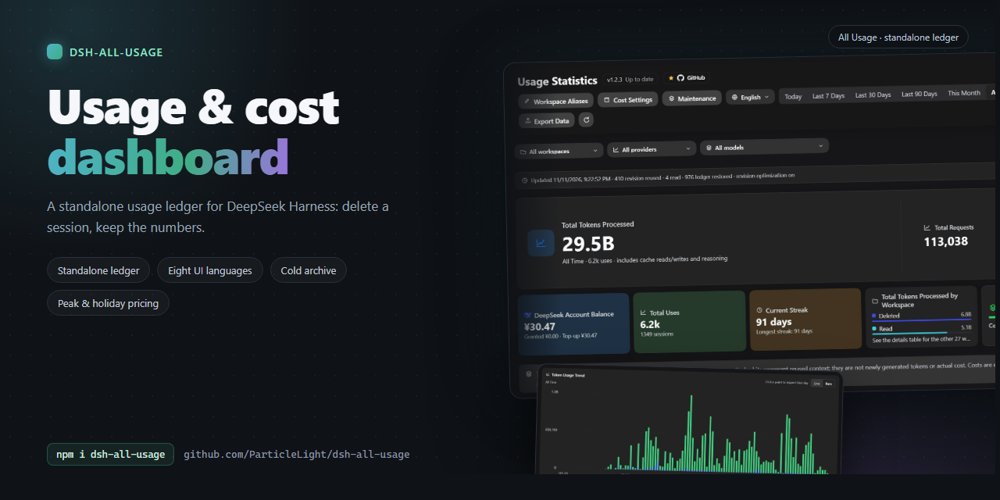

# dsh-all-usage

[中文](README.md) · [English](README.en.md) · [日本語](README.ja.md) · [Español](README.es.md) · [Français](README.fr.md) · [Deutsch](README.de.md) · [Русский](README.ru.md) · [Português](README.pt.md)

## はじめに

DeepSeek Harness のための包括的な使用量ダッシュボードです。Token、キャッシュの挙動、推定コスト、アカウント残高、そしてモデル・プロバイダー・ワークスペース・期間ごとのアクティビティを分析できます。

ローカルのセッションデータから Token 使用量、モデル別のコスト、ワークスペースのアクティビティを確認したい DSH ユーザー向けです。

## クイックスタート

DSH の「プラグイン」ページで「プラグインを追加」を選び、パッケージ名 `dsh-all-usage` またはリポジトリ `https://github.com/ParticleLight/dsh-all-usage` を入力します。

シェルからインストールすることもできます（Web プロファイル）：

~~~bash
dsh plugin --profile web add github:ParticleLight/dsh-all-usage
~~~

どちらの方法でもバンドルが組み立てられ、プロファイルを手動で編集する必要はありません。お使いの DSH がインストール直後のパッケージを動的に組み立てない場合は、DSH の案内に従ってパッケージを再読み込みするかプロセスを再起動し、ページを再読み込みしてから DSH のサイドバーでダッシュボードを開いてください。

## 主な機能

- **さまざまな軸で使用量を掘り下げる**: サマリー、推移、ヒートマップ、ページ送り付きのリクエストログを確認できます。日付・ワークスペース・プロバイダー・モデルのフィルターを組み合わせ、表示中の内容をそのまま CSV にエクスポートできます。
- **モデルとワークスペースを把握する**: 混在モデル・統合モデル・プロバイダーの各ビューを比較でき、連続記録、ワークスペース分布、日ごとのターン明細も確認できます。43 種類のブランドマークを内蔵し、正体のわからないモデルは中立表示のまま扱います。
- **コストと残高を設定する**: 4 つの Token バケットにわたってコストを推定し、公式モデルのマッピングや手動価格の設定、コンテキスト段階とピーク時間帯の設定、アカウント残高の照会ができます。詳しくは後述の「設定」を参照してください。
- **履歴全体を差分で同期する**: 読み取り可能なセッションをスキャンし、永続化された revision を手がかりに変更のないセッションの台帳データを再利用し、変更されたログだけを読み取り、DSH のワークスペースレジストリの変化にも追従します。
- **日常の動作を監査する**: スキャンの健全性、読み取り、台帳の復元、失敗を確認できます。表示言語の切り替え、ワークスペース別名の管理、実行中のプラグインバージョンの確認も行えます。

## インターフェースツアー

以下のスクリーンショットは、実際に動作中のインストール（ホスト 1.2.3 とクライアント 1.2.4）から 2026-11-11 に取得したものです。中国語と英語のインターフェース、ダークテーマで撮影しています。表示されている使用量とワークスペースのデータは、その取得環境のものです。

### ダッシュボードの概要

ヘッダーにはバージョンの状態と各ツール（ワークスペースの別名、コスト設定、データメンテナンス、表示言語）が並び、その下に期間（今日 / 過去 7 日 / 過去 30 日 / 過去 90 日 / 今月 / 全期間 / カスタム）とワークスペース・プロバイダー・モデルのフィルターがあります。ヒーローカードには期間内の Token 合計、リクエスト数、推定コストが表示され、続いてアカウント残高、総使用回数、現在の連続記録、ワークスペース分布、キャッシュヒット率が並びます。

### 使用量の推移

折れ線または棒で表示する日ごとの推移です。データ点をクリックするとその日の内容を確認できます。長い期間は 3 日単位の点にダウンサンプリングされ、さらに週・月・四半期・年の単位へと広がり、1 つのグラフあたり最大 180 点に抑えられます。

棒表示に切り替えても同じデータを日ごとに読め、ホバーカードと日別の内訳も同じように使えます。

### 使用量ヒートマップ

30 日・90 日・12 か月の 3 つの期間があり、曜日が行ごとに揃い、色の濃さで各日の Token 量を表します。

### モデルとワークスペースの統計

明細エリアにはリクエストログ、モデル統計、ワークスペース統計があります。モデル統計は統合表示・モデル別・プロバイダー別に集約でき、各行に呼び出し、入力、キャッシュヒット、出力、推論、合計、コスト、ヒット率が並びます。ワークスペース統計はワークスペースごとに集計され、設定した別名が反映されます。

### リクエストログ

各リクエストは新しい順に、モデル・Token・コストとともに一覧表示され、現在の絞り込み表示は CSV にエクスポートできます。revision の再利用、読み取り、台帳の復元といった監査カウンターは、ページ上部の同期行に表示されます。

### コスト設定

コストは 4 つの Token バケットにわたって推定されます。公式モデルのマッピング、手動価格、コンテキスト段階、ピーク時間帯に加えて、アカウント残高の照会も行えます。

### メンテナンス

しばらく更新のないセッションは月ごとの圧縮ファイルにまとめられます。対象となる記録、サイズ、月をまずプレビューし、それから実行します。アーカイブされた記録も引き続き閲覧・集計できます。

## 技術スタックとアーキテクチャ

- **ホスト**（エントリーは `lib/index.js`、`lib/plugin.js` が組み立て）: `aggregation.js`（集計 / クエリ）、`ledger.js`（永続台帳）、`session-sync.js`（履歴 / ライブ同期）、`pricing-runtime.js`（実行時料金）、`balance.js`（残高）、`http.js`（保護されたルート）に責務ごとに分割され、`turn/end`、`assistant/chunk` の使用量、最後の `assistant/message.usage` を集約し、ライブの `session/event` 更新を畳み込み、`webServer` 経由でデータルートを公開します。
- **クライアント**: 可読なソースは `src/client.js` にあり、`npm run build:client` が固定バージョンの Terser で `window.__ModuleLoader__` バンドルを `lib/client.js` に生成します。このバンドルが `sidebar.footer.action` スロットを通じてサイドバーに「使用量統計」の項目を登録します。すべての API ルートはループバックからのリクエストを受け付け、明示的なクロスオリジンの Origin ヘッダーは拒否します。残高の読み取りと別名の書き込みには、プラグイン起動時に生成されるプロセス単位のトークンも必要です（残高の GET はブラウザが Origin を省略することを許容します）。**書き込みの認可は Origin ではなくこのトークンで行います**: DSH デスクトップシェルは独自スキームで UI を実行し、リクエストを Electron 経由で転送しますが、Electron は `Origin`（および `Host` / `Cookie` / `Sec-Fetch-*`）を取り除くため、Origin を必須にするとデスクトップでの保存がすべて 403 で失敗しました。`Origin` が存在する場合は依然としてループバックかシェル自身のスキームでなければならず、`Host` もループバックでなければなりません（DNS リバインディング対策）。

### 履歴とライブデータの流れ

### ストレージとパフォーマンス

- **1 セッション 1 レコード**: 台帳は各セッションを独立したドキュメントとして書き込み（安定ハッシュで 32 個のディレクトリに振り分け）、更新時は 1 ファイルを公開するだけで済みます。同じデータで実測したところ、1 回の更新は 13.27 MB のシャードを書き直す方式（273 ms）から、1 レコードの書き込み（中央値 4.6 ms）になりました。
- **ルートごとに 1 つの識別情報**: 使用量の項目はルートの識別情報とその価格定義を繰り返さずに参照するため、1059 件のレコードが **91.3 MB から 74.7 MB へ（-18%）** 縮小しました
- **スナップショットが支払うのは 1 つのタイムゾーン分だけ**: `GET /api/all-usage?utc=0|1` は単一のカレンダーを返し（以前は 2 つのコピーでペイロードが半分に分かれていました）、日付は直近 **180 日** 分のセッション ID 明細を保持し、それより古い日は件数と集計のみを保持します
- **推移グラフは 180 点が上限**: 半年を超えると 1 点あたり 3 日になり、週 / 月 / 四半期 / 年の単位へと広がるため、グラフが履歴とともに肥大化することはありません
- **予算はコードに置く**: クエリ 20 件・レコード 20 件のキャッシュエントリ、5000 件の価格解決、セッションあたり 512 件のコンテキストエントリ、500 行の価格、32 シャード、180 点の推移、180 日のセッション ID ウィンドウ。これらは `test/perf-budgets.test.js` で守られているため、緩めるにはその表を書き換える必要があります
- **再現可能なベンチマーク**: `node bench/ledger.mjs`（台帳サイズと更新ごとの書き直しコスト）、`node bench/ledger-layout.mjs`（2 つのストレージレイアウトを実シャードのコピーで比較）、`node bench/endpoints.mjs`（5 つの読み取りエンドポイントのレイテンシ中央値とペイロード）、`node scripts/dead-code.mjs`（どこからも参照されない export、誰も呼ばないクライアントヘルパー、マークアップから描画されないスタイルシートのクラス）

## インストール

`dsh.bundle` マニフェストと Web クライアントを備えた、標準的な DSH コミュニティプラグインのパッケージです。永続化されたセッションログと別系統の使用量台帳を読み取り、有効化時に履歴をバックフィルします。

### 互換性と既知の制限

- **ランタイム**: Node.js `>=22 <25` が必要です。CI では Node 22 と Node 24 でテストスイート、構文チェック、パッケージ内容のチェックを実行しています。
- **DSH 互換性**: `package.json` は DSH ランタイム `>=0.1.1-rc.1 <0.1.5-0 || >=0.1.5-rc.1 <0.1.6-0 || >=0.1.7-rc.2 <0.1.8-0 || >=0.2.0-rc.2 <0.2.1-0 || 0.2.1-alpha.2 || 0.2.1-rc.1 || 0.2.1-rc.2 || 0.2.2-alpha.3 || 0.2.2-rc.1 || 0.2.2-rc.2` を宣言しています。実際の Cordis サービスチェーンは `0.2.1-rc.1` と `0.2.1-rc.2` でローカル検証済み（Node 24 での厳格な smoke。どちらも Cordis を安定版 4.0.5 / loader 1.0.6 / timer 1.1.7 の組み合わせに昇格させます）、`0.2.2-rc.2`（同じ Cordis 安定線 4.1.0 / loader 1.1.0 / timer 1.2.0）も検証済みで、ほかに `0.2.1-alpha.2`、`0.2.0-rc.2`、`0.1.7-rc.2`、`0.1.5-rc.2`、`0.1.5-rc.1`、`0.1.1-rc.2`、`0.1.1-rc.1` も検証済みです。宣言されたすべてのランタイムは Node 22 と 24 の CI smoke マトリクスに入っていますが、`0.2.1` 系と `0.2.2` 系の各ラインは SKIPPED（合格ではなくスキップ）と報告されます。上流が対応する `@deepseek-ai/dsh-invariants` のバージョンを一度も公開していないためです。`0.1.2-rc.1` も実運用で互換性が確認されていますが、CI smoke マトリクスには含まれていません。宣言が 1 つの区間ではなくタプルごとに分割されているのは、node-semver がプレリリース版を受け入れるのが、同じ `major.minor.patch` タプルを共有し、かつ自身もプレリリースタグを持つ比較子が存在する場合に限られるためです。`0.2.0-rc.2` が受け入れられるのは、範囲が `>=0.2.0-rc.2` と書かれているからです。
- **デスクトップクライアント（Electron、Windows）**: プラグインは DSH デスクトップクライアント（実測時は `@deepseek-ai/dsh-desktop` `0.1.7-rc.2`）での動作を検証済みです。デスクトップクライアントはウィンドウ上部に自前の最小化 / 最大化 / 閉じるボタン用の 40px のキャプション帯を確保し、ドキュメントに `data-windows-titlebar` と `--dsh-windows-titlebar-height` を付与します。パネルはその帯の**下**から描画されるため、クライアント自身の閉じるボタンが覆われることはありません。ブラウザにはそのようなマーカーがなく、何も確保しません。帯の高さはまずホストの宣言から、次に Window Controls Overlay の矩形、最後にユーザーエージェントの順に決まります。調整するには DevTools で `localStorage.setItem('dsh-all-usage:topInset', '48')` を実行して再読み込みしてください（`0` は何も確保しません）。再ビルドは不要です。デスクトップクライアントは独自のランタイムを同梱しており、そこで実測した `0.1.7-rc.2` は宣言範囲にも、後述の CI smoke マトリクスにも含まれています。
- **Web サービスの依存関係**: ホストは `webServer` を必須の依存として宣言しているため、DSH は遅れてマウントされたサービスを待ってからプラグインを適用します。このパッケージは DSH Web プロファイルを対象としており、WebServer なしではルートを公開しません。HTTP ガードは実際のソケットのピアも確認するため、リバースプロキシが受け入れられるのは接続自体がループバックである場合に限られます。
- **表示言語**: 初回表示時、パネルは DSH の **Language** 設定（`Settings → General → Language`、ホストの `locale` サービス経由で読み取ります）に従います。そのサービスがない場合はブラウザの言語、次に英語へとフォールバックします。パネル内で言語を一度選ぶと、パネルの選択が優先され、ホストの設定では上書きされなくなります。日付とカレンダーは常にこのマシン（DSH を動かしているマシン）のタイムゾーンに従うため、言語を切り替えても日の区切りは変わらず、別のカレンダーを取り直すこともありません。

| DSH ランタイム | Node.js 対応 | 実際の Cordis smoke | 結論 |
| --- | --- | --- | --- |
| `0.2.2-rc.2` | `>=22 <25` | 合格（Node 24 で厳格な実 Cordis smoke をローカル検証済み。安定版 Cordis 4.1.0 / loader 1.1.0 / timer 1.2.0） | 宣言済みかつ検証済み（この rc のみ。上流が `dsh-invariants@0.2.2-rc.2` を公開していないため CI は SKIPPED と報告） |
| `0.2.2-rc.1` | `>=22 <25` | 合格（Node 24 で厳格な実 Cordis smoke をローカル検証済み。安定版 Cordis 4.1.0 / loader 1.1.0 / timer 1.2.0） | 宣言済みかつ検証済み（この rc のみ。上流が `dsh-invariants@0.2.2-rc.1` を公開していないため CI は SKIPPED と報告） |
| `0.2.2-alpha.3` | `>=22 <25` | 合格（Node 24 で厳格な実 Cordis smoke をローカル検証済み。プレリリース版 Cordis 4.0.6-alpha.2 / loader 1.0.7-alpha.2 / timer 1.1.8-alpha.2） | 宣言済みかつ検証済み（この alpha.3 のみ。他の alpha バージョンを含意しません。上流が `dsh-invariants@0.2.2-alpha.3` を公開していないため CI は SKIPPED と報告） |
| `0.2.1-rc.2` | `>=22 <25` | 合格（Node 24 で厳格な実 Cordis smoke をローカル検証済み。安定版 Cordis 4.0.5 / loader 1.0.6 / timer 1.1.7） | 宣言済みかつ検証済み（この rc のみ。上流が `dsh-invariants@0.2.1-rc.2` を公開していないため CI は SKIPPED と報告） |
| `0.2.1-rc.1` | `>=22 <25` | 合格（Node 24 で厳格な実 Cordis smoke をローカル検証済み。安定版 Cordis 4.0.5 / loader 1.0.6 / timer 1.1.7） | 宣言済みかつ検証済み（この rc のみ。他の rc バージョンを含意しません。上流が `dsh-invariants@0.2.1-rc.1` を公開していないため CI は SKIPPED と報告） |
| `0.2.1-alpha.2` | `>=22 <25` | 合格（Node 24 で厳格な実 Cordis smoke をローカル検証済み。上流が `dsh-invariants@0.2.1-alpha.2` を公開していないため CI は SKIPPED と報告） | 宣言済みかつ検証済み（この alpha.2 のみ。他の alpha バージョンを含意しません） |
| `0.2.0-rc.2` | `>=22 <25`、CI は 22/24 をカバー | 合格（実際の Cordis サービスチェーン。CI は Node 22/24 をカバー） | 宣言済みかつ検証済み（過去に検証済み。CI は Node 22/24 をカバー） |
| `0.1.7-rc.2` | `>=22 <25`、CI は 22/24 をカバー | 合格（実際の Cordis サービスチェーン。CI は Node 22/24 をカバー） | 宣言済みかつ検証済み（過去に検証済み。CI は Node 22/24 をカバー） |
| `0.1.5-rc.2` | `>=22 <25`、CI は 22/24 をカバー | 合格（実際の Cordis サービスチェーン。CI は Node 22/24 をカバー） | 宣言済みかつ検証済み |
| `0.1.5-rc.1` | `>=22 <25`、CI は 22/24 をカバー | 合格（実際の Cordis サービスチェーン。CI は Node 22/24 をカバー） | 宣言済みかつ検証済み |
| `0.1.2-rc.1` | `>=22 <25` | 実運用で合格（CI 対象外） | 実運用で互換性を確認済み |
| `0.1.1-rc.2` | `>=22 <25`、CI は 22/24 をカバー | 合格（実際の Cordis サービスチェーン。CI は Node 22/24 をカバー） | 宣言済みかつ検証済み |
| `0.1.1-rc.1` | `>=22 <25`、CI は 22/24 をカバー | 合格（実際の Cordis サービスチェーン。CI は Node 22/24 をカバー） | 宣言済みかつ検証済み |
| その他のバージョン | `>=22 <25` | 未検証 | 検証済みマトリクスの対象外 |

一覧にない DSH バージョンが必ずしも非互換とは限りません。問題を報告する際は DSH、Node.js、プラグインのバージョンを添えてください。

- **中断されたリクエスト**: 中断された上流のリクエストは `assistant/chunk` の使用量だけを出し、最後の `assistant/message` を生成しないことがあります。そのチャンクは保持されます。同じターン / ステップの最終メッセージが後から届けば、それが置き換えます。上流が使用量イベントをまったく出さない場合、正確な Token 使用量を応答テキストから復元することはできません。
- **推定コスト**: コストは models.dev の料金と DSH の使用量バケットに基づく推定値であり、プロバイダーの請求書ではありません。カタログを取得できない場合や一致するモデルがない場合は、推測した料金を当てずに未計価のままにします。キャッシュ読み込み、キャッシュ書き込み、推論は、上流の DSH イベントが報告するバケットに従います。
- **段階料金**: models.dev のコンテキスト段階付きエントリは、リクエストの入力コンテキスト（新規入力とキャッシュ読み書きの Token）から適用レートを選びます。不正なスケジュールは引き続き非対応です。
- **ワークスペースの境界**: cwd が DSH に登録されたワークスペースにマップされるセッションのみが対象です。未登録の cwd（レジストリに存在しない既存ディレクトリを含む）は無視されます。レジストリは `domain/changed` プローブで最新に保たれます。ワークスペースドメインへの永続的な書き込みがあれば再読み取りが走り、追加・削除されたワークスペースだけが差分で再処理されます。変更のないワークスペースは計算済みの集計と台帳を再利用します。セッションのフラッシュが成功する前に削除・破損したデータは、別系統の台帳から復元できません。

### 手動でのローカル登録

1. このディレクトリを任意の場所に置き、$DSH_HOME/profiles/node_modules/ の下にシンボリックリンクを作成します（Windows ではジャンクションを使います）:

   ~~~powershell
   New-Item -ItemType Junction -Path (Join-Path $env:DSH_HOME 'profiles/node_modules/dsh-all-usage') -Target '<absolute plugin path>'
   ~~~

2. $DSH_HOME/profiles/web/cordis.patch.yml に次のエントリを追加します:

   ~~~yaml
   - insert:
       - id: all-usage
         name: dsh-all-usage
   ~~~

プロファイルのパッチレイヤーはホットリロードされます。ファイルを保存してページを再読み込みしてください。

## 使用例

### よくあるシナリオ

- 今日、過去 7 / 30 / 90 日、全履歴、カスタム期間から選べます。ワークスペース・プロバイダー・モデルのフィルターを組み合わせ、推移とヒートマップで変化を探し、個々のリクエスト行を確認し、CSV にエクスポートできます。
- コストの推定値を見直すときは、まずモデルのマッピングと価格の状態を確認し、次に入力・出力・キャッシュ読み込み・キャッシュ書き込みのバケットを確認してください。一致しない価格や検証できない価格は未計価として表示されます。
- 失敗したリクエストや不完全なリクエストについては、後述のマスク済みイベント例を参照してください。ローカルに記録があるということは DSH が使用量を観測したという意味であり、プロバイダーがそのリクエストに課金したことを証明するものではありません。

### ローカル統計と公式請求

このプラグインはローカルの DSH イベントログから再生可能な統計を報告するものであり、プロバイダーの請求書をそのまま写したものではありません:

- ローカル統計は DSH の `assistant/chunk`、最終の `assistant/message`、および関連するセッションイベントを読み、論理的な `turn / step` 単位でサンプルを重複排除・置換します。公式の請求では、プロバイダー独自のトークナイザー、丸め規則、割引、無料枠、請求期間が使われる場合があります。
- 失敗したリクエストでも、使用量のチャンクを残した場合はローカルに含まれます。その失敗リクエストにプロバイダーが課金したかどうかは公式の請求書で確認してください。
- 価格は公開の models.dev カタログとローカルの明示的な上書きから取得します。カタログ価格はプロバイダー価格、地域別料金、請求書の割引と異なることがあるため、コスト欄は推定値です。価格はモデルに属するため、同じ公式モデルから計価されるすべての行が 1 つの手動エントリを共有します。価格の編集が既存の正のコストを書き換えることはなく、ピークプランの変更はそのモデルの履歴を新しいポリシーに照らして整合させます。
- ローカル統計に含まれるのは登録済みのワークスペースのみで、未登録の cwd に対する古い台帳行は除外されます。**削除されたワークスペース**の使用量は保持され、「削除済み」の 1 行に合算されるため、ワークスペースを削除しても履歴の合計が減ることはありません。それでも、ログが破損・整理された場合や上流が使用量イベントを出さない場合は、合計が公式の請求書を下回ることがあります。

### 再現可能なイベント例

以下はマスク済みの最小例です。実行可能な完全なデータは [`fixtures/usage-events.json`](fixtures/usage-events.json) にあります。

#### 失敗したリクエストのチャンクを保持する

~~~json
[
  {"type": "assistant/chunk", "data": {"turn": 1, "step": 1, "chunk": {"type": "usage", "usage": {"inputTokens": 100, "outputTokens": 20}}}},
  {"type": "request/error", "data": {"code": "upstream-failed"}}
]
~~~

最終の `assistant/message` がない場合、そのチャンクはローカルの 1 回の呼び出しとして残ります。これはプロバイダーが必ず課金したという意味ではありません。

#### 孤立した使用量チャンク

~~~json
{"type": "assistant/chunk", "data": {"turn": 1, "step": 1, "chunk": {"type": "usage", "usage": {"inputTokens": 7, "cacheReadTokens": 8}}}}
~~~

request/context や request/header がない場合でも Token は集計されますが、モデルの識別情報は不明と表示されます。プラグインがプロバイダー名や表示文字列からモデルを推測することはありません。

#### キャッシュ Token バケット

~~~json
{"inputTokens": 100, "outputTokens": 20, "cacheReadTokens": 40, "cacheWriteTokens": 5, "reasoningTokens": 3}
~~~

ローカルで処理される合計は `100 + 20 + 40 + 5 + 3 = 168` です。コストは入力・出力・cacheRead・cacheWrite のバケットで計算し、推論が出力に再度加算されることはありません。

リポジトリのフィクスチャを再生します:

~~~bash
node scripts/replay-fixture.mjs fixtures/usage-events.json
~~~

このコマンドは実際のプラグインのホストを読み込み、互換 API を呼び出し、ドキュメントに記載された Token / レコードの合計を検証して、機密情報を含まないサマリーを出力します。

### データの意味、プライバシー、制限

- 呼び出しと Token は DSH のセッションログから取得します。`session/flush` は関連イベントが dirty なときにだけ派生台帳を再構築してキューに入れ、セッションごとの最新の保留レコードをまとめ、プラグインの破棄時に排出します。読み取り可能なログと台帳の履歴はプラグインの有効化時にバックフィルされるため、永続化に成功したデータは再読み込みやセッション削除をまたいで残ります。ワークスペースを削除した場合も同様に履歴が保持され、まだ台帳に届いていない使用量とともに「削除済み」の 1 行に合算されます
- 日レベルの範囲データは、使用量が記録された読み取り可能な過去のセッション日付をすべて保持します。ヒートマップは切り替え可能なスパンのビュー（過去 30 日 / 90 日 / 12 か月、既定は 12 か月）であり、直近 53 週に固定されたビューではありません
- セッションが削除された後も、正常にフラッシュされた使用量は別系統の台帳から復元されます。破棄のヒントと定期的な照合が、台帳の行を削除せずに再構築を促します
- セッションと論理的な `turn / step` ごとに、最後の使用量の寄与だけが保持されます。リトライや置き換えられたメッセージが二重に数えられることはありません
- 入力 Token は新規分です（キャッシュヒット / 書き込みはそれぞれ別のバケットに入るため含みません）。使用量がすべて 0 の再生は記録済みの使用量を上書きせず、キャッシュ読み込みだけのリクエストも集計対象になります
- バージョンチェックは `registry.npmjs.org` への読み取り専用の GET 1 回だけです（`dsh-all-usage` のバージョン番号のみで、本文も Cookie も送りません。ホストが発行し 6 時間キャッシュします。ページ自体がネットワークに出ることはありません）。チェックに失敗した場合は推測せず「不明」に縮退します
- 軽量なステータスエンドポイントは、ホストインスタンス、統計リビジョン、スキャン進捗、同期カウンター、`memory` 常駐カウンター、`counters`（診断用の操作回数）、`accounting`（当日の集計整合性）、`mismatch`（最初のバケット差分の不整合サンプル、なければ null）に加えて、最後のクライアント環境レポート（ユーザーエージェント、ビューポート、確保している帯とそのソース、パネルの矩形。ローカルクライアントが報告し、メモリ内にのみ保持されます）を公開します。mismatch サンプルは内部の使用量キーとワークスペース ID を含みます（使用量キーはセッション ID から導出され、セッションを指し示すことがあります）。このエンドポイントがプロンプト、応答本文、ワークスペースのパス、認証情報を運ぶことはありません。完全なスナップショットは、ステータスが変わった後か手動更新のときだけ取得されます
- スコープ付きの結果では、ターン、モデル呼び出し、異なるセッションを別々の指標として保持します。ルーティング情報がない場合は表示ラベルから推測せず、明示的に不明とします
- レコードエンドポイントは短いハッシュ、時刻、ワークスペース ID、構造化されたモデル識別情報、ターン / ステップ、Token バケット、現在の実体化ソースのみを返します。生のセッション ID、パス、プロンプト、応答、認証情報は含みません
- 処理済み Token = 入力 + 出力 + キャッシュ読み書き + 推論。キャッシュヒットはコンテキストの再利用を意味し、新たに生成された Token や実際のコストを意味するものではありません
- コストは cc-switch の 4 バケット方式に従います。入力、出力、キャッシュ読み込み、キャッシュ書き込みの Token をそれぞれ計価して合算し、最後に倍率を掛けます。入力コンテキストがコンテキスト段階のしきい値を厳密に超えると、段階的に分割するのではなく、そのリクエスト全体で 4 つのレートすべてが切り替わります。DSH の推論が出力に二度加算されることはありません
- 時間帯別料金は UTC の曜日と半開区間のウィンドウを照合します。一致したリクエストはルールのピークレートを、それ以外はその行の基本レートを使います（オフピーク = 基本）。プランの有効時刻より前の使用量には検証できるレート帯がないため、今日のレートを引き継ぐのではなく、未計価としてフェイルクローズします。1 つのプランは、同じエントリから計価されるすべての行で共有されます（DeepSeek では組み込みプランが公式の国務院の祝日リストを保持し、プラグインのリリースとともに更新されます）。休日スイッチを有効にすると、法定休日はピーク時間帯に一致せず、コストスナップショットに pricingHoliday が記録されるため、レコードは単なるオフピーク帯ではなく「休日オフピーク」と表示されます。組み込みの DeepSeek 表はすでに 2026 年の日程を同梱している（プラグインのリリースとともに更新）ため、ファーストパーティまたはマッピング済みの DeepSeek 行は設定なしで休日をオフピークとして計価します。リセラー経由の行は、公式エントリにマッピングされるまで固定価格のままです
- `tiered` を持つ旧形式の台帳コストは、読み込み時に `unsupported`（`tiered-pricing-not-modeled`）へ移行されます。現在のフラットな計価済み推定値として誤って表示され続けることはありません。Token の統計は変わりません。
- 料金の同期は既定でオフです。models.dev を利用できないときは最後に成功したカタログを使い続け、一致しないモデルに推測の既定価格が与えられることはありません。コスト設定の価格入力欄が手動価格の入口です（同じ公式モデルから計価されるすべての行で共有）。各行はコンテキスト帯と UTC のピークルール（中国の法定休日の終日オフピーク計価を含む、任意）に展開でき、組み込みの DeepSeek 表はカスタマイズ用にコピーしたり元に戻したりできます。ダッシュボードの期間と明細ビューの設定はブラウザのストレージに保存され、6 時間ごとの同期スイッチは保護された料金 API を通じて即座に保存されます
- マッピングの意味: `identityKey` を持つマッピングは、その正確なルート識別情報にのみ適用されます。識別キーを持たないマッピングはモデル全体のフォールバックです。旧形式の `usageIdentityKey` の値は読み込み時に正規化されます。
- 休日カレンダーは、ユーザーが「公開カレンダーから読み込む」をクリックしたときだけ取得されます。リクエストは `cdn.jsdelivr.net` に送られ（失敗時は `raw.githubusercontent.com` にフォールバック）、年以外の何も運びません。**使用量、セッション、認証情報が含まれることは決してありません**。返された日付は保存するまで不活性のままで、保存するとソースの注記とともにそのモデルのピークプランへ凍結されます（ソースはポリシーハッシュから除外されます）
- 残高データは DeepSeek の公式 `/user/balance` エンドポイントから取得します。API キーが設定されていない場合、カードには案内が表示されます
- 日付バケット、期間フィルター、連続記録、ヒートマップの日付、エクスポートのタイムスタンプは、どの表示言語でもこのマシンのタイムゾーンを使います。CSV には使ったタイムゾーンと日の区切りを明記します
- 台帳は各セッション ID を 32 個の安定ハッシュディレクトリのいずれかに割り当て、**1 セッションにつき 1 つのレコードドキュメント**を保持するため、フラッシュはシャードを書き直すのではなくその 1 ファイルを公開するだけです。旧形式のユニット全体のファイル（元の `all_usage_ledger.json` を含む）は、レコードツリーがデータを確実に保持していると確認できた時点で削除され、`DSH_ALL_USAGE_KEEP_LEGACY=1` を設定すると保持されます。非同期書き込みの失敗やフラッシュされない終了でメモリ内の統計が失われることはなく、次回起動時にそのセッションをスキャンし直すだけです
- 作業ディレクトリによって登録済みワークスペースにマップできるセッションのみが対象です

## 設定

| 設定 | 場所 | 説明 |
| --- | --- | --- |
| モデル価格とルール | ダッシュボードの「コスト設定」 | models.dev の同期は既定でオフです。公式モデルのマッピング、手動価格の設定、コンテキスト段階、UTC のピーク時間帯、中国の法定休日のオフピークルールを設定できます。計算式と境界については「データの意味、プライバシー、制限」を参照してください。 |
| ワークスペースの別名 | DSH のサイドバー、`$DSH_HOME/storages` 配下の KV ユニット `all_usage_aliases` | 表示上のワークスペース名を置き換えます。 |
| 期間と明細の設定 | ブラウザのローカルストレージ | 選択したダッシュボードの期間と明細ビューがローカルに保存されます。 |
| Electron の上部インセット | ブラウザの `localStorage` キー `dsh-all-usage:topInset` | ピクセル値を設定して確保する帯を調整します。`0` で無効になります。反映には再読み込みが必要です。 |
| 旧形式の台帳シャードを保持 | ホストの環境変数 `DSH_ALL_USAGE_KEEP_LEGACY=1` | セッション単位のレコードツリーが確認できた後、旧形式のシャード全体のファイルは削除されます。`1` を設定すると保持します。 |
| 常駐する使用量行の予算 | ホストの環境変数 `DSH_ALL_USAGE_RESIDENT_ROWS` | 行数、既定値は 12000。有限の値は切り捨てられます（Math.floor）。負の値はすべての明細行を常駐させ、`0` はスキャン完了時に解放可能な行をすべて返却します。数値でない値は既定値にフォールバックします。これはソフトな予算です。価格が未確定の行や、書き込み・読み取り・再同期・プリフェッチ中のセッションの行は決して返却されません。 |
| セッションレコードのキャッシュ上限 | ホストの環境変数 `DSH_ALL_USAGE_RECORD_CACHE_MB` | MiB、既定値は 16。0 以上の有限の値のみ受け付け、負の値や数値でない値は 16 にフォールバックします。`0` は解放可能なクリーンなレコードを最新の 1 件まで追い出すだけなので、保護されたレコードによって実際の常駐量が予算を超えることがあります。これはソフトな予算です。dirty・保留中・書き込み中・再同期中・プリフェッチ中・読み取り中のレコードは決して追い出されず、1 件のレコードも読み戻せない台帳ストアではすべてのレコードが常駐したままになります。常駐量は（実測の割り当てではなく）使用量行の件数から推定されます。ステータスの `recordCacheMB` を参照してください。 |

## API と CLI

### CLI

このプラグインに独立したランタイム CLI はありません。公式のインストールコマンドはクイックスタートにあり、開発用・テスト用のコマンドは以下に記載しています。

### HTTP API

- `GET /api/all-usage` — 互換性のある使用量スナップショット
- `GET /api/all-usage/status` — 軽量なリビジョンと同期の健全性に加えて、最後のクライアント環境レポート（`clientEnv`）、実行中のプラグインバージョン（`pluginVersion`）、書き込みケーパビリティの導出 ID（`capabilityId`。ケーパビリティがローテーションすると変わるため、ページはプラグインの再読み込みに気づけます。ケーパビリティ自体は完全なスナップショットでのみ送信されます）、そして `memory` 常駐カウンター（`residentRows`（常駐する使用量明細行）、`residentRecords`（常駐するセッションレコード）、`recordCacheMB`（セッションレコードキャッシュのサイズ、MiB、小数 1 桁。実測の割り当てではなく使用量行の件数から導出した推定値）、`sessions`（セッション集計）、`recordsCache`（レコードクエリキャッシュの統計）、`heapUsedMB` / `rssMB`（いずれもプラグイン単体ではなく Host プロセス全体の値））を返します。同じ応答には `counters`（診断用の操作回数）、`accounting`（当日の集計整合性）、`mismatch`（最初のバケット差分の不整合サンプル、なければ null）も含まれます
- `GET /api/all-usage/query` — スコープ付きの集計、日次 / 時間別の推移、ヒートマップのデータ。単日スコープでは `hourly` が埋まり、複数日にまたがるスコープでは `hourly` は空配列になります
- `GET /api/all-usage/records` — ページ送り付きで、プライバシーに配慮した正規化済みの使用量行
- `POST /api/all-usage/archive` — `days` 日（既定 90、1〜3650 の整数）より古いセッションレコードを `<root>/archive/<YYYY-MM>.jsonl.gz` にまとめ、月ファイルが永続化された時点でそれらのツリーのドキュメントを削除します。既定はプレビューのみ（`dryRun: true`）で、明示的な `dryRun: false` のときだけ書き込みます。移行処理や CLI と同じメンテナンスロックを取得し、`{ ok, months, archived, bytes, compressed, dryRun, errors }` を返し、ロックが保持されている場合は 409 を返します。価格の保存と同じローカルの書き込みケーパビリティが必要です
- `GET /api/all-usage/icon?key=<brand key>` — ブランドマークを要求に応じて 1 つ配信します（長いキャッシュと ETag 付きの SVG）。クライアントバンドルは解決用のメタデータだけを持つため、ブランドを追加してもバンドルは大きくなりません
- `GET /api/all-usage/version?force=1` — バージョンチェック。実行中のバージョン、最新の公開バージョン、判定（`latest` / `outdated` / `unknown`）、確認日時、取得元を返します。ホスト側で 6 時間キャッシュされ、プロセスあたり最大 30 秒に 1 回だけ上流へリクエストします（この下限は `force=1` にも適用されます）。`force=1` は更新ボタンから送られます
- `GET /api/all-usage/balance?force=1` — 設定された `llm-deepseek` の API キーを使ったアカウント残高
- `POST /api/all-usage/alias` — ワークスペースの別名を更新
- `GET /api/all-usage/pricing` — 編集可能な価格表全体を読み取ります。行ごとの実効レートと状態、マッピング、手動価格、ピークプラン（組み込み / 明示の由来と完全なルール付き）、設定にのみ存在する行が含まれます
- `GET /api/all-usage/pricing/models?q=...` — 公式モデルの ID と表示名を検索します。プレビュー料金、段階料金のフラグ、組み込みのピーク表の有無も含みます
- `POST /api/all-usage/pricing` — 同期、マッピング、手動価格、コンテキストのレート帯、ピーク時間帯のルールを保存します（リクエストの形は変わりません）
- `POST /api/all-usage/pricing/sync` — models.dev を同期し、未計価の呼び出しをバックフィルします
- `POST /api/all-usage/pricing/holidays` — 中国の休日日程 1 年分（holiday-cn データセット、まず jsDelivr、次に GitHub raw にフォールバック、ホスト側で 24 時間キャッシュ）を取得し、休日の一覧とそのソースだけを返します。**設定には何も書き込まれません**。クライアントが日付をピークプランへ凍結します
- `GET /api/all-usage/client-env` — クライアント環境レポート（ユーザーエージェント、ウィンドウコントロールオーバーレイの高さ、確保している帯**とそのソース**、ビューポート、パネルの矩形）。クライアントは読み込み時とシートを開くたびに報告し、メモリ内にのみ保持されます

## 開発とテスト

- `src/client.js` を編集したら `npm run build:client` を実行し、DSH のクライアントモジュールを再読み込みしてページを更新してください。`lib/client.js` は生成物なので直接編集しないでください。`lib/plugin.js` などのホストモジュールを編集したら、DSH からパッケージを再読み込みするかプロセスを再起動してください
- このプラグインにサードパーティの実行時依存はありません。ホストは Cordis のサービスを、クライアントはランタイムが提供する React モジュールを使います。固定バージョンの Terser はブラウザ用成果物を生成するための開発時依存にすぎません
- 手動での npm 復旧公開には、対象の `v<package.version>` タグと完全なコミット SHA が必要です。GitHub Actions はチェックアウトしたタグとパッケージのバージョンの両方に対してこれを検証します。リリースイベントでも同じコミット検証が行われます。

### ローカルチェック

~~~bash
npm test
npm run fixture:check
npm run build:client
npm run check:pack
~~~

## ステータスと更新

現在の最新リリースは `v1.2.4`（[GitHub Release](https://github.com/ParticleLight/dsh-all-usage/releases/tag/v1.2.4)｜npm：`npm i dsh-all-usage@1.2.4`）。開発とリリースの全履歴は [CHANGELOG.md](CHANGELOG.md) を参照。

### 最新公開版: v1.2.4

- **UI 言語が 8 種類に**：DSH が同梱する言語に従い、初回は自動で合わせ、選んだ言語は記憶されます。
- **「今月」範囲を追加**：今月 1 日から今日まで。
- **日付はこのマシンのタイムゾーンに統一**：UI 言語でカレンダーが切り替わらなくなり、日付の横に UTC オフセットを表示します。
- **古い記録をコールドアーカイブ可能**：CLI かパネルの「データメンテナンス」で古いセッションを月別 gzip にまとめます。集計と絞り込みは変わらず、既定では何も動きません。
- **3 件の修正**：ヒートマップの「今日」を緑のリングに、データフォルダを共有する 2 つの DSH プロセスで履歴が失われないように、プラグインが持たない言語では英語にフォールバックするように。

完全なバージョン履歴は [CHANGELOG.md](CHANGELOG.md) を参照。

## コントリビュートと連絡先

バグ報告には以下のテンプレートを利用してください。一般的な質問や機能の議論は [プロジェクトリポジトリ](https://github.com/ParticleLight/dsh-all-usage) へお願いします。プルリクエストは歓迎します。バグ報告には DSH、Node.js、プラグインのバージョンを添えてください。

- [データの不整合](.github/ISSUE_TEMPLATE/data-inconsistency.md)
- [プラグインの起動失敗](.github/ISSUE_TEMPLATE/startup-failure.md)
- [コスト計算の問題](.github/ISSUE_TEMPLATE/cost-calculation.md)

## ライセンス

MIT
