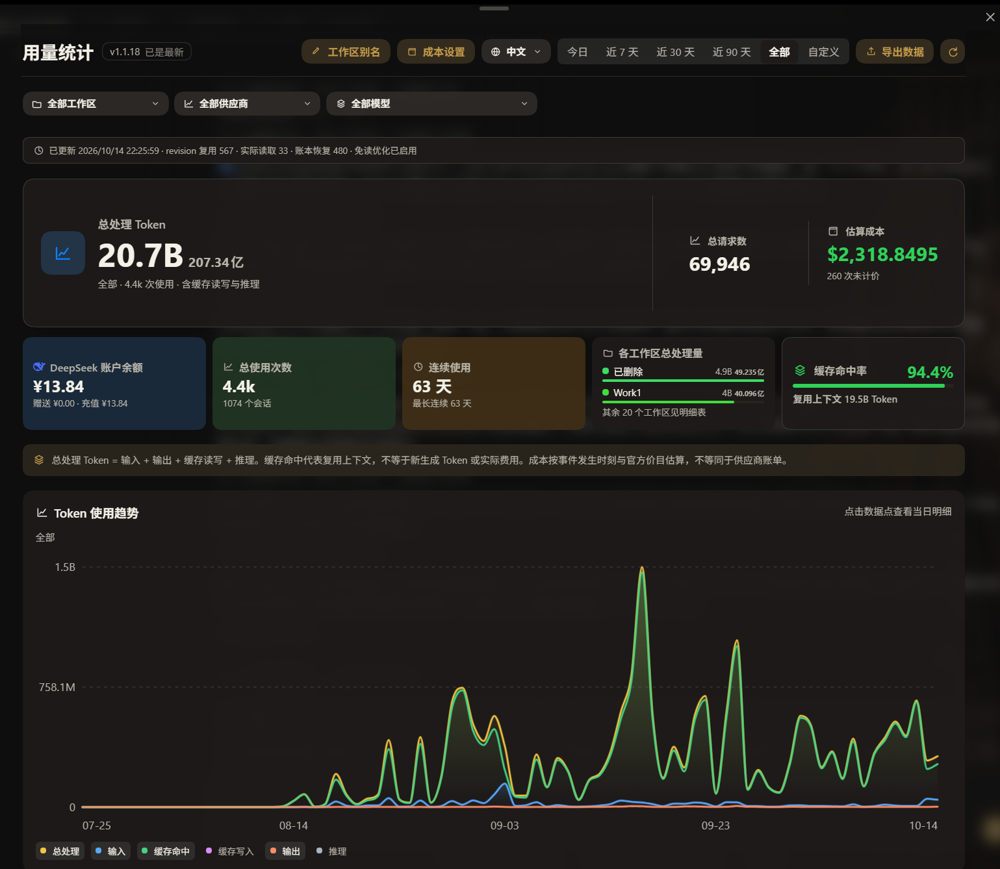
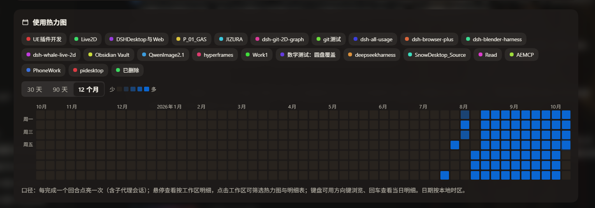
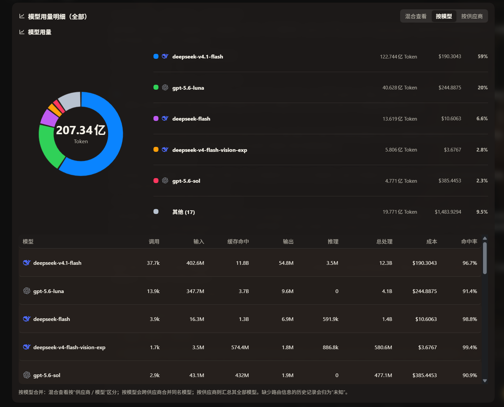
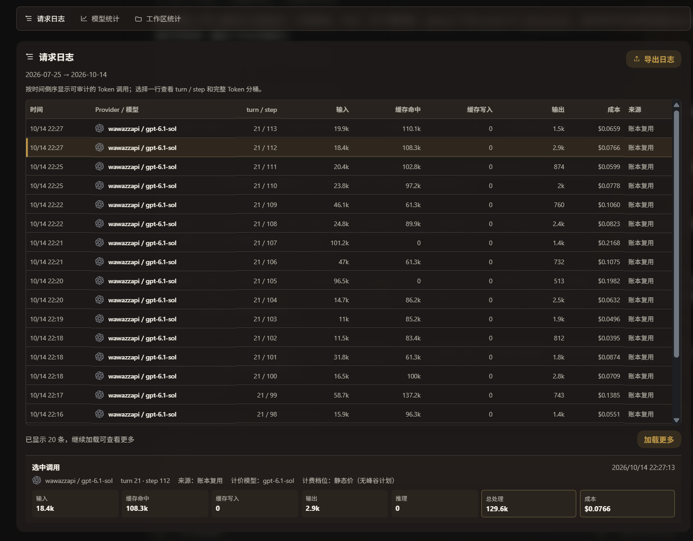
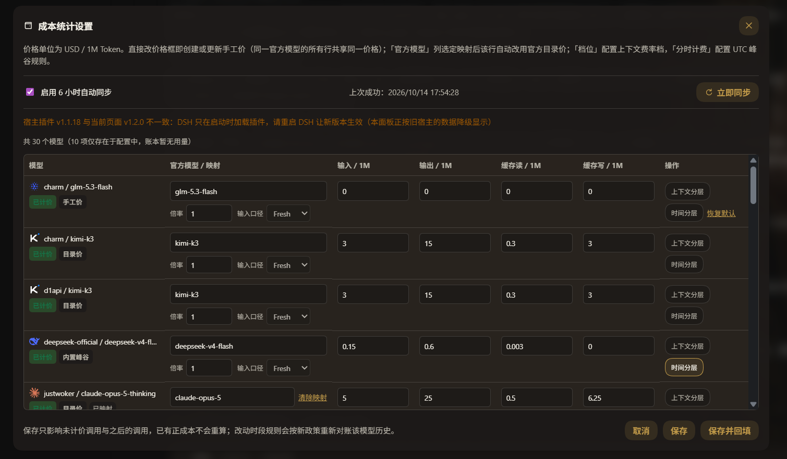
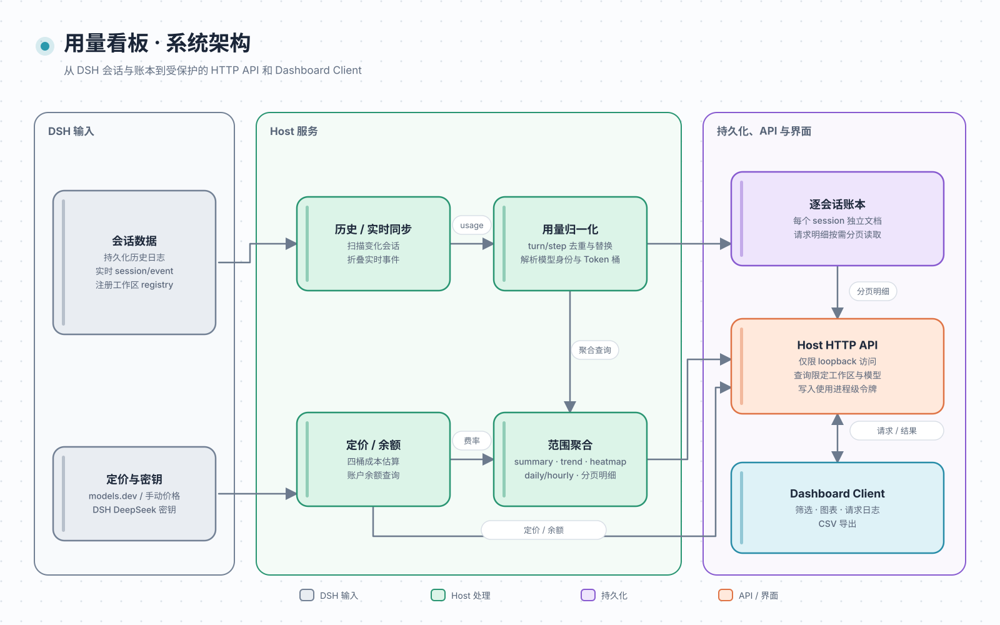
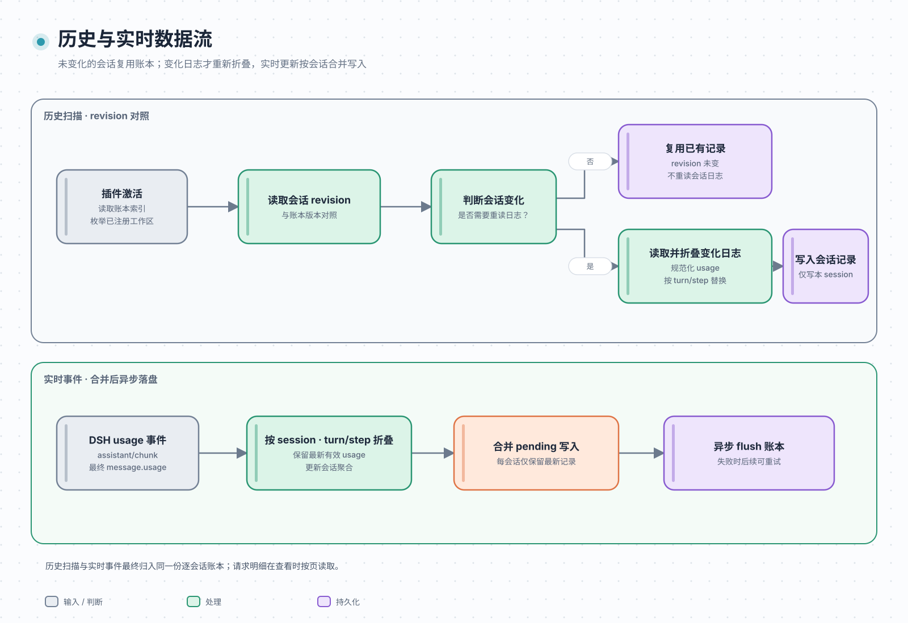

# dsh-all-usage

[中文](README.md) · [English](README.en.md)

## 简介

DeepSeek Harness 全量用量看板：按模型、供应商、工作区和时间范围分析 Token、缓存与账户余额。

适合希望从 DSH 本地会话中核查 Token 分布、模型成本与工作区用量的用户。

## 快速开始

~~~bash
dsh plugin --profile web add github:ParticleLight/dsh-all-usage
~~~

安装命令会装配 bundle；通常刷新浏览器页面即可加载 Client，无需手动修改 profile。若当前 DSH 版本未动态装配新包，请按 DSH 的提示重载包或重启进程，然后刷新页面并从 DSH 侧栏打开看板。

## 核心功能

- **多维用量分析**：以摘要、趋势、热力图和分页请求日志查看历史；可按日期、工作区、供应商和模型组合筛选，并将当前视图导出为 CSV。
- **模型与工作区洞察**：支持混合模型、按模型合并和按供应商汇总，提供连续使用、工作区分布与每日回合明细；内置 43 个品牌图标，未知模型身份保持中性。
- **可配置成本与余额**：按四类 Token 桶估算成本，支持官方模型映射、手工价格、上下文档位和峰谷规则，并可查询账户余额；配置细节见下文。
- **完整历史与增量同步**：首次扫描可读会话，后续按会话账本与持久化 revision 复用未变化数据，只增量读取变化，并跟随 DSH 工作区注册表更新。
- **可审计的日常操作**：显示扫描健康、实际读取、账本恢复和失败状态；支持中英文界面切换、工作区别名及版本状态提示。

## 截图

以上五张截图于 2026-10-14 从 v1.2.0 客户端界面截取，图中宿主插件版本为 v1.1.18；其中的实际用量与工作区数据属于该截图环境；成本设置中的版本不一致警告为有意保留。

## 技术栈与架构

- **Host 端**（入口 `lib/index.js`，组装 `lib/plugin.js`）：按职责拆分为 `aggregation.js`（聚合与查询）、`ledger.js`（持久账本）、`session-sync.js`（历史/实时同步）、`pricing-runtime.js`（运行时定价）、`balance.js`（余额）、`http.js`（安全路由）；扫描 `turn/end`、`assistant/chunk` usage 和最终 `assistant/message.usage`，监听 `session/event` 实时折叠，并通过 `webServer` 服务注册数据路由。
- **Client 端**：可读源码位于 `src/client.js`，`npm run build:client` 使用固定版本 Terser 生成 `window.__ModuleLoader__` 工厂格式的 `lib/client.js` 浏览器 bundle，并注册侧边栏「用量统计」入口（`sidebar.footer.action` 槽位）。所有 API 仅接受本机 loopback 请求并拒绝显式跨域请求；余额读取与别名写入还要求插件启动时生成、仅在当前进程有效的令牌（余额 GET 兼容浏览器省略 Origin）。英文模式的日期分桶、范围筛选、连续使用、热力图和导出时间统一按 UTC；中文模式按本地时区。

### 历史与实时数据流

### 存储与性能

- **一个会话一条记录**：账本把每个会话写成独立文档（按 session ID 稳定 hash 到 32 个目录），一次更新只发布一个文件。实测同一份数据下，单次更新的落盘成本从「重写整个 13.27 MB 分片 / 273 ms」降到「写一条记录 / 中位 4.6 ms」。
- **同一路由只存一次身份**：记录里的用量条目只引用身份与价格定义，相同的供应商 / 模型不再逐条重复；实测本机 1059 条记录体积 **91.3 → 74.7 MB（−18%）**
- **快照只为当前时区买单**：`GET /api/all-usage?utc=0|1` 只返回一份日历（此前两份各占一半载荷），每个日期只保留最近 **180 天**的会话 ID 明细，更早的日期保留数量与聚合
- **趋势点数封顶 180**：超过半年自动降到 3 天一点，再按需要扩到周 / 月 / 季 / 年，图表不随历史无限变长
- **预算写进代码**：查询与记录缓存各 20 条、定价解析缓存 5000、每会话上下文归档 512、价格行 500、分片 32、单图点数 180、快照会话 ID 窗口 180 天 —— 由 `test/perf-budgets.test.js` 守着，放开任何一项都必须显式修改那张表
- **可复现的基准**：`node bench/ledger.mjs`（账本体积与单次重写成本）、`node bench/ledger-layout.mjs`（两种存储布局对比，在真实分片的副本上跑）、`node bench/endpoints.mjs`（5 个读接口的中位延迟与载荷）、`node scripts/dead-code.mjs`（死代码体检：无人引用的导出、客户端里没被调用的函数、样式表里再也渲染不出的 class）

## 安装

本插件是标准的 DSH 社区插件包，声明 `dsh.bundle` manifest 与 Web Client；数据来自持久化会话日志和独立用量账本，安装后自动回填历史。

### 兼容性与已知限制

- **运行环境**：需要 Node.js `>=22 <25`；CI 会在 Node 22 和 Node 24 上运行测试、语法检查和 npm 包内容检查。
- **DSH 兼容**：`package.json` 声明 DSH runtime `>=0.1.1-rc.1 <0.1.5-0 || >=0.1.5-rc.1 <0.1.6-0 || >=0.1.7-rc.2 <0.1.8-0 || >=0.2.0-rc.2 <0.2.1-0 || 0.2.1-alpha.2 || 0.2.1-rc.1 || 0.2.1-rc.2`，已在本机用真实 Cordis 服务链验证 `0.2.1-rc.1` / `0.2.1-rc.2`（Node 24 严格 smoke；这两条把 Cordis 提升为稳定版 4.0.5 / loader 1.0.6 / timer 1.1.7）、`0.2.1-alpha.2` 以及 `0.2.0-rc.2`、`0.1.7-rc.2`、`0.1.5-rc.2`、`0.1.5-rc.1`、`0.1.1-rc.2`、`0.1.1-rc.1`；全部已声明版本都进了 CI smoke 矩阵（Node 22/24 双档），但 `0.2.1` 那两条因上游从未发布对应版本的 `@deepseek-ai/dsh-invariants`，CI 会**如实标记 SKIPPED，不等于通过**；`0.1.2-rc.1` 已通过实际使用验证兼容，但未纳入 CI smoke 矩阵。声明按元组逐条拆开而非写成单一区间，是因为 node-semver 只有在范围里存在与目标版本同 `major.minor.patch` 且自身带预发布标签的比较符时，才会放行该预发布版本 —— 例如必须写成 `>=0.2.0-rc.2` 才能让 `0.2.0-rc.2` 进入范围。
- **桌面客户端（Electron，Windows）**：本插件在 DSH 桌面客户端上实测运行正常（实测 `@deepseek-ai/dsh-desktop` `0.1.7-rc.2`）。桌面客户端会在窗口顶部为自身的最小化 / 最大化 / 关闭按钮保留一条 40px 顶栏，并在文档上标记 `data-windows-titlebar` 与 `--dsh-windows-titlebar-height`；面板据此从该条**下方**开始绘制，所以桌面端自己的关闭按钮永远不会被面板盖住。浏览器端没有该标记，不留白。顶栏高度优先取宿主声明，其次取 Window Controls Overlay 矩形，最后退回 UA；需要微调时可在 DevTools 执行 `localStorage.setItem('dsh-all-usage:topInset', '48')` 后刷新（`0` 表示不留白），无需重新构建。桌面客户端自带运行时，实测版本 `0.1.7-rc.2` 已纳入声明区间与 CI smoke 矩阵（见下表）。
- **Web 服务依赖**：Host 将 `webServer` 声明为必需依赖，确保服务晚挂载时由 DSH 等待后再执行插件；该包面向 DSH Web profile，不提供无 WebServer 的 headless 路由。HTTP 守卫还会检查真实 socket peer，反向代理只有在连接本身来自 loopback 时才会被接受。写接口（价格保存、立即同步、节假日抓取、别名）以**进程令牌**为授权凭据，不强制要求 `Origin`：DSH 桌面端把 UI 跑在自定义协议上、请求由 Electron 主进程转发，转发时会删掉 `Origin`（连同 `Host`/`Cookie`/`Sec-Fetch-*`），强制 Origin 会让桌面端所有写入 403；而 `Origin` 若存在仍必须是 loopback 或桌面端自身 scheme，`Host` 仍必须是 loopback（防 DNS rebinding）。
- **界面语言**：首次进入时面板跟随 DSH 的 **Language 设置**（`Settings → General → Language`，经宿主的 `locale` 服务读取）；宿主未提供该服务时退回浏览器语言，最后退回英语。在面板里手动选过语言之后以面板的选择为准，宿主设置不再覆盖它。语言同时决定时区口径——中文按本地时区，英文按 UTC——所以切换语言会重新取一份对应时区的快照。

| DSH runtime | Node.js 支持 | 真实 Cordis smoke | 结论 |
| --- | --- | --- | --- |
| `0.2.1-rc.2` | `>=22 <25` | 通过（本机 Node 24 严格真实 Cordis smoke；稳定版 Cordis 4.0.5 / loader 1.0.6 / timer 1.1.7） | 已声明、已验证（仅此精确版本；CI 因上游缺 `dsh-invariants@0.2.1-rc.2` 如实标记 SKIPPED） |
| `0.2.1-rc.1` | `>=22 <25` | 通过（本机 Node 24 严格真实 Cordis smoke；稳定版 Cordis 4.0.5 / loader 1.0.6 / timer 1.1.7） | 已声明、已验证（仅此精确版本，不代表其他 rc 版本；CI 因上游缺 `dsh-invariants@0.2.1-rc.1` 如实标记 SKIPPED） |
| `0.2.1-alpha.2` | `>=22 <25` | 通过（本机 Node 24 严格真实 Cordis smoke；CI 因上游缺 `dsh-invariants@0.2.1-alpha.2` 如实标记 SKIPPED） | 已声明、已验证（仅此精确版本，不代表其他 alpha 版本） |
| `0.2.0-rc.2` | `>=22 <25`，CI 覆盖 22/24 | 通过（真实 Cordis 服务链，CI 覆盖 Node 22/24） | 已声明、已验证（历史验证结果，CI 覆盖 Node 22/24） |
| `0.1.7-rc.2` | `>=22 <25`，CI 覆盖 22/24 | 通过（真实 Cordis 服务链，CI 覆盖 Node 22/24） | 已声明、已验证（历史验证结果，CI 覆盖 Node 22/24） |
| `0.1.5-rc.2` | `>=22 <25`，CI 覆盖 22/24 | 通过（真实 Cordis 服务链，CI 覆盖 Node 22/24） | 已声明、已验证 |
| `0.1.5-rc.1` | `>=22 <25`，CI 覆盖 22/24 | 通过（真实 Cordis 服务链，CI 覆盖 Node 22/24） | 已声明、已验证 |
| `0.1.2-rc.1` | `>=22 <25` | 通过（实际使用验证，未纳入 CI） | 已实际验证兼容 |
| `0.1.1-rc.2` | `>=22 <25`，CI 覆盖 22/24 | 通过（真实 Cordis 服务链，CI 覆盖 Node 22/24） | 已声明、已验证 |
| `0.1.1-rc.1` | `>=22 <25`，CI 覆盖 22/24 | 通过（真实 Cordis 服务链，CI 覆盖 Node 22/24） | 已声明、已验证 |
| 其他版本 | `>=22 <25` | 未测试 | 不在已验证矩阵内 |

未列出的 DSH 版本不代表一定不兼容；提交问题时请附 DSH、Node.js 和插件版本。

- **中断请求**：上游请求被中断时可能只有 `assistant/chunk` 的 usage，没有最终 `assistant/message`；本插件会保留该 chunk 用量。同一 `turn / step` 后续出现最终 message 时，message 会替换 chunk。若上游完全没有 usage 事件，则无法从响应内容精确恢复 Token。
- **估算成本**：成本是基于 models.dev 价格和 DSH usage 桶的估算，不是供应商账单；目录不可用或模型没有官方匹配时不会猜测价格，而是显示未计价。缓存读取、缓存写入和 reasoning 的口径取决于 DSH 上游事件。
- **分层价格**：models.dev 的 tiered/context-dependent 价格按本次请求的输入上下文（fresh input + cache read + cache write）选择对应档位；阈值边界遵循目录定义，无法验证的异常 tier 仍显示为 unsupported。
- **工作区边界**：只有 cwd 能映射到 DSH 已注册工作区的会话才进入统计；未注册 cwd（包括已存在但未在 registry 中登记的目录）会被忽略。工作区注册列表通过 DSH 的 `domain/changed` 探针自动同步：注册表一有改动就重读并只对新增/删除的工作区做增量处理，未变化的已有工作区直接复用已计算账本，不会全量重扫。会话尚未成功 flush 前删除或损坏的日志无法由独立账本恢复。工作区被删除时历史用量不会丢失：它会被保留并汇总为一行「已删除」。

### 手动注册（本地包）

1. 把本目录放入任意位置，并在 $DSH_HOME/profiles/node_modules/ 下创建指向本目录的符号链接（Windows 用 junction）：

   ~~~powershell
   New-Item -ItemType Junction -Path (Join-Path $env:DSH_HOME 'profiles/node_modules/dsh-all-usage') -Target '<本目录绝对路径>'
   ~~~

2. 在 $DSH_HOME/profiles/web/cordis.patch.yml 添加一行：

   ~~~yaml
   - insert:
       - id: all-usage
         name: dsh-all-usage
   ~~~

用户 patch 层会被热重载：保存后刷新页面即可。

## 使用示例

### 常见场景

- 选择今日、近 7 天、近 30/90 天、全部或自定义日期，再组合工作区、供应商和模型筛选；用趋势与热力图定位变化，打开请求日志检查单条记录并导出 CSV。
- 核对成本时，先在成本设置中检查模型映射和价格状态，再查看输入、输出、缓存读取与缓存写入的分项估算；未匹配或无法验证的价格会明确显示为未计价。
- 解释失败或不完整的请求时，查看下面的脱敏事件样例；本地记录表示 DSH 观察到的 usage，不等同于供应商确认收费。

### 本地统计与官方账单

本插件展示的是 DSH 本地事件日志上的可重放统计，不是供应商账单的镜像：

- 本地统计读取 DSH 的 `assistant/chunk`、最终 `assistant/message` 和其他会话事件，按同一 `turn / step` 去重和替换；官方账单可能按供应商自己的请求、分词器、舍入、折扣、免费额度和结算周期计算。
- 失败请求只要留下 usage chunk，就会进入本地统计；供应商是否对该失败请求收费，应以官方账单为准。
- 价格来自 models.dev 的公开模型目录和本地显式覆盖；目录价格、供应商实际价格、区域费率和账单折扣可能不同。成本字段应理解为估算值。
- 本地统计只包含已注册工作区；未注册 cwd 的旧 ledger 不进入统计。**已删除工作区**的历史用量会保留并汇总为一行「已删除」，删除工作区不会让历史统计变小。统计仍可能因日志损坏、清理或上游没有发出 usage 而少于官方账单。

### 可复现事件示例

下面的事件是脱敏的最小示例；完整可运行数据见 [`fixtures/usage-events.json`](fixtures/usage-events.json)。

#### 失败请求仍保留 usage chunk

~~~json
[
  {"type": "assistant/chunk", "data": {"turn": 1, "step": 1, "chunk": {"type": "usage", "usage": {"inputTokens": 100, "outputTokens": 20}}}},
  {"type": "request/error", "data": {"code": "upstream-failed"}}
]
~~~

没有最终 `assistant/message` 时，chunk 仍计为一个本地调用；这不等于官方一定收费。

#### 孤立 usage chunk

~~~json
{"type": "assistant/chunk", "data": {"turn": 1, "step": 1, "chunk": {"type": "usage", "usage": {"inputTokens": 7, "cacheReadTokens": 8}}}}
~~~

缺少 request/context 或 request/header 时，Token 仍可统计，但模型身份显示为 Unknown；插件不会从 Provider 名称或展示字符串猜测模型。

#### 缓存 Token 的四桶含义

~~~json
{"inputTokens": 100, "outputTokens": 20, "cacheReadTokens": 40, "cacheWriteTokens": 5, "reasoningTokens": 3}
~~~

本地 processed total 为 `100 + 20 + 40 + 5 + 3 = 168`；成本只对 input、output、cacheRead、cacheWrite 四个桶定价，reasoning 不会再次加到 output。

使用仓库中的 fixture 复现：

~~~bash
node scripts/replay-fixture.mjs fixtures/usage-events.json
~~~

该命令会加载真实插件 Host、调用兼容 API、校验预期 Token/records，并输出不含敏感信息的摘要。

### 数据口径、隐私与限制

- 使用次数与 Token 来自 DSH 会话日志；`session/flush` 只在存在新的相关事件时重建并将派生账本写入异步队列，同一 session 的 pending record 会合并，插件退出时 drain；插件激活时会回填日志与账本历史，插件卸载/重启后已成功持久化的数据不丢
- 按日范围统计会保留全部可读取历史会话的有使用记录日期；热力图是可切换跨度的视图窗口（最近 30 天 / 90 天 / 12 个月，默认 12 个月）
- 会话删除后，已成功 flush 的用量仍从独立账本恢复；工作区删除同样不会丢数据——其历史用量汇总为一行「已删除」（含未落账的实时用量）。会话销毁提示和周期对账只负责触发重建，不会删除账本记录
- 同一会话的同一 `turn / step` 只保留一份最终 usage；重试或替换消息会替换旧贡献，不重复累计
- 输入 Token 按「未含缓存命中」计（缓存命中 / 写入独立成桶）；全 0 用量的重放事件不会覆盖已记录的真实用量，纯缓存命中的请求仍会计入
- 版本检查会向 `registry.npmjs.org` 发一次只读 GET（仅读取 `dsh-all-usage` 的版本号，无请求体、无 Cookie；由 Host 发起并缓存 6 小时，页面自身不联网），失败时降级为「未知」而非猜测
- 轻量状态接口公开 Host 实例、统计 revision、扫描进度、同步计数、`memory` 常驻计数、`counters` 诊断操作计数、`accounting` 当日聚合一致性、`mismatch` 首个桶增量不一致样本（无则为 null），以及最近一次客户端环境报告（UA、视口、预留顶栏值及其来源、面板矩形——由本机客户端上报且只存内存）；`mismatch` 样本含内部用量 key 与工作区 ID（用量 key 由会话 ID 派生，可指向某一会话），但不含提示词或回复正文，也不含工作区路径或凭据；完整快照仅在状态变化或手动刷新时获取
- scope query 将回合（turns）、模型调用（calls）和去重会话（sessions）分开统计；Provider/模型筛选缺少路由信息时明确归为 Unknown，不从展示字符串猜测
- records 接口只返回短 hash、时间、工作区 ID、结构化模型身份、turn/step、Token buckets 和当前物化来源，不返回原始 session ID、路径、提示词、回复或凭据
- 看板中的总处理量 = 输入 + 输出 + 缓存读写 + 推理；缓存命中表示复用的上下文 Token，不等于新生成 Token 或实际费用
- 成本计算沿用 cc-switch 的四桶公式：输入、输出、缓存读取和缓存写入分别乘每百万价格，四项相加后再乘倍率；context tier 在输入上下文严格大于阈值时为整次请求切换四项费率，不做渐进分段；DSH 的 reasoning 字段不再次加到 output，避免底层 completion/thoughts 已含推理时重复计费
- 分时段计费以 UTC 周几与半开时间窗判定：命中规则的请求使用峰时四项费率，未命中时使用该行基础价（谷时＝基础价）；生效起点之前的用量没有可验证档位，会失败关闭为未计价而不会套用今天的费率；同一峰谷计划被所有使用该价格条目的行共享；开启节假日规则后，节假日当天不再命中任何峰时规则，成本快照会记下 pricingHoliday，明细里显示为「节假日谷时」而不是普通「谷时」
- 历史账本中带 `tiered` 标志的旧 flat 成本会在加载升级时迁移为 `unsupported`（`tiered-pricing-not-modeled`），不再继续显示为当前精确 priced；Token 统计不受影响。
- 价格同步默认关闭；models.dev 不可用时保留最近一次成功目录，未匹配模型不会套用默认价格；成本设置的价格框即手工价入口（同一官方模型的所有行共享该价格），每行可展开配置上下文档位与 UTC 峰谷规则（含可选的中国法定节假日全天谷价），内置 DeepSeek 峰谷表可一键复制后自定义、也可恢复；看板范围与明细视图保存在浏览器本地，6 小时自动同步开关会立即写入受保护的 pricing API
- Mapping 语义：带 `identityKey` 的 mapping 只对精确路由身份生效；不带身份键的 mapping 才按模型做全局回退；旧配置中的 `usageIdentityKey` 会在加载时归一化。
- 节假日日历只在用户点击「从公开日历载入」时抓取：目标主机是 `cdn.jsdelivr.net`（失败时 `raw.githubusercontent.com`），请求里只有年份，**不发送任何用量、会话或凭据数据**；返回的日期串在用户保存前不会生效，保存后连同来源说明一起冻结进该模型的峰谷计划（来源不参与政策哈希）
- 余额查询走 DeepSeek 官方 `/user/balance` 接口；未配置 API Key 时卡片显示引导文案
- 账本按 session ID 稳定 hash 到 32 个分片目录，**每个会话一条记录文件**：一次 flush 只发布这一个文件，不再重写整个分片；旧的整体式分片文件（含最初的 `all_usage_ledger.json`）在记录树确认已写入后会被清理，`DSH_ALL_USAGE_KEEP_LEGACY=1` 可保留它们。异步写失败或退出前未落盘不会丢失内存统计，只会让下次启动重新扫描
- 仅统计能归属到已注册工作区（按会话 cwd 匹配）的会话

## 配置

| 配置项 | 位置 | 说明 |
| --- | --- | --- |
| 模型价格与计费规则 | 看板「成本设置」 | models.dev 同步默认关闭；可映射官方模型、设置手工价、上下文费率档位、UTC 峰谷时段和中国法定节假日谷价。详细公式与边界见「数据口径、隐私与限制」。 |
| 工作区别名 | DSH 侧栏入口；存于 `$DSH_HOME/storages` 的 KV 单元 `all_usage_aliases` | 以别名替代工作区显示名称。 |
| 范围与明细偏好 | 浏览器本地存储 | 当前看板范围与明细视图保存在本地。 |
| Electron 顶栏留白 | 浏览器 `localStorage` 键 `dsh-all-usage:topInset` | 可用像素数微调；`0` 表示不留白，修改后刷新即可。 |
| 保留旧账本分片 | Host 环境变量 `DSH_ALL_USAGE_KEEP_LEGACY=1` | 默认在逐会话记录树确认写入后清理旧整体分片；设为 `1` 可保留。 |
| 常驻用量明细行预算 | Host 环境变量 `DSH_ALL_USAGE_RESIDENT_ROWS` | 单位为「行」，默认 12000；有限数字向下取整（`Math.floor`）。负数表示全部明细行常驻内存；设为 0 时在扫描结束后交还所有可交还的行；非数字值回退默认。这是软预算：定价未定稿的行，以及正在写入 / 读取 / 重同步 / 预取的会话的行不会被交还。 |
| 会话记录缓存上限 | Host 环境变量 `DSH_ALL_USAGE_RECORD_CACHE_MB` | 单位为 MiB，默认 16。只接受 ≥ 0 的有限数字，负数或非数字一律回退 16；设为 0 时只逐出**可逐出的干净记录**、至少保留最近一条，所以受保护的记录可以让实际常驻超过预算。这是软预算：脏 / 待写 / 写入中 / 重同步 / 预取 / 读取中的记录不会被逐出；账本存储不支持单条读回时一条都不逐出，记录全部常驻。占用由用量行数估算（不是实测分配），见 status 的 `recordCacheMB`。 |

## API 与 CLI

### CLI

插件没有独立的运行时 CLI；官方安装命令见「快速开始」。开发和测试脚本见下文。

### HTTP API

- `GET /api/all-usage` — 兼容统计快照
- `GET /api/all-usage/status` — 轻量 revision 与同步健康状态，并附带最近一次客户端环境报告（`clientEnv`）、运行中插件的版本号（`pluginVersion`）与写入令牌的派生 ID（`capabilityId`，令牌轮换时变化，用于让页面察觉宿主被重新加载；令牌本身只在完整快照里下发），以及 `memory` 常驻计数：`residentRows`（常驻用量明细行数）、`residentRecords`（常驻会话记录数）、`recordCacheMB`（会话记录缓存占用估算，MiB，一位小数；由用量行数推算，不是实测分配）、`sessions`（会话聚合数）、`recordsCache`（记录查询缓存统计）与 `heapUsedMB` / `rssMB`（均为整个 Host 进程的堆与 RSS，不是插件单独占用）；同一响应还带 `counters`（诊断操作计数）、`accounting`（当日聚合一致性）与 `mismatch`（首个桶增量不一致样本，无则为 null）
- `GET /api/all-usage/query` — 按 scope 返回聚合、daily/hourly 趋势和 heatmap 数据；单日 scope 填充 `hourly`，跨日 scope 的 `hourly` 为空
- `GET /api/all-usage/records` — 按 scope 分页返回脱敏 canonical usage rows
- `GET /api/all-usage/icon?key=<品牌 key>` — 按需返回一个品牌图标（SVG，长缓存 + ETag）；客户端 bundle 只携带解析元数据，图标本身由宿主按需发送，所以新增品牌不再增加 bundle 体积
- `GET /api/all-usage/version?force=1` — 版本检查：返回运行中版本与 npm 上最新版本、比较结论（`latest` / `outdated` / `unknown`）、检查时间与来源；Host 侧缓存 6 小时，同一进程内对上游的请求最多每 30 秒一次（`force=1` 也受此下限约束），`force=1` 来自刷新按钮
- `GET /api/all-usage/balance?force=1` — 账户余额（复用 `llm-deepseek` 的 API Key 配置）
- `POST /api/all-usage/alias` — 设置工作区别名
- `GET /api/all-usage/pricing` — 读取可编辑价格表所需的完整配置：逐模型的生效费率与状态、映射、手工价、峰谷计划（含内置表来源与完整规则）以及仅存在于配置中的行
- `GET /api/all-usage/pricing/models?q=...` — 检索官方模型 ID 与名称匹配结果（含预览费率、是否分层计费、是否有内置峰谷表）
- `POST /api/all-usage/pricing` — 保存同步、mapping、手工价，以及上下文费率档位与峰谷时段规则（请求形状不变）
- `POST /api/all-usage/pricing/sync` — 手动同步 models.dev 并回填未计价调用
- `POST /api/all-usage/pricing/holidays` — 按年份抓取中国法定节假日安排（holiday-cn 数据集，jsDelivr 主源、GitHub raw 兜底，主机侧缓存 24 小时），只返回放假日日期列表与来源；**不写入任何配置**，由客户端冻结进峰谷计划
- `GET /api/all-usage/client-env` — 客户端环境诊断上报（UA、窗口控件遮罩高度、预留顶栏值**及其来源**、视口、面板矩形）；客户端在加载与打开面板时各上报一次，只在内存保留

## 开发与测试

- 修改 `src/client.js` 后先运行 `npm run build:client`，再让 DSH 重载客户端模块并刷新页面；`lib/client.js` 是生成产物，不直接编辑。修改 `lib/plugin.js` 或其他 Host 模块后，需由 DSH 重载该包或重启进程
- 插件无第三方运行时依赖：Host 端只使用 Cordis 服务，Client 端只使用 runtime 提供的 React 模块；Terser 仅作为固定版本开发依赖生成浏览器产物
- 手动恢复 npm 发布时，GitHub Actions 要求输入目标 `v<package.version>` tag 和完整 commit SHA，并在 checkout 后校验 tag、SHA 与包版本一致；Release 事件同样执行 commit 校验。

### 本地门禁

~~~bash
npm test
npm run fixture:check
npm run build:client
npm run check:pack
~~~

## 状态与更新

当前最新发布版本为 `v1.1.18`；`v1.2.0` 仍在开发中，尚未发布。完整开发与版本记录见 [CHANGELOG.md](CHANGELOG.md)。

### 最近发布：v1.1.18

- **新增「近 7 天」时间范围**：预设行变为 今日 / **近 7 天** / 近 30 天 / 近 90 天 / 全部 / 自定义；口径是含今天的 7 个日历日，摘要、趋势、模型表、请求日志、筛选与 CSV 导出同步生效，选择会记在浏览器里。
- **热力图跨度可切换（30 天 / 90 天 / 12 个月）**：列数随跨度变化（5 / 13 / 53 列），每列一周、格子保持 1:1，所以跨度越短格子越大（实测 12 个月 18×18px、30/90 天 34×34px，并做了上限避免少数几列被拉成巨块）；默认仍是 12 个月，与上方时间范围互不影响。
- **标题旁新增版本指示**：显示当前运行版本，与 npm 最新版一致时小字「已是最新」，落后时高亮「最新 vX.Y.Z」，点击打开 GitHub 仓库；检查由宿主发起（只读一次 npm registry，缓存 6 小时，同一进程 30 秒内不重复请求），拿不到结论时降级为「未知」而不是猜。

完整版本记录见 [CHANGELOG.md](CHANGELOG.md)。

## 反馈、贡献与联系

欢迎通过对应模板报告问题。一般问题或功能讨论可前往[项目仓库](https://github.com/ParticleLight/dsh-all-usage)，也欢迎提交代码 PR；报告缺陷时请附 DSH、Node.js 和插件版本。

- [数据不一致](.github/ISSUE_TEMPLATE/data-inconsistency.md)
- [插件启动失败](.github/ISSUE_TEMPLATE/startup-failure.md)
- [成本计算问题](.github/ISSUE_TEMPLATE/cost-calculation.md)

## 许可证

MIT
