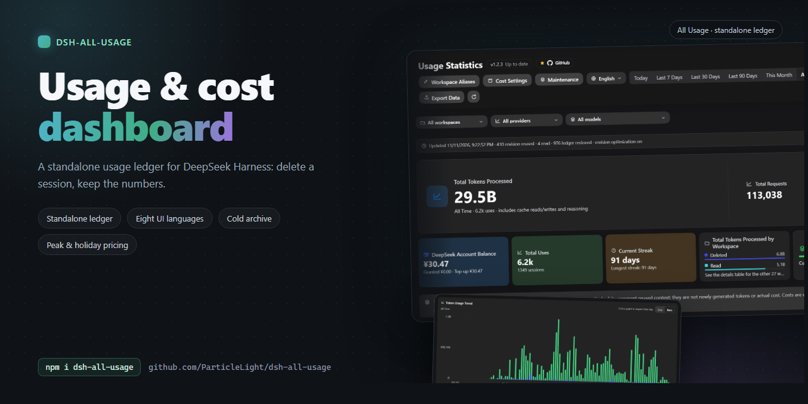

# dsh-all-usage

[中文](README.md) · [English](README.en.md) · [日本語](README.ja.md) · [Español](README.es.md) · [Français](README.fr.md) · [Deutsch](README.de.md) · [Русский](README.ru.md) · [Português](README.pt.md)

## Introdução

Um painel completo de uso para o DeepSeek Harness. Analise tokens, comportamento de cache, custo estimado, saldo da conta e atividade por modelo, provedor, workspace e intervalo de tempo.

Para usuários do DSH que precisam inspecionar uso de tokens, custos de modelos e atividade de workspaces a partir dos dados de sessões locais.

## Início rápido

~~~bash
dsh plugin --profile web add github:ParticleLight/dsh-all-usage
~~~

O comando de instalação monta o bundle. Normalmente, atualizar a página do navegador carrega o cliente; nenhuma edição manual de profile é necessária. Se a sua versão do DSH não montar dinamicamente os pacotes recém-instalados, use o recarregamento de pacotes suportado ou reinicie, depois atualize a página e abra o painel pela barra lateral do DSH.

## Recursos principais

- **Explore o uso em várias dimensões**: inspecione resumos, tendências, mapas de calor e registros de requisições paginados; combine filtros de data, workspace, provedor e modelo e, em seguida, exporte a visualização atual para CSV.
- **Entenda modelos e workspaces**: compare as visões de modelos mistos, modelos mesclados e provedores, com sequências, distribuições por workspace e detalhes diários por turno; 43 marcas já vêm incorporadas e identidades de modelo desconhecidas permanecem neutras.
- **Configure custos e saldos**: estime custos nos quatro buckets de tokens, mapeie modelos oficiais ou defina preços manuais, configure faixas de contexto e janelas de pico e consulte o saldo da conta; veja Configuração abaixo.
- **Sincronize o histórico completo de forma incremental**: varra sessões legíveis, reutilize os dados de ledger por sessão inalterados por meio de revisões persistidas, leia apenas os logs alterados e acompanhe as mudanças no registro de workspaces do DSH.
- **Audite a operação rotineira**: inspecione a saúde da varredura, as leituras, as restaurações do ledger e as falhas; alterne o idioma da interface, gerencie aliases de workspace e verifique a versão do plugin em execução.

## Tour pela interface

Estas capturas de tela foram feitas em 2026-11-11 a partir de uma instalação em execução (host 1.2.3 com o cliente 1.2.4): interfaces em chinês e inglês, tema escuro. Os dados de uso e de workspace mostrados pertencem a esse ambiente de captura.

### Visão geral do painel

O cabeçalho reúne o status de versão e as ferramentas (aliases de workspace, configurações de custo, manutenção, idioma da interface); abaixo dele ficam o intervalo de tempo (Hoje / Últimos 7 dias / Últimos 30 dias / Últimos 90 dias / Este mês / Todo o período / Personalizado) e os filtros de workspace, provedor e modelo. O cartão principal mostra o total de tokens, a contagem de requisições e o custo estimado do intervalo, seguidos do saldo da conta, do total de usos, da sequência atual, da distribuição por workspace e da taxa de acerto de cache.

### Tendência de uso

Uma tendência por dia em forma de linha ou de barras; clique em um ponto de dados para ler aquele dia. Intervalos longos são reduzidos a pontos de três em três dias e depois a semanas, meses, trimestres ou anos, com limite de 180 pontos por gráfico.

Alternando para barras, os mesmos dados são lidos por dia, com o mesmo cartão flutuante e o mesmo detalhe diário.

### Mapa de calor de uso

Três intervalos — 30 dias, 90 dias e 12 meses — com os dias da semana alinhados por linha e a intensidade da cor mostrando o volume de tokens de cada dia.

### Estatísticas de modelos e de workspaces

A área de detalhes oferece registros de requisições, estatísticas de modelos e estatísticas de workspaces. As estatísticas de modelos podem mesclar por visão combinada, por modelo ou por provedor, com chamadas, entrada, acertos de cache, saída, raciocínio, total, custo e taxa de acerto por linha; as estatísticas de workspaces agregam por workspace e respeitam seus aliases.

### Registros de requisições

Cada requisição é listada da mais recente para a mais antiga com seu modelo, tokens e custo, e a visão filtrada atual é exportada para CSV; contadores de auditoria como reutilização de revisões, leituras e restaurações do ledger ficam na linha de sincronização no topo da página.

### Configurações de custo

O custo é estimado em quatro buckets de tokens: mapeamento de modelos oficiais, preços manuais, faixas de contexto e janelas de pico, além de uma consulta ao saldo da conta.

### Manutenção

Sessões que não mudam há algum tempo são consolidadas em arquivos comprimidos mensais: visualize primeiro os registros afetados, o tamanho e os meses, e só então execute; os registros arquivados permanecem legíveis e contabilizáveis.

## Stack tecnológico e arquitetura

- **Host** (entrada `lib/index.js`, montada por `lib/plugin.js`): dividida por responsabilidade em `aggregation.js` (agregação/consulta), `ledger.js` (ledger durável), `session-sync.js` (sincronização de histórico/ao vivo), `pricing-runtime.js` (precificação em runtime), `balance.js` (saldo) e `http.js` (rotas protegidas); agrega `turn/end`, o uso de `assistant/chunk` e o `assistant/message.usage` final, incorpora atualizações ao vivo de `session/event` e expõe rotas de dados por meio de `webServer`.
- **Cliente**: o código-fonte legível fica em `src/client.js`; `npm run build:client` usa a versão fixada do Terser para gerar o bundle `window.__ModuleLoader__` em `lib/client.js`, que registra a entrada “Estatísticas de uso” na barra lateral pelo slot `sidebar.footer.action`. Todas as rotas de API aceitam requisições de loopback e rejeitam um Origin cross-origin explícito; leituras de saldo e gravações de alias também exigem um token com escopo de processo gerado quando o plugin inicia (o GET de saldo tolera navegadores que omitem Origin). **As gravações são autorizadas por esse token, não por um Origin**: o shell desktop do DSH executa a UI em seu próprio esquema e encaminha requisições pelo Electron, que remove `Origin` (junto com `Host`/`Cookie`/`Sec-Fetch-*`), então exigir um Origin fazia toda gravação no desktop falhar com 403. Um `Origin` presente ainda precisa ser loopback ou o próprio esquema do shell, e `Host` ainda precisa ser loopback (proteção contra DNS rebinding).

### Histórico e fluxo de dados ao vivo

### Armazenamento e desempenho

- **Um registro por sessão**: o ledger grava cada sessão como um documento próprio (com hash estável em 32 diretórios), então uma atualização publica um único arquivo. Medido nos mesmos dados: uma única atualização passou de reescrever um shard de 13,27 MB (273 ms) para gravar um registro (mediana de 4,6 ms).
- **Uma identidade por rota**: os itens de uso referenciam a identidade da rota e sua definição de preço em vez de repeti-las, então 1059 registros encolheram de **91,3 para 74,7 MB (-18%)**
- **O snapshot paga por apenas um fuso horário**: `GET /api/all-usage?utc=0|1` retorna um único calendário (as duas cópias antes dividiam o payload pela metade), e um dia mantém o detalhe de session-id dos últimos **180 dias**, enquanto dias mais antigos mantêm contagens e agregados
- **O gráfico de tendência é limitado a 180 pontos**: passados seis meses, ele cai para três dias por ponto e se amplia para semana / mês / trimestre / ano, então o gráfico não pode crescer junto com o histórico
- **Os orçamentos estão no código**: 20 entradas de cache de consulta e 20 de registros, 5000 resoluções de preço, 512 entradas de contexto por sessão, 500 linhas de preço, 32 shards, 180 pontos de tendência e uma janela de session-id de 180 dias - protegidos por `test/perf-budgets.test.js`, então afrouxar um deles significa editar essa tabela
- **Benchmarks reproduzíveis**: `node bench/ledger.mjs` (tamanho do ledger e custo de reescrita por atualização), `node bench/ledger-layout.mjs` (os dois layouts de armazenamento, em cópias de shards reais) `node bench/endpoints.mjs` (latência mediana e payload de cinco endpoints de leitura) e `node scripts/dead-code.mjs` (exports que nada referencia, helpers de cliente que ninguém chama, classes de folha de estilo que nenhuma marcação consegue renderizar)

## Instalação

Este é um pacote de plugin da comunidade DSH padrão, com um manifesto `dsh.bundle` e Web Client. Ele lê logs de sessão persistidos e um ledger de uso separado e, na ativação, preenche o histórico.

### Compatibilidade e limitações conhecidas

- **Runtime**: Node.js `>=22 <25` é obrigatório. O CI executa a suíte de testes, verificações de sintaxe e verificações de conteúdo do pacote no Node 22 e no Node 24.
- **Compatibilidade com DSH**: o `package.json` declara o runtime DSH `>=0.1.1-rc.1 <0.1.5-0 || >=0.1.5-rc.1 <0.1.6-0 || >=0.1.7-rc.2 <0.1.8-0 || >=0.2.0-rc.2 <0.2.1-0 || 0.2.1-alpha.2 || 0.2.1-rc.1 || 0.2.1-rc.2 || 0.2.2-alpha.3 || 0.2.2-rc.1`; a cadeia real de serviços Cordis é verificada localmente em `0.2.1-rc.1` e `0.2.1-rc.2` (smoke estrito no Node 24; ambas promovem o Cordis ao pareamento estável 4.0.5 / loader 1.0.6 / timer 1.1.7), `0.2.1-alpha.2`, `0.2.0-rc.2`, `0.1.7-rc.2`, `0.1.5-rc.2`, `0.1.5-rc.1`, `0.1.1-rc.2` e `0.1.1-rc.1`. Todo runtime declarado está na matriz de smoke do CI no Node 22 e 24, mas as duas linhas `0.2.1` são reportadas como SKIPPED — não aprovadas — porque o upstream nunca publicou a versão correspondente de `@deepseek-ai/dsh-invariants`. `0.1.2-rc.1` também foi verificada como compatível pelo uso real, mas não é coberta pela matriz de smoke do CI. A declaração é dividida por tupla em vez de escrita como um único intervalo porque o node-semver só admite uma versão de pré-lançamento quando algum comparador compartilha sua tupla exata `major.minor.patch` e ele mesmo carrega uma tag de pré-lançamento — `0.2.0-rc.2` só é admitida porque o intervalo diz `>=0.2.0-rc.2`.
- **Cliente desktop (Electron, Windows)**: o plugin é verificado em execução no cliente desktop do DSH (`@deepseek-ai/dsh-desktop` `0.1.7-rc.2` conforme medido). O cliente desktop mantém uma faixa de título de 40px no topo da janela para seus próprios botões de minimizar / maximizar / fechar e marca o documento com `data-windows-titlebar` e `--dsh-windows-titlebar-height`; o painel desenha **abaixo** dessa faixa, então o botão de fechar do próprio cliente nunca é coberto. Navegadores não carregam esse marcador e não reservam nada. A altura da faixa vem primeiro da declaração do host, depois do retângulo do Window Controls Overlay e por último do user agent; para ajustá-la, execute `localStorage.setItem('dsh-all-usage:topInset', '48')` no DevTools e recarregue (`0` não reserva nada) — nenhuma recompilação é necessária. O cliente desktop traz seu próprio runtime; a versão medida nele, `0.1.7-rc.2`, faz parte do intervalo declarado e da matriz de smoke do CI abaixo.
- **Dependência do serviço Web**: o Host declara `webServer` como dependência obrigatória, então o DSH espera por um serviço montado tardiamente antes de aplicar o plugin; este pacote tem como alvo o profile Web do DSH e não expõe rotas sem WebServer. A proteção HTTP também confere o peer real do socket, então um proxy reverso só é aceito quando a conexão em si é loopback.
- **Idioma da interface**: na primeira entrada, o painel segue a configuração **Language** do DSH (`Settings → General → Language`, lida pelo serviço `locale` do host); sem esse serviço, ele recorre ao idioma do navegador e depois ao inglês. Depois que um idioma é escolhido dentro do painel, a escolha do painel prevalece e a configuração do host deixa de sobrepor. As datas e o calendário seguem sempre o fuso horário deste computador — o que executa o DSH —, então o idioma nunca move o limite do dia e alterná-lo não rebusca outro calendário.

| Runtime do DSH | Suporte a Node.js | Smoke real do Cordis | Conclusão |
| --- | --- | --- | --- |
| `0.2.2-rc.1` | `>=22 <25` | Aprovado (smoke real e estrito do Cordis verificado localmente no Node 24; Cordis estável 4.1.0 / loader 1.1.0 / timer 1.2.0) | Declarado e verificado (somente esta rc exata; o CI reporta SKIPPED porque o upstream nunca publicou `dsh-invariants@0.2.2-rc.1`) |
| `0.2.2-alpha.3` | `>=22 <25` | Aprovado (smoke real e estrito do Cordis verificado localmente no Node 24; Cordis de pré-lançamento 4.0.6-alpha.2 / loader 1.0.7-alpha.2 / timer 1.1.8-alpha.2) | Declarado e verificado (somente este alpha.3 exato; nenhuma outra versão alpha está implícita; o CI reporta SKIPPED porque o upstream nunca publicou `dsh-invariants@0.2.2-alpha.3`) |
| `0.2.1-rc.2` | `>=22 <25` | Aprovado (smoke real e estrito do Cordis verificado localmente no Node 24; Cordis estável 4.0.5 / loader 1.0.6 / timer 1.1.7) | Declarado e verificado (somente esta rc exata; o CI reporta SKIPPED porque o upstream nunca publicou `dsh-invariants@0.2.1-rc.2`) |
| `0.2.1-rc.1` | `>=22 <25` | Aprovado (smoke real e estrito do Cordis verificado localmente no Node 24; Cordis estável 4.0.5 / loader 1.0.6 / timer 1.1.7) | Declarado e verificado (somente esta rc exata; nenhuma outra versão rc está implícita; o CI reporta SKIPPED porque o upstream nunca publicou `dsh-invariants@0.2.1-rc.1`) |
| `0.2.1-alpha.2` | `>=22 <25` | Aprovado (smoke real e estrito do Cordis verificado localmente no Node 24; o CI reporta SKIPPED porque o upstream nunca publicou `dsh-invariants@0.2.1-alpha.2`) | Declarado e verificado (somente este alpha.2 exato; nenhuma outra versão alpha está implícita) |
| `0.2.0-rc.2` | `>=22 <25`, o CI cobre 22/24 | Aprovado (cadeia real de serviços Cordis, o CI cobre Node 22/24) | Declarado e verificado (verificado historicamente; o CI cobre Node 22/24) |
| `0.1.7-rc.2` | `>=22 <25`, o CI cobre 22/24 | Aprovado (cadeia real de serviços Cordis, o CI cobre Node 22/24) | Declarado e verificado (verificado historicamente; o CI cobre Node 22/24) |
| `0.1.5-rc.2` | `>=22 <25`, o CI cobre 22/24 | Aprovado (cadeia real de serviços Cordis, o CI cobre Node 22/24) | Declarado e verificado |
| `0.1.5-rc.1` | `>=22 <25`, o CI cobre 22/24 | Aprovado (cadeia real de serviços Cordis, o CI cobre Node 22/24) | Declarado e verificado |
| `0.1.2-rc.1` | `>=22 <25` | Aprovado pelo uso real (fora do CI) | Compatibilidade verificada no uso real |
| `0.1.1-rc.2` | `>=22 <25`, o CI cobre 22/24 | Aprovado (cadeia real de serviços Cordis, o CI cobre Node 22/24) | Declarado e verificado |
| `0.1.1-rc.1` | `>=22 <25`, o CI cobre 22/24 | Aprovado (cadeia real de serviços Cordis, o CI cobre Node 22/24) | Declarado e verificado |
| Outras versões | `>=22 <25` | Não testado | Fora da matriz verificada |

Uma versão do DSH não listada não é necessariamente incompatível. Inclua as versões do DSH, do Node.js e do plugin ao relatar um problema.

- **Requisições interrompidas**: uma requisição upstream interrompida pode emitir apenas o uso de `assistant/chunk` e nunca produzir um `assistant/message` final; esse chunk é retido. Uma mensagem final posterior do mesmo turn/step a substitui. Se o upstream não emitir nenhum evento de uso, o uso exato de tokens não pode ser reconstruído a partir do texto da resposta.
- **Custo estimado**: o custo é uma estimativa baseada nas tarifas do models.dev e nos buckets de uso do DSH, não em uma fatura do provedor. Catálogos indisponíveis e modelos não correspondidos permanecem sem preço em vez de receber tarifas estimadas. Leituras de cache, gravações de cache e raciocínio seguem os buckets reportados pelo evento DSH upstream.
- **Preços por faixa**: entradas com faixas de contexto do models.dev selecionam a tarifa aplicável a partir do contexto de entrada da requisição (entrada fresca mais tokens de leitura/gravação de cache); cronogramas malformados permanecem sem suporte.
- **Fronteira de workspace**: apenas sessões cujo cwd mapeia para um workspace registrado no DSH são incluídas. Cwds não registrados, incluindo diretórios existentes ausentes do registro, são ignorados. O registro é mantido atualizado por uma sonda `domain/changed`: qualquer gravação durável no domínio de workspace dispara uma releitura, e apenas workspaces adicionados/removidos são reprocessados de forma incremental — workspaces inalterados reutilizam seus agregados calculados e o ledger. Dados excluídos ou corrompidos antes de um flush de sessão bem-sucedido não podem ser recuperados a partir do ledger separado.

### Registro local manual

1. Coloque este diretório em qualquer lugar e crie um symlink para ele em $DSH_HOME/profiles/node_modules/ (use uma junction no Windows):

   ~~~powershell
   New-Item -ItemType Junction -Path (Join-Path $env:DSH_HOME 'profiles/node_modules/dsh-all-usage') -Target '<absolute plugin path>'
   ~~~

2. Adicione esta entrada a $DSH_HOME/profiles/web/cordis.patch.yml:

   ~~~yaml
   - insert:
       - id: all-usage
         name: dsh-all-usage
   ~~~

A camada de patch do profile recarrega a quente; salve o arquivo e atualize a página.

## Exemplos de uso

### Cenários comuns

- Escolha hoje, os últimos 7/30/90 dias, todo o histórico ou um intervalo de datas personalizado. Combine filtros de workspace, provedor e modelo, use tendências e mapas de calor para encontrar mudanças, inspecione linhas de requisição individuais e exporte CSV.
- Para revisar estimativas de custo, confira primeiro os mapeamentos de modelos e o status dos preços, depois inspecione os buckets de entrada, saída, leitura de cache e gravação de cache. Preços não correspondidos ou não verificáveis são exibidos como sem preço.
- Para requisições com falha ou incompletas, use os exemplos de eventos desidentificados abaixo. Um registro local significa que o DSH observou uso; ele não prova que o provedor cobrou pela requisição.

### Estatísticas locais vs. cobrança oficial

Este plugin reporta estatísticas reproduzíveis a partir dos logs de eventos locais do DSH; ele não é um espelho da fatura de um provedor:

- As estatísticas locais leem `assistant/chunk`, o `assistant/message` final e eventos de sessão relacionados do DSH, e então deduplicam e substituem amostras por `turn / step` lógico. A cobrança oficial pode usar o tokenizador do provedor, regras de arredondamento, descontos, cotas gratuitas e períodos de cobrança.
- Uma requisição com falha é incluída localmente sempre que deixa um chunk de uso; se o provedor cobrou por essa requisição com falha precisa ser conferido na fatura oficial.
- Os preços vêm do catálogo público do models.dev e de substituições explícitas locais. Os preços do catálogo podem diferir dos preços do provedor, das tarifas regionais e dos descontos da fatura, então o campo de custo é uma estimativa. Um preço pertence ao modelo, então toda linha precificada a partir do mesmo modelo oficial compartilha uma única entrada manual; edições de preço nunca reescrevem custos positivos existentes, enquanto uma mudança de plano de pico reconcilia o histórico desse modelo com a nova política.
- As estatísticas locais incluem apenas workspaces registrados; linhas antigas do ledger para cwds não registrados são excluídas. O uso registrado para um **workspace excluído** é mantido e somado em uma única linha “Excluído”, então remover um workspace nunca reduz os totais históricos. Os totais ainda podem ficar abaixo da fatura oficial quando os logs são danificados, limpos ou o upstream não emite nenhum evento de uso.

### Exemplos de eventos reproduzíveis

Os exemplos a seguir são mínimos e desidentificados; os dados completos e executáveis estão em [`fixtures/usage-events.json`](fixtures/usage-events.json).

#### Retendo um chunk de requisição com falha

~~~json
[
  {"type": "assistant/chunk", "data": {"turn": 1, "step": 1, "chunk": {"type": "usage", "usage": {"inputTokens": 100, "outputTokens": 20}}}},
  {"type": "request/error", "data": {"code": "upstream-failed"}}
]
~~~

Sem um `assistant/message` final, o chunk permanece como uma chamada local; isso não significa que o provedor necessariamente cobrou por ela.

#### Chunk de uso órfão

~~~json
{"type": "assistant/chunk", "data": {"turn": 1, "step": 1, "chunk": {"type": "usage", "usage": {"inputTokens": 7, "cacheReadTokens": 8}}}}
~~~

Sem request/context ou request/header, os tokens ainda são contados, mas a identidade do modelo aparece como “Desconhecido”; o plugin não adivinha um modelo a partir do nome do provedor ou de uma string de exibição.

#### Buckets de tokens de cache

~~~json
{"inputTokens": 100, "outputTokens": 20, "cacheReadTokens": 40, "cacheWriteTokens": 5, "reasoningTokens": 3}
~~~

O total processado local é `100 + 20 + 40 + 5 + 3 = 168`; o custo usa os buckets de input, output, cacheRead e cacheWrite, e o raciocínio não é somado ao output novamente.

Reproduza o fixture do repositório:

~~~bash
node scripts/replay-fixture.mjs fixtures/usage-events.json
~~~

O comando carrega o Host real do plugin, chama suas APIs compatíveis, confere os totais documentados de tokens/registros e imprime um resumo sem dados sensíveis.

### Semântica dos dados, privacidade e limites

- Chamadas e tokens vêm dos logs de sessão do DSH; `session/flush` só reconstrói e enfileira o ledger derivado quando há eventos relacionados sujos, coalescendo o registro pendente mais recente por sessão e drenando ao descartar o plugin. Logs legíveis e o histórico do ledger são preenchidos quando o plugin ativa, então dados persistidos com sucesso sobrevivem a recarregamentos ou à exclusão da sessão; excluir um workspace também mantém seu histórico, somado em uma única linha “Excluído” junto com o uso que ainda não havia chegado ao ledger
- Os dados de intervalo em nível de dia retêm todas as datas de sessões históricas legíveis com uso rastreado; o mapa de calor é uma visão de intervalo alternável (últimos 30 dias / 90 dias / 12 meses, 12 meses por padrão), não uma visão fixa das últimas 53 semanas
- Depois que uma sessão é excluída, o uso gravado com sucesso é restaurado a partir do ledger separado; dicas de descarte e a reconciliação periódica acionam reconstruções sem excluir linhas do ledger
- Para cada sessão e `turn / step` lógico, apenas a contribuição final de uso é mantida; novas tentativas ou mensagens substituídas não contam em dobro
- Os tokens de entrada são frescos (excluem acertos/gravações de cache, que ficam em buckets próprios); reproduções de uso totalmente zerado não sobrescrevem o uso registrado, e requisições de leitura pura de cache ainda contam
- A verificação de versão é um único GET somente-leitura para `registry.npmjs.org` (apenas o número de versão do `dsh-all-usage`: sem corpo, sem cookies; emitido pelo host e armazenado em cache por 6 horas, a página em si nunca acessa a rede), e uma verificação malsucedida degrada para “desconhecida” em vez de adivinhar
- O endpoint leve de status expõe a instância do Host, a revisão de estatísticas, o progresso da varredura, os contadores de sincronização, os contadores de residência `memory`, `counters` (contagens de operações de diagnóstico), `accounting` (consistência do agregado de hoje) e `mismatch` (a primeira amostra de inconsistência de delta de bucket, ou null), além do último relatório de ambiente do cliente (user agent, viewport, faixa reservada e sua origem, retângulos do painel — reportados por um cliente local e mantidos apenas em memória). A amostra de mismatch carrega a chave de uso interna e o ID do workspace (uma chave de uso é derivada do ID da sessão e pode apontar para uma sessão); o endpoint nunca carrega prompts, corpos de resposta, caminhos de workspace ou credenciais; snapshots completos são buscados apenas após mudanças de status ou uma atualização manual
- Resultados com escopo mantêm turnos, chamadas de modelo e sessões distintas como métricas separadas; a identidade de rota ausente aparece explicitamente como “Desconhecido” em vez de ser inferida de um rótulo de exibição
- O endpoint de registros retorna apenas um hash curto, hora, ID do workspace, identidade estruturada do modelo, turn/step, buckets de tokens e a fonte de materialização atual. Ele omite IDs de sessão brutos, caminhos, prompts, respostas e credenciais
- Tokens processados = entrada + saída + leitura/gravação de cache + raciocínio; um acerto de cache significa contexto reutilizado, não tokens recém-gerados nem custo real
- O custo segue a fórmula de quatro buckets do cc-switch: tokens de input, output, cache-read e cache-write são precificados de forma independente, somados e então multiplicados pelo multiplicador final; quando o contexto de entrada é estritamente maior que um limite de faixa de contexto, todas as quatro tarifas mudam para a requisição inteira em vez de dividir em faixas progressivas, e o reasoning do DSH não é somado ao output uma segunda vez
- A precificação por horário compara dias da semana em UTC com janelas semiabertas: uma requisição correspondente usa as tarifas de pico da regra, qualquer outra usa as tarifas base da linha (fora de pico = base); uso anterior ao instante de vigência de um plano não tem faixa verificável e, por segurança, fica sem preço em vez de herdar as tarifas de hoje, e um plano é compartilhado por toda linha precificada a partir da mesma entrada (para o DeepSeek o plano embutido traz a lista oficial de feriados do Conselho de Estado, atualizada junto com as versões do plugin); com a opção de feriados ativada, um feriado legal nunca corresponde a uma janela de pico e o snapshot de custo registra pricingHoliday, então os registros mostram “feriado fora de pico” em vez de uma faixa fora de pico comum. A tabela embutida do DeepSeek já traz o arranjo de 2026 (atualizado junto com as versões do plugin), então linhas DeepSeek próprias ou mapeadas precificam feriados como fora de pico sem configuração; rotas de revendedores permanecem estáticas até serem mapeadas para a entrada oficial
- Custos de ledger legados que carregam `tiered` são migrados para `unsupported` (`tiered-pricing-not-modeled`) no carregamento em vez de permanecerem falsamente marcados como estimativas atuais de preço fixo; as estatísticas de tokens não mudam.
- A sincronização de preços fica desativada por padrão; quando o models.dev está indisponível, o último catálogo bom continua em uso, e modelos não correspondidos nunca recebem um preço padrão estimado; as caixas de preço em Configurações de custo são o ponto de entrada de preço manual (compartilhado por toda linha precificada a partir do mesmo modelo oficial), cada linha se expande em faixas de contexto e regras de pico em UTC (incluindo a precificação opcional de fora de pico o dia inteiro em feriados legais chineses), e a tabela embutida do DeepSeek pode ser copiada para personalização ou restaurada; as preferências de intervalo e de visão de detalhe do painel são armazenadas no armazenamento do navegador, enquanto o botão de sincronização de 6 horas é salvo imediatamente pela API de preços protegida
- Semântica de mapeamento: um mapeamento com `identityKey` se aplica apenas àquela identidade exata de rota; um mapeamento sem chave de identidade é o fallback para todo o modelo. Valores legados de `usageIdentityKey` são normalizados no carregamento.
- O calendário de feriados é buscado apenas quando o usuário clica em “Carregar do calendário público”: a requisição vai para `cdn.jsdelivr.net` (com fallback para `raw.githubusercontent.com`), não carrega nada além do ano e **nunca inclui dados de uso, de sessão ou de credenciais**; as datas retornadas permanecem inertes até serem salvas, e salvar as congela junto com sua nota de origem no plano de pico daquele modelo (a origem é excluída do hash da política)
- Os dados de saldo vêm do endpoint oficial `/user/balance` da DeepSeek; o cartão mostra orientação quando nenhuma chave de API está configurada
- Os buckets de data, os filtros de intervalo, as sequências, as datas do mapa de calor e os timestamps de exportação usam o fuso horário deste computador em todos os idiomas da interface; o CSV informa o fuso e o limite de dia aplicados
- O ledger atribui cada ID de sessão a um entre 32 diretórios de hash estável e mantém **um documento de registro por sessão**, então um flush publica esse único arquivo em vez de reescrever um shard; os arquivos antigos de unidade inteira (incluindo o `all_usage_ledger.json` original) são removidos quando a árvore de registros comprovadamente contém os dados, e `DSH_ALL_USAGE_KEEP_LEGACY=1` os mantém. Uma falha de gravação assíncrona ou um desligamento sem flush não perde as estatísticas em memória; a próxima inicialização simplesmente varre aquela sessão novamente
- Apenas sessões que podem ser mapeadas para um workspace registrado por seu diretório de trabalho são incluídas

## Configuração

| Configuração | Onde | Descrição |
| --- | --- | --- |
| Preços e regras de modelos | Painel “Configurações de custo” | A sincronização com o models.dev fica desativada por padrão; mapeie modelos oficiais, defina preços manuais, configure faixas de contexto, janelas de pico em UTC e regras de fora de pico para feriados legais chineses. Veja Semântica dos dados para fórmulas e fronteiras. |
| Aliases de workspace | Barra lateral do DSH; unidade KV `all_usage_aliases` em `$DSH_HOME/storages` | Substitui nomes de workspace na exibição. |
| Preferências de intervalo e de detalhe | Armazenamento local do navegador | O intervalo do painel e a visão de detalhe selecionados são salvos localmente. |
| Inset superior do Electron | Chave `dsh-all-usage:topInset` do `localStorage` do navegador | Defina um valor em pixels para ajustar a faixa reservada; `0` a desativa. Atualize para aplicar. |
| Manter shards do ledger legado | Variável de ambiente do Host `DSH_ALL_USAGE_KEEP_LEGACY=1` | Arquivos legados de shard inteiro são removidos depois que a árvore de registros por sessão é confirmada; defina como `1` para mantê-los. |
| Orçamento de linhas de uso residentes | Variável de ambiente do Host `DSH_ALL_USAGE_RESIDENT_ROWS` | Linhas, padrão 12000; um valor finito é arredondado para baixo (Math.floor). Um valor negativo mantém toda linha de detalhe residente; `0` devolve toda linha removível assim que uma varredura termina; um valor não numérico recai no padrão. Este é um orçamento flexível: linhas cujo preço não está definido e linhas de uma sessão que está sendo gravada, lida, ressincronizada ou pré-carregada nunca são devolvidas. |
| Limite do cache de registros de sessão | Variável de ambiente do Host `DSH_ALL_USAGE_RECORD_CACHE_MB` | MiB, padrão 16. Apenas um valor finito ≥ 0 é aceito; um valor negativo ou não numérico recai em 16. `0` remove apenas registros limpos removíveis até o mais recente, então registros protegidos podem empurrar a residência real acima do orçamento. Este é um orçamento flexível: um registro sujo, pendente, em gravação, ressincronizando, pré-carregando ou em leitura nunca é removido, e um armazenamento de ledger que não consegue reler um registro mantém todos os registros residentes. A residência é estimada a partir da contagem de linhas de uso (não é uma alocação medida); veja `recordCacheMB` no status. |

## API e CLI

### CLI

O plugin não tem uma CLI de runtime separada. O comando oficial de instalação está em Início rápido; os comandos de desenvolvimento e de teste estão listados abaixo.

### HTTP API

- `GET /api/all-usage` — snapshot de uso compatível
- `GET /api/all-usage/status` — revisão leve e saúde da sincronização, além do último relatório de ambiente do cliente (`clientEnv`), da versão do plugin em execução (`pluginVersion`) e de um id derivado da capacidade de gravação (`capabilityId`, que muda quando a capacidade gira para que a página perceba um recarregamento do plugin; a capacidade em si só é enviada no snapshot completo), e dos contadores de residência `memory`: `residentRows` (linhas de detalhe de uso residentes), `residentRecords` (registros de sessão residentes), `recordCacheMB` (tamanho do cache de registros de sessão em MiB com uma casa decimal; uma estimativa derivada da contagem de linhas de uso, não uma alocação medida), `sessions` (agregados de sessão), `recordsCache` (estatísticas do cache de consulta de registros) e `heapUsedMB` / `rssMB` (ambos pertencem ao processo Host inteiro, não apenas ao plugin). A mesma resposta carrega `counters` (contagens de operações de diagnóstico), `accounting` (consistência do agregado de hoje) e `mismatch` (a primeira amostra de inconsistência de delta de bucket, ou null)
- `GET /api/all-usage/query` — agregado com escopo, tendência diária/horária e dados de mapa de calor; escopos de um único dia preenchem `hourly`, enquanto escopos de vários dias retornam um array `hourly` vazio
- `GET /api/all-usage/records` — linhas de uso canônicas paginadas e seguras para privacidade
- `POST /api/all-usage/archive` — consolida registros de sessão mais antigos que `days` dias (padrão 90, um inteiro entre 1 e 3650) em `<root>/archive/<YYYY-MM>.jsonl.gz` e depois remove os documentos de sua árvore assim que os arquivos mensais estão duráveis; o padrão é apenas um plano (`dryRun: true`) e somente um `dryRun: false` explícito grava; ele usa o mesmo lock de manutenção que a migração e a CLI, responde `{ ok, months, archived, bytes, compressed, dryRun, errors }` e 409 quando o lock está retido. Exige a mesma capacidade de gravação local que salvar preços
- `GET /api/all-usage/icon?key=<brand key>` — serve uma marca sob demanda (SVG com cache longo e um ETag); o bundle do cliente carrega apenas os metadados de resolução, então adicionar uma marca não o aumenta mais
- `GET /api/all-usage/version?force=1` — verificação de versão: a versão em execução, a versão publicada mais recente, o veredito (`latest` / `outdated` / `unknown`), quando foi verificada e de onde veio; armazenada em cache no host por 6 horas, com no máximo uma requisição upstream a cada 30 segundos por processo (o piso também se aplica a `force=1`), `force=1` vem do botão de atualização
- `GET /api/all-usage/balance?force=1` — saldo da conta usando a chave de API `llm-deepseek` configurada
- `POST /api/all-usage/alias` — atualiza aliases de workspace
- `GET /api/all-usage/pricing` — lê a tabela de preços editável completa: tarifas efetivas e status por linha, mapeamentos, preços manuais, planos de pico (com sua origem embutida/explícita e regras completas) e linhas que existem apenas na configuração
- `GET /api/all-usage/pricing/models?q=...` — pesquisa IDs e nomes de exibição de modelos oficiais, incluindo tarifas de prévia, sinalizadores de preço por faixa e se existe uma tabela de pico embutida
- `POST /api/all-usage/pricing` — salva sincronização, mapeamentos, preços manuais, faixas de tarifa por contexto e regras de janela de pico (formato da requisição inalterado)
- `POST /api/all-usage/pricing/sync` — sincroniza o models.dev e preenche chamadas sem preço
- `POST /api/all-usage/pricing/holidays` — busca um ano do arranjo de feriados chineses (o conjunto de dados holiday-cn, jsDelivr primeiro com fallback para o raw do GitHub, armazenado em cache no lado do host por 24 horas) e retorna apenas a lista de dias não úteis mais sua origem; **nada é gravado na configuração** — o cliente congela as datas em um plano de pico
- `GET /api/all-usage/client-env` — relatório de ambiente do cliente (user agent, altura do window-controls overlay, a faixa reservada **e sua origem**, viewport, retângulos do painel); o cliente o reporta no carregamento e sempre que o painel é aberto, mantido apenas em memória

## Desenvolvimento e testes

- Depois de editar `src/client.js`, execute `npm run build:client`, recarregue o módulo cliente do DSH e atualize a página; `lib/client.js` é gerado e não deve ser editado diretamente. Depois de editar `lib/plugin.js` ou outro módulo do Host, recarregue o pacote pelo DSH ou reinicie o processo
- O plugin não tem dependências de runtime de terceiros: o Host usa serviços Cordis e o Cliente usa o módulo React fornecido pelo runtime; o Terser fixado é apenas uma dependência de desenvolvimento para gerar o artefato do navegador
- Publicações manuais de recuperação via npm exigem uma tag de destino `v<package.version>` e o SHA completo do commit; o GitHub Actions confere ambos contra a tag verificada e a versão do pacote. Eventos de release fazem a mesma verificação de commit.

### Verificações locais

~~~bash
npm test
npm run fixture:check
npm run build:client
npm run check:pack
~~~

## Status e atualizações

A versão publicada mais recente é `v1.2.3` ([GitHub Release](https://github.com/ParticleLight/dsh-all-usage/releases/tag/v1.2.3) | npm: `npm i dsh-all-usage@1.2.3`). Veja [CHANGELOG.md](CHANGELOG.md) para o histórico completo de desenvolvimento e versões.

### Última publicação: v1.2.3

- **Quatro correções de exibição**: a barra mais à esquerda não cobre mais as marcas do eixo de valores, os rótulos dos dias da semana no mapa de calor voltam a alinhar com suas linhas, os cartões de hover não são mais cortados pelo painel, e gráficos e calendário continuam legíveis no tema claro.
- **O painel virou um cartão flutuante de cantos arredondados**: cantos de 24 px e margem nos quatro lados, então janelas estreitas não voltam mais aos cantos retos.
- **A barra de título é um cartão arredondado próprio**: a borda inferior virou uma sombra suave, e ela permanece sob a alça de arraste durante a rolagem.

Veja [CHANGELOG.md](CHANGELOG.md) para o histórico completo de versões.

## Contribuição e contato

Use os templates abaixo para relatar bugs. Para perguntas gerais ou discussão de recursos, visite o [repositório do projeto](https://github.com/ParticleLight/dsh-all-usage). Pull requests são bem-vindos; relatos de bug devem incluir as versões do DSH, do Node.js e do plugin.

- [Inconsistência de dados](.github/ISSUE_TEMPLATE/data-inconsistency.md)
- [Falha de inicialização do plugin](.github/ISSUE_TEMPLATE/startup-failure.md)
- [Problema no cálculo de custo](.github/ISSUE_TEMPLATE/cost-calculation.md)

## Licença

MIT
