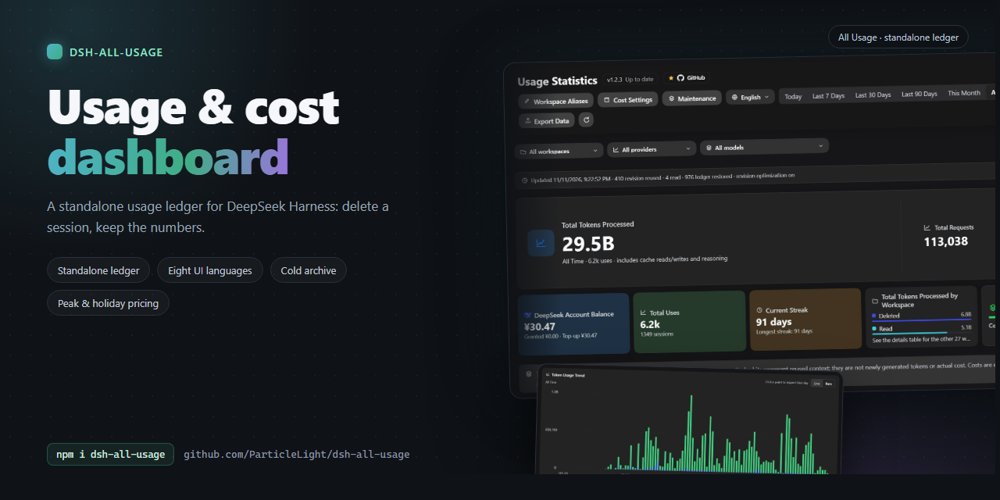

# dsh-all-usage

[中文](README.md) · [English](README.en.md) · [日本語](README.ja.md) · [Español](README.es.md) · [Français](README.fr.md) · [Deutsch](README.de.md) · [Русский](README.ru.md) · [Português](README.pt.md)

## Введение

Полноценная панель статистики использования для DeepSeek Harness. Анализируйте токены, поведение кеша, оценочную стоимость, баланс аккаунта и активность по моделям, провайдерам, рабочим пространствам и диапазонам времени.

Для пользователей DSH, которым нужно изучать расход токенов, стоимость моделей и активность рабочих пространств по локальным данным сессий.

## Быстрый старт

~~~bash
dsh plugin --profile web add github:ParticleLight/dsh-all-usage
~~~

Команда установки собирает пакет. Обычно достаточно обновить страницу в браузере, чтобы клиент загрузился; вручную править профиль не требуется. Если ваша версия DSH не собирает динамически только что установленные пакеты, перезагрузите пакеты поддерживаемым в вашей версии способом или перезапустите DSH, затем обновите страницу и откройте панель из боковой панели DSH.

## Основные возможности

- **Анализ использования по разным срезам**: сводки, тренды, тепловые карты и постраничные журналы запросов; сочетайте фильтры по дате, рабочему пространству, провайдеру и модели, а затем экспортируйте текущий вид в CSV.
- **Понимание моделей и рабочих пространств**: сравнивайте смешанный, объединённый и провайдерский виды, с сериями дней, распределением по рабочим пространствам и детализацией по дням; 43 фирменных значка встроены, а неизвестные идентичности моделей остаются нейтральными.
- **Настройка стоимости и баланса**: оценка стоимости по четырём корзинам токенов, сопоставление официальных моделей или ручные цены, настройка уровней контекста и пиковых окон, а также запрос баланса аккаунта; см. раздел «Настройка» ниже.
- **Инкрементальная синхронизация всей истории**: сканирование доступных сессий, повторное использование неизменённых данных журнала по сессиям с помощью сохранённых ревизий, чтение только изменённых логов и отслеживание изменений реестра рабочих пространств DSH.
- **Аудит повседневной работы**: состояние сканирования, чтения, восстановления журнала и ошибки; переключение языка интерфейса, управление псевдонимами рабочих пространств и проверка версии запущенного плагина.

## Обзор интерфейса

Эти скриншоты сделаны 2026-11-11 на работающей установке (хост 1.2.3 с клиентом 1.2.4): китайский и английский интерфейсы, тёмная тема. Показанные данные об использовании и рабочих пространствах относятся к той среде, где делались снимки.

### Обзор панели

В шапке — статус версии и инструменты (псевдонимы рабочих пространств, настройки стоимости, обслуживание, язык интерфейса); ниже — диапазон времени (Сегодня / Последние 7 дней / Последние 30 дней / Последние 90 дней / Этот месяц / Всё время / Свой диапазон) и фильтры по рабочему пространству, провайдеру и модели. Главная карточка показывает сумму токенов, число запросов и оценочную стоимость за выбранный диапазон, а за ней следуют баланс аккаунта, общее число обращений, текущая серия, распределение по рабочим пространствам и доля попаданий в кеш.

### Динамика использования

Тренд по дням в виде линии или столбцов; щёлкните по точке данных, чтобы прочитать этот день. Длинные диапазоны прореживаются до трёхдневных точек, а затем до недель, месяцев, кварталов или лет — не более 180 точек на график.

В режиме столбцов те же данные читаются по дням, с той же карточкой при наведении и детализацией дня.

### Тепловая карта использования

Три диапазона — 30 дней, 90 дней и 12 месяцев — дни недели выровнены по строкам, а насыщенность цвета показывает объём токенов за каждый день.

### Статистика моделей и рабочих пространств

В области детализации доступны журналы запросов, статистика моделей и статистика рабочих пространств. Статистику моделей можно сводить по объединённому виду, по модели или по провайдеру; в каждой строке — вызовы, вход, попадания в кеш, выход, рассуждения, итог, стоимость и доля попаданий. Статистика рабочих пространств агрегируется по каждому пространству и учитывает ваши псевдонимы.

### Журналы запросов

Запросы перечислены от новых к старым с указанием модели, токенов и стоимости, а текущий отфильтрованный вид экспортируется в CSV; счётчики аудита — повторное использование ревизий, чтения и восстановления журнала — находятся в строке синхронизации в верхней части страницы.

### Настройки стоимости

Стоимость оценивается по четырём корзинам токенов: сопоставление официальных моделей, ручные цены, уровни контекста и пиковые окна, плюс запрос баланса аккаунта.

### Обслуживание

Сессии, которые давно не менялись, свёртываются в месячные сжатые файлы: сначала просмотрите затронутые записи, размер и месяцы, и только потом запускайте; архивные записи остаются читаемыми и учитываемыми.

## Технологический стек и архитектура

- **Хост** (точка входа `lib/index.js`, сборка через `lib/plugin.js`): разделён по ответственности между `aggregation.js` (агрегация и запросы), `ledger.js` (долговременный журнал), `session-sync.js` (синхронизация истории и живых данных), `pricing-runtime.js` (цены во время выполнения), `balance.js` (баланс) и `http.js` (защищённые маршруты); агрегирует использование из `turn/end`, `assistant/chunk` и финального `assistant/message.usage`, подхватывает живые обновления `session/event` и публикует маршруты данных через `webServer`.
- **Клиент**: читаемый исходный код лежит в `src/client.js`; `npm run build:client` с закреплённой версией Terser генерирует бандл `window.__ModuleLoader__` в `lib/client.js`, который регистрирует пункт боковой панели «Статистика использования» через слот `sidebar.footer.action`. Все маршруты API принимают запросы с loopback и отклоняют явный межсайтовый Origin; чтение баланса и запись псевдонимов дополнительно требуют токен уровня процесса, создаваемый при старте плагина (GET баланса допускает отсутствие Origin в браузерах). **Запись авторизуется этим токеном, а не Origin**: настольная оболочка DSH запускает интерфейс на собственной схеме и пересылает запросы через Electron, который вырезает `Origin` (вместе с `Host`/`Cookie`/`Sec-Fetch-*`), поэтому требование Origin ломало каждое сохранение в настольном клиенте с ошибкой 403. Присутствующий `Origin` всё равно должен быть loopback или собственной схемой оболочки, а `Host` по-прежнему должен быть loopback (защита от DNS-rebinding).

### История и поток живых данных

### Хранение и производительность

- **Одна запись на сессию**: журнал пишет каждую сессию отдельным документом (стабильный хеш разносит их по 32 каталогам), поэтому обновление публикует один файл. Измерено на одних и тех же данных: одно обновление прошло путь от перезаписи шарда объёмом 13.27 MB (273 мс) до записи одного документа (медиана 4.6 мс).
- **Одна идентичность на маршрут**: элементы использования ссылаются на идентичность маршрута и её определение цены вместо их повторения, поэтому 1059 записей сжались с **91.3 до 74.7 MB (-18%)**
- **Снимок платит только за один часовой пояс**: `GET /api/all-usage?utc=0|1` возвращает один календарь (раньше обе копии делили полезную нагрузку пополам), и день хранит детализацию по идентификаторам сессий за последние **180 дней**, а более старые дни хранят счётчики и агрегаты
- **График тренда ограничен 180 точками**: после полугода шаг становится три дня на точку и расширяется до недели / месяца / квартала / года, поэтому график не может расти вместе с историей
- **Бюджеты живут в коде**: 20 записей в кеше запросов и 20 в кеше записей, 5000 разрешений цен, 512 записей контекста на сессию, 500 строк цен, 32 шарда, 180 точек тренда и 180-дневное окно идентификаторов сессий - всё под защитой `test/perf-budgets.test.js`, поэтому ослабить один бюджет значит отредактировать эту таблицу
- **Воспроизводимые бенчмарки**: `node bench/ledger.mjs` (размер журнала и стоимость перезаписи при обновлении), `node bench/ledger-layout.mjs` (две раскладки хранения, на копиях реальных шардов) `node bench/endpoints.mjs` (медианная задержка и полезная нагрузка пяти эндпоинтов чтения) и `node scripts/dead-code.mjs` (экспорты, на которые никто не ссылается, клиентские помощники, которые никто не вызывает, классы таблиц стилей, которые не может отрисовать никакая разметка)

## Установка

Это стандартный пакет плагина сообщества DSH с манифестом `dsh.bundle` и веб-клиентом. Он читает сохранённые логи сессий и отдельный журнал использования, а при активации дозаполняет историю.

### Совместимость и известные ограничения

- **Среда выполнения**: требуется Node.js `>=22 <25`. CI запускает набор тестов, проверки синтаксиса и проверки содержимого пакета на Node 22 и Node 24.
- **Совместимость с DSH**: в `package.json` объявлена поддержка runtime DSH `>=0.1.1-rc.1 <0.1.5-0 || >=0.1.5-rc.1 <0.1.6-0 || >=0.1.7-rc.2 <0.1.8-0 || >=0.2.0-rc.2 <0.2.1-0 || 0.2.1-alpha.2 || 0.2.1-rc.1 || 0.2.1-rc.2 || 0.2.2-alpha.3 || 0.2.2-rc.1`; реальная цепочка сервисов Cordis проверена локально на `0.2.1-rc.1` и `0.2.1-rc.2` (строгий smoke на Node 24; обе версии переводят Cordis на стабильную связку 4.0.5 / loader 1.0.6 / timer 1.1.7), на `0.2.1-alpha.2`, `0.2.0-rc.2`, `0.1.7-rc.2`, `0.1.5-rc.2`, `0.1.5-rc.1`, `0.1.1-rc.2` и `0.1.1-rc.1`. Каждый объявленный runtime входит в smoke-матрицу CI на Node 22 и 24, но две линейки `0.2.1` отмечены как SKIPPED — не пройдены — потому что upstream так и не опубликовал соответствующую версию `@deepseek-ai/dsh-invariants`. Совместимость с `0.1.2-rc.1` тоже подтверждена реальной эксплуатацией, но эта версия не покрыта smoke-матрицей CI. Объявление разбито по кортежам, а не записано одним интервалом, потому что node-semver допускает prerelease-версию только тогда, когда какой-либо компаратор содержит точно такой же кортеж `major.minor.patch` и сам несёт prerelease-метку — `0.2.0-rc.2` допускается только потому, что диапазон содержит `>=0.2.0-rc.2`.
- **Настольный клиент (Electron, Windows)**: работа плагина проверена в настольном клиенте DSH (`@deepseek-ai/dsh-desktop` `0.1.7-rc.2` на момент измерений). Настольный клиент держит в верхней части окна полосу заголовка высотой 40px для собственных кнопок сворачивания / разворачивания / закрытия и помечает документ атрибутом `data-windows-titlebar` и переменной `--dsh-windows-titlebar-height`; панель рисуется **ниже** этой полосы, поэтому собственная кнопка закрытия клиента никогда не перекрывается. В браузерах такого маркера нет, и они ничего не резервируют. Высота полосы берётся сначала из объявления хоста, затем из прямоугольника Window Controls Overlay, затем из user agent; чтобы её подстроить, выполните `localStorage.setItem('dsh-all-usage:topInset', '48')` в DevTools и перезагрузите страницу (`0` не резервирует ничего) — пересборка не требуется. Настольный клиент поставляется со своим runtime; измеренная там версия `0.1.7-rc.2` входит в объявленный диапазон и в smoke-матрицу CI ниже.
- **Зависимость от веб-сервиса**: хост объявляет `webServer` обязательной зависимостью, поэтому DSH дожидается поздно смонтированного сервиса, прежде чем применить плагин; пакет рассчитан на профиль DSH Web и не публикует маршруты без WebServer. HTTP-защита проверяет ещё и фактический peer сокета, поэтому обратный прокси допускается только тогда, когда само соединение идёт с loopback.
- **Язык интерфейса**: при первом открытии панель следует настройке DSH **Language** (`Settings → General → Language`, читается через сервис `locale` хоста); без этого сервиса используется язык браузера, а затем английский. Как только язык выбран внутри панели, выбор панели становится главным, и настройка хоста больше его не переопределяет. Даты и календарь всегда следуют часовому поясу этого компьютера — того, на котором работает DSH, — поэтому язык никогда не сдвигает границу дня и его переключение не запрашивает другой календарь.

| Runtime DSH | Поддержка Node.js | Реальный smoke Cordis | Вывод |
| --- | --- | --- | --- |
| `0.2.2-rc.1` | `>=22 <25` | Пройден (строгий реальный smoke Cordis проверен локально на Node 24; стабильные Cordis 4.1.0 / loader 1.1.0 / timer 1.2.0) | Объявлен и проверен (только эта самая rc; CI сообщает SKIPPED, потому что upstream так и не опубликовал `dsh-invariants@0.2.2-rc.1`) |
| `0.2.2-alpha.3` | `>=22 <25` | Пройден (строгий реальный smoke Cordis проверен локально на Node 24; prerelease Cordis 4.0.6-alpha.2 / loader 1.0.7-alpha.2 / timer 1.1.8-alpha.2) | Объявлен и проверен (только эта самая alpha.3; другие alpha-версии не подразумеваются; CI сообщает SKIPPED, потому что upstream так и не опубликовал `dsh-invariants@0.2.2-alpha.3`) |
| `0.2.1-rc.2` | `>=22 <25` | Пройден (строгий реальный smoke Cordis проверен локально на Node 24; стабильные Cordis 4.0.5 / loader 1.0.6 / timer 1.1.7) | Объявлен и проверен (только эта самая rc; CI сообщает SKIPPED, потому что upstream так и не опубликовал `dsh-invariants@0.2.1-rc.2`) |
| `0.2.1-rc.1` | `>=22 <25` | Пройден (строгий реальный smoke Cordis проверен локально на Node 24; стабильные Cordis 4.0.5 / loader 1.0.6 / timer 1.1.7) | Объявлен и проверен (только эта самая rc; другие rc-версии не подразумеваются; CI сообщает SKIPPED, потому что upstream так и не опубликовал `dsh-invariants@0.2.1-rc.1`) |
| `0.2.1-alpha.2` | `>=22 <25` | Пройден (строгий реальный smoke Cordis проверен локально на Node 24; CI сообщает SKIPPED, потому что upstream так и не опубликовал `dsh-invariants@0.2.1-alpha.2`) | Объявлен и проверен (только эта самая alpha.2; другие alpha-версии не подразумеваются) |
| `0.2.0-rc.2` | `>=22 <25`, CI покрывает 22/24 | Пройден (реальная цепочка сервисов Cordis, CI покрывает Node 22/24) | Объявлен и проверен (проверен исторически; CI покрывает Node 22/24) |
| `0.1.7-rc.2` | `>=22 <25`, CI покрывает 22/24 | Пройден (реальная цепочка сервисов Cordis, CI покрывает Node 22/24) | Объявлен и проверен (проверен исторически; CI покрывает Node 22/24) |
| `0.1.5-rc.2` | `>=22 <25`, CI покрывает 22/24 | Пройден (реальная цепочка сервисов Cordis, CI покрывает Node 22/24) | Объявлен и проверен |
| `0.1.5-rc.1` | `>=22 <25`, CI покрывает 22/24 | Пройден (реальная цепочка сервисов Cordis, CI покрывает Node 22/24) | Объявлен и проверен |
| `0.1.2-rc.1` | `>=22 <25` | Пройден благодаря реальной эксплуатации (не в CI) | Совместимость подтверждена в реальной эксплуатации |
| `0.1.1-rc.2` | `>=22 <25`, CI покрывает 22/24 | Пройден (реальная цепочка сервисов Cordis, CI покрывает Node 22/24) | Объявлен и проверен |
| `0.1.1-rc.1` | `>=22 <25`, CI покрывает 22/24 | Пройден (реальная цепочка сервисов Cordis, CI покрывает Node 22/24) | Объявлен и проверен |
| Другие версии | `>=22 <25` | Не тестировались | Вне проверенной матрицы |

Версия DSH, которой нет в списке, не обязательно несовместима. При сообщении о проблеме указывайте версии DSH, Node.js и плагина.

- **Прерванные запросы**: прерванный запрос к upstream может отдать только использование из `assistant/chunk` и так и не породить финальный `assistant/message`; этот чанк сохраняется. Более позднее финальное сообщение для того же turn/step заменяет его. Если upstream вообще не отдал событие использования, точный расход токенов восстановить по тексту ответа нельзя.
- **Оценочная стоимость**: стоимость — это оценка по тарифам models.dev и корзинам использования DSH, а не счёт провайдера. Недоступные каталоги и несопоставленные модели остаются без цены, а не получают придуманный тариф. Чтения кеша, записи кеша и рассуждения следуют корзинам, которые сообщает событие upstream DSH.
- **Ступенчатые цены**: записи models.dev с уровнями по контексту выбирают применимый тариф по входному контексту запроса (свежий вход плюс токены чтения и записи кеша); некорректные расписания по-прежнему не поддерживаются.
- **Граница рабочих пространств**: учитываются только сессии, чей cwd соответствует рабочему пространству, зарегистрированному в DSH. Незарегистрированные cwd, включая существующие каталоги, отсутствующие в реестре, игнорируются. Реестр поддерживается в актуальном состоянии проверкой `domain/changed`: любая долговременная запись в домен рабочих пространств вызывает повторное чтение, и только добавленные и удалённые пространства обрабатываются инкрементально — неизменённые пространства переиспользуют свои вычисленные агрегаты и журнал. Данные, удалённые или повреждённые до успешного сброса сессии, из отдельного журнала не восстановить.

### Ручная локальная регистрация

1. Разместите этот каталог в любом месте и создайте на него символическую ссылку в $DSH_HOME/profiles/node_modules/ (в Windows используйте junction):

   ~~~powershell
   New-Item -ItemType Junction -Path (Join-Path $env:DSH_HOME 'profiles/node_modules/dsh-all-usage') -Target '<absolute plugin path>'
   ~~~

2. Добавьте эту запись в $DSH_HOME/profiles/web/cordis.patch.yml:

   ~~~yaml
   - insert:
       - id: all-usage
         name: dsh-all-usage
   ~~~

Слой патчей профиля перезагружается на лету; сохраните файл и обновите страницу.

## Примеры использования

### Типичные сценарии

- Выберите сегодня, последние 7/30/90 дней, всю историю или свой диапазон дат. Сочетайте фильтры по рабочему пространству, провайдеру и модели, ищите изменения по трендам и тепловым картам, просматривайте отдельные строки запросов и экспортируйте CSV.
- Чтобы разобраться с оценками стоимости, сначала проверьте сопоставления моделей и статус цен, а затем посмотрите корзины входа, выхода, чтения кеша и записи кеша. Несопоставленные или непроверяемые цены показываются как «без цены».
- Для неудачных или неполных запросов используйте приведённые ниже вычищенные примеры событий. Локальная запись означает, что DSH наблюдал использование; она не доказывает, что провайдер списал за этот запрос деньги.

### Локальная статистика и официальные списания

Плагин показывает воспроизводимую статистику из локальных логов событий DSH; это не зеркало счёта провайдера:

- Локальная статистика читает `assistant/chunk` DSH, финальный `assistant/message` и связанные события сессии, а затем устраняет дубликаты и заменяет замеры по логическому `turn / step`. Официальные списания могут использовать токенизатор провайдера, правила округления, скидки, бесплатные квоты и расчётные периоды.
- Неудачный запрос попадает в локальную статистику всякий раз, когда он оставляет чанк использования; то, списал ли провайдер за этот неудачный запрос, нужно проверять по официальному счёту.
- Цены берутся из публичного каталога models.dev и локальных явных переопределений. Цены каталога могут отличаться от цен провайдера, региональных тарифов и скидок в счёте, поэтому поле стоимости — оценка. Цена принадлежит модели, поэтому все строки, оценённые по одной официальной модели, используют одну ручную запись; правки цен никогда не переписывают уже существующие положительные стоимости, а изменение пикового плана пересчитывает историю этой модели по новой политике.
- Локальная статистика включает только зарегистрированные рабочие пространства; старые строки журнала для незарегистрированных cwd исключаются. Использование, записанное для **удалённого рабочего пространства**, сохраняется и суммируется в одну строку «Удалено», поэтому удаление пространства никогда не уменьшает исторические итоги. Итоги всё равно могут быть ниже официального счёта, если логи повреждены, очищены или upstream не отдал событие использования.

### Воспроизводимые примеры событий

Ниже — вычищенные минимальные примеры; полные данные, готовые к запуску, лежат в [`fixtures/usage-events.json`](fixtures/usage-events.json).

#### Сохранение чанка неудачного запроса

~~~json
[
  {"type": "assistant/chunk", "data": {"turn": 1, "step": 1, "chunk": {"type": "usage", "usage": {"inputTokens": 100, "outputTokens": 20}}}},
  {"type": "request/error", "data": {"code": "upstream-failed"}}
]
~~~

Без финального `assistant/message` чанк остаётся одним локальным вызовом; это не значит, что провайдер обязательно списал за него деньги.

#### Чанк использования без запроса

~~~json
{"type": "assistant/chunk", "data": {"turn": 1, "step": 1, "chunk": {"type": "usage", "usage": {"inputTokens": 7, "cacheReadTokens": 8}}}}
~~~

Без request/context или request/header токены всё равно учитываются, но идентичность модели показывается как Unknown; плагин не угадывает модель по имени провайдера или отображаемой строке.

#### Корзины токенов кеша

~~~json
{"inputTokens": 100, "outputTokens": 20, "cacheReadTokens": 40, "cacheWriteTokens": 5, "reasoningTokens": 3}
~~~

Локальный обработанный итог — `100 + 20 + 40 + 5 + 3 = 168`; стоимость считается по корзинам input, output, cacheRead и cacheWrite, а reasoning не прибавляется к output повторно.

Воспроизведите фикстуру из репозитория:

~~~bash
node scripts/replay-fixture.mjs fixtures/usage-events.json
~~~

Команда загружает настоящий хост плагина, вызывает его совместимые API, сверяет задокументированные итоги по токенам и записям и печатает сводку без чувствительных данных.

### Семантика данных, приватность и ограничения

- Вызовы и токены берутся из логов сессий DSH; `session/flush` перестраивает и ставит в очередь производный журнал только когда связанные события помечены как изменённые, объединяя последнюю ожидающую запись по каждой сессии и дописывая всё при выгрузке плагина. При активации плагина доступные логи и история журнала дозаполняются, поэтому успешно сохранённые данные переживают перезагрузки и удаление сессии; удаление рабочего пространства аналогично сохраняет его историю, суммируя её в строку «Удалено» вместе с использованием, которое ещё не дошло до журнала
- Данные диапазона на уровне дней сохраняют каждую читаемую историческую дату сессии с учтённым использованием; тепловая карта — это вид с переключаемым диапазоном (последние 30 дней / 90 дней / 12 месяцев, по умолчанию 12 месяцев), а не фиксированный вид последних 53 недель
- После удаления сессии успешно сброшенное использование восстанавливается из отдельного журнала; подсказки при выгрузке и периодическая сверка запускают перестройку, не удаляя строки журнала
- Для каждой сессии и логического `turn / step` сохраняется только финальный вклад использования; повторные попытки и заменённые сообщения не считаются дважды
- Входные токены — свежие (без попаданий в кеш и записей в кеш, они лежат в своих корзинах); повторы с нулевым использованием не перезаписывают записанное использование, а запросы только с чтением кеша всё равно учитываются
- Проверка версии — один GET только на чтение к `registry.npmjs.org` (только номер версии `dsh-all-usage`: без тела, без cookies; запрос делает хост, результат кешируется на 6 часов, сама страница в сеть не ходит), а неудачная проверка переходит в «unknown» вместо догадок
- Лёгкий статус-эндпоинт отдаёт экземпляр хоста, ревизию статистики, прогресс сканирования, счётчики синхронизации, счётчики резидентности `memory`, `counters` (счётчики диагностических операций), `accounting` (согласованность сегодняшних агрегатов) и `mismatch` (первый пример расхождения по корзинам или null), а также последний отчёт об окружении клиента (user agent, viewport, зарезервированная полоса и её источник, прямоугольники панели — сообщается локальным клиентом и хранится только в памяти). Пример расхождения несёт внутренний ключ использования и ID рабочего пространства (ключ использования выводится из ID сессии и может указывать на сессию); эндпоинт никогда не несёт промптов, тел ответов, путей рабочих пространств или учётных данных; полные снимки запрашиваются только после изменения статуса или ручного обновления
- Результаты по срезу хранят ходы, вызовы моделей и уникальные сессии как отдельные метрики; отсутствующая идентичность маршрута явно помечается как Unknown, а не выводится из отображаемой строки
- Эндпоинт записей возвращает только короткий хеш, время, ID рабочего пространства, структурированную идентичность модели, turn/step, корзины токенов и текущий источник материализации. Он не отдаёт сырые ID сессий, пути, промпты, ответы и учётные данные
- Обработанные токены = вход + выход + чтение и запись кеша + рассуждения; попадание в кеш означает переиспользованный контекст, а не новые сгенерированные токены или фактические затраты
- Стоимость считается по формуле cc-switch с четырьмя корзинами: токены входа, выхода, чтения кеша и записи кеша оцениваются независимо, суммируются, а затем умножаются на итоговый множитель; когда входной контекст строго больше порога уровня контекста, для всего запроса переключаются все четыре тарифа, а не применяется прогрессивное разбиение по полосам, и рассуждения DSH не прибавляются к выходу второй раз
- Ценообразование по времени суток сопоставляет дни недели UTC с полуоткрытыми окнами: подходящий запрос использует пиковые тарифы правила, всё остальное — базовые тарифы строки (вне пика = базовый); использование до момента вступления плана в силу не имеет проверяемой полосы и по принципу fail closed остаётся без цены вместо наследования сегодняшних тарифов, а один план используется всеми строками, оценёнными по той же записи (для DeepSeek встроенный план несёт официальный список праздников Госсовета КНР, обновляемый вместе с релизами плагина); при включённом переключателе праздников официальный праздник никогда не попадает в пиковое окно, а снимок стоимости записывает pricingHoliday, поэтому записи показывают «Праздничный вне пика» вместо обычной полосы вне пика. Встроенная таблица DeepSeek уже содержит раскладку 2026 года (обновляется вместе с релизами плагина), поэтому собственные и сопоставленные строки DeepSeek считают праздники как вне пика без всякой настройки; маршруты реселлеров остаются статичными, пока их не сопоставят с официальной записью
- Устаревшие стоимости журнала с пометкой `tiered` при загрузке переносятся в `unsupported` (`tiered-pricing-not-modeled`) вместо того, чтобы оставаться ложно помеченными как актуальные оценки по плоскому тарифу; статистика токенов не меняется.
- Синхронизация цен по умолчанию выключена; когда models.dev недоступен, продолжает использоваться последний удачный каталог, а несопоставленные модели никогда не получают придуманную цену по умолчанию; поля цен в настройках стоимости — это точка ввода ручных цен (общая для всех строк, оценённых по одной официальной модели), каждая строка разворачивается в полосы контекста и пиковые правила UTC (включая необязательный круглосуточный тариф вне пика в официальные праздники КНР), а встроенную таблицу DeepSeek можно скопировать для настройки или восстановить; настройки диапазона и вида детализации панели хранятся в хранилище браузера, а переключатель 6-часовой синхронизации сразу сохраняется через защищённый API цен
- Семантика сопоставлений: сопоставление с `identityKey` применяется только к этой самой идентичности маршрута; сопоставление без ключа идентичности — запасной вариант для всей модели. Устаревшие значения `usageIdentityKey` нормализуются при загрузке.
- Календарь праздников запрашивается только когда пользователь нажимает «Загрузить из публичного календаря»: запрос идёт на `cdn.jsdelivr.net` (с запасным вариантом `raw.githubusercontent.com`), несёт только год и **никогда не включает данные об использовании, сессиях или учётные данные**; полученные даты остаются инертными до сохранения, а сохранение закрепляет их вместе с пометкой об источнике в пиковом плане этой модели (источник исключён из хеша политики)
- Данные баланса берутся с официального эндпоинта DeepSeek `/user/balance`; если API-ключ не настроен, карточка показывает подсказку
- Календарные корзины, фильтры диапазона, серии, даты тепловой карты и метки времени экспорта во всех языках интерфейса используют часовой пояс этого компьютера; CSV указывает применённые пояс и границу дня
- Журнал относит каждый ID сессии к одному из 32 каталогов стабильного хеша и хранит **один документ записи на сессию**, поэтому сброс публикует этот один файл вместо перезаписи шарда; старые файлы целых единиц (включая исходный `all_usage_ledger.json`) удаляются, как только доказано, что дерево записей содержит данные, а `DSH_ALL_USAGE_KEEP_LEGACY=1` сохраняет их. Асинхронная ошибка записи или незавершённое выключение не теряют статистику в памяти; следующая загрузка просто сканирует эту сессию заново
- Включаются только сессии, которые можно сопоставить с зарегистрированным рабочим пространством по их рабочему каталогу

## Настройка

| Параметр | Где | Описание |
| --- | --- | --- |
| Цены и правила для моделей | Панель «Настройки стоимости» | Синхронизация models.dev по умолчанию выключена; сопоставляйте официальные модели, задавайте ручные цены, настраивайте уровни контекста, пиковые окна UTC и правила тарифа вне пика для официальных праздников КНР. Формулы и границы см. в разделе «Семантика данных». |
| Псевдонимы рабочих пространств | Боковая панель DSH; KV-единица `all_usage_aliases` в `$DSH_HOME/storages` | Заменяет имена рабочих пространств в отображении. |
| Настройки диапазона и детализации | Локальное хранилище браузера | Выбранный диапазон панели и вид детализации сохраняются локально. |
| Верхний отступ Electron | Ключ `localStorage` браузера `dsh-all-usage:topInset` | Задайте значение в пикселях, чтобы подстроить зарезервированную полосу; `0` отключает её. Для применения обновите страницу. |
| Сохранять устаревшие шарды журнала | Переменная окружения хоста `DSH_ALL_USAGE_KEEP_LEGACY=1` | Устаревшие файлы целых шардов удаляются после подтверждения дерева записей по сессиям; значение `1` сохраняет их. |
| Бюджет резидентных строк использования | Переменная окружения хоста `DSH_ALL_USAGE_RESIDENT_ROWS` | Строки, по умолчанию 12000; конечное значение округляется вниз (Math.floor). Отрицательное значение держит все строки детализации в памяти; `0` отдаёт все вытесняемые строки после завершения сканирования; нечисловое значение возвращает значение по умолчанию. Это мягкий бюджет: строки с нерешённой ценой и строки сессии, которая пишется, читается, пересинхронизируется или предзагружается, никогда не отдаются. |
| Лимит кеша записей сессий | Переменная окружения хоста `DSH_ALL_USAGE_RECORD_CACHE_MB` | MiB, по умолчанию 16. Принимается только конечное значение ≥ 0; отрицательное или нечисловое значение возвращает 16. `0` вытесняет только вытесняемые чистые записи, вплоть до самой свежей, поэтому защищённые записи могут вывести фактическую резидентность за пределы бюджета. Это мягкий бюджет: грязная, ожидающая, записываемая, пересинхронизируемая, предзагружаемая или читаемая запись никогда не вытесняется, а хранилище журнала, которое не может прочитать запись обратно, держит все записи в памяти. Резидентность оценивается по количеству строк использования (а не по измеренному распределению); см. `recordCacheMB` в статусе. |

## API и CLI

### CLI

У плагина нет отдельного CLI для работы. Официальная команда установки — в разделе «Быстрый старт»; команды разработки и тестирования перечислены ниже.

### HTTP API

- `GET /api/all-usage` — совместимый снимок использования
- `GET /api/all-usage/status` — лёгкая ревизия и состояние синхронизации, а также последний отчёт об окружении клиента (`clientEnv`), версия запущенного плагина (`pluginVersion`) и производный идентификатор возможности записи (`capabilityId`, меняется при ротации возможности, чтобы страница могла заметить перезагрузку плагина; сама возможность передаётся только в полном снимке), а также счётчики резидентности `memory`: `residentRows` (резидентные строки детализации использования), `residentRecords` (резидентные записи сессий), `recordCacheMB` (размер кеша записей сессий в MiB с одним знаком после запятой; оценка по количеству строк использования, а не измеренное распределение), `sessions` (агрегаты сессий), `recordsCache` (статистика кеша запросов записей) и `heapUsedMB` / `rssMB` (оба относятся ко всему процессу хоста, а не только к плагину). Тот же ответ несёт `counters` (счётчики диагностических операций), `accounting` (согласованность сегодняшних агрегатов) и `mismatch` (первый пример расхождения по корзинам или null)
- `GET /api/all-usage/query` — агрегат по срезу, дневной и почасовой тренд и данные тепловой карты; срезы на один день заполняют `hourly`, а срезы на несколько дней возвращают пустой массив `hourly`
- `GET /api/all-usage/records` — постраничные канонические строки использования, безопасные для приватности
- `POST /api/all-usage/archive` — свёртывает записи сессий старше `days` дней (по умолчанию 90, целое от 1 до 3650) в `<root>/archive/<YYYY-MM>.jsonl.gz`, затем удаляет их документы в дереве, как только месячные файлы надёжно записаны; по умолчанию выполняется только план (`dryRun: true`), и пишет только явный `dryRun: false`; операция берёт ту же блокировку обслуживания, что миграция и CLI, отвечает `{ ok, months, archived, bytes, compressed, dryRun, errors }` и возвращает 409, если блокировка занята. Требует той же локальной возможности записи, что и сохранение цен
- `GET /api/all-usage/icon?key=<brand key>` — отдаёт один фирменный значок по запросу (SVG с долгим кешированием и ETag); клиентский бандл несёт только метаданные разрешения, поэтому добавление бренда его больше не увеличивает
- `GET /api/all-usage/version?force=1` — проверка версии: запущенная версия, самая свежая опубликованная версия, вердикт (`latest` / `outdated` / `unknown`), когда проверялось и откуда пришли данные; кешируется на хосте на 6 часов, не более одного запроса к upstream каждые 30 секунд на процесс (ограничение действует и для `force=1`), `force=1` приходит от кнопки обновления
- `GET /api/all-usage/balance?force=1` — баланс аккаунта с использованием настроенного API-ключа `llm-deepseek`
- `POST /api/all-usage/alias` — обновляет псевдонимы рабочих пространств
- `GET /api/all-usage/pricing` — читает полную редактируемую таблицу цен: действующие тарифы и статус по каждой строке, сопоставления, ручные цены, пиковые планы (с их встроенным или явным происхождением и полными правилами) и строки, которые существуют только в конфигурации
- `GET /api/all-usage/pricing/models?q=...` — ищет официальные ID моделей и отображаемые имена, включая предварительные тарифы, признаки ступенчатых цен и наличие встроенной пиковой таблицы
- `POST /api/all-usage/pricing` — сохраняет синхронизацию, сопоставления, ручные цены, полосы тарифов по контексту и правила пиковых окон (форма запроса не изменилась)
- `POST /api/all-usage/pricing/sync` — синхронизирует models.dev и дозаполняет цены для неоценённых вызовов
- `POST /api/all-usage/pricing/holidays` — получает раскладку китайских праздников на год (набор данных holiday-cn, сначала jsDelivr, с запасным вариантом GitHub raw, кешируется на стороне хоста на 24 часа) и возвращает только список выходных дней вместе с источником; **в конфигурацию ничего не записывается** — клиент закрепляет даты в пиковом плане
- `GET /api/all-usage/client-env` — отчёт об окружении клиента (user agent, высота наложения управления окном, зарезервированная полоса **и её источник**, viewport, прямоугольники панели); клиент сообщает его при загрузке и каждый раз при открытии листа, хранится только в памяти

## Разработка и тестирование

- После правки `src/client.js` выполните `npm run build:client`, перезагрузите модуль клиента DSH и обновите страницу; `lib/client.js` генерируется, редактировать его напрямую не нужно. После правки `lib/plugin.js` или другого модуля хоста перезагрузите пакет через DSH или перезапустите процесс
- У плагина нет сторонних зависимостей времени выполнения: хост использует сервисы Cordis, а клиент — модуль React, предоставляемый runtime; закреплённый Terser — только зависимость разработки для сборки браузерного артефакта
- Ручные восстановительные публикации в npm требуют целевого тега `v<package.version>` и полного SHA коммита; GitHub Actions сверяет и то и другое с извлечённым тегом и версией пакета. События релиза выполняют ту же проверку коммита.

### Локальные проверки

~~~bash
npm test
npm run fixture:check
npm run build:client
npm run check:pack
~~~

## Статус и обновления

Последняя опубликованная версия — `v1.2.4` ([GitHub Release](https://github.com/ParticleLight/dsh-all-usage/releases/tag/v1.2.4) | npm: `npm i dsh-all-usage@1.2.4`). Полная история разработки и версий — в [CHANGELOG.md](CHANGELOG.md).

### Последняя публикация: v1.2.4

- **Восемь языков интерфейса**: панель следует языку, который поставляет DSH, при первом открытии и после выбора.
- **Новый диапазон «Этот месяц»**: с 1-го числа месяца по сегодня.
- **Даты следуют часовому поясу этой машины**: календарь больше не переключается вместе с языком интерфейса, а рядом с датами указано смещение UTC.
- **Старые записи можно архивировать**: CLI или панель «Обслуживание» сводят старые сессии в месячные gzip-файлы; итоги и фильтры не меняются, по умолчанию ничего не архивируется.
- **Три исправления**: сегодняшняя ячейка тепловой карты обведена зелёным, два процесса DSH с общей папкой данных больше не теряют историю, а язык хоста, которого нет в панели, откатывается на английский.

Полная история версий — в [CHANGELOG.md](CHANGELOG.md).

## Участие в проекте и контакты

Для сообщений об ошибках используйте шаблоны ниже. С общими вопросами и для обсуждения возможностей заходите в [репозиторий проекта](https://github.com/ParticleLight/dsh-all-usage). Pull request'ы приветствуются; в сообщении об ошибке указывайте версии DSH, Node.js и плагина.

- [Несогласованность данных](.github/ISSUE_TEMPLATE/data-inconsistency.md)
- [Плагин не запускается](.github/ISSUE_TEMPLATE/startup-failure.md)
- [Проблема с расчётом стоимости](.github/ISSUE_TEMPLATE/cost-calculation.md)

## Лицензия

MIT
